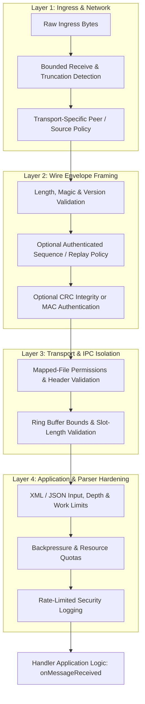

# Comprehensive System Hardening Opportunities & Attack Surface Analysis

This document identifies security boundaries, attack vectors, and hardening opportunities across the entire `Proxy` architecture—complementing the message verification plan in `HARDENING_PLAN.md`.

---

## 1. Threat Matrix & Defense Layers



---

## 2. Ingress & Wire-Level Hardening

Safe framing is mandatory regardless of whether a channel enables integrity or authentication. CRC detects accidental corruption but is not an authenticity control; a MAC does not provide confidentiality.

### 2.1 Replay Attack & Stale Packet Protection
* **The Vulnerability**: An attacker who can capture authenticated packets or access a channel may replay a previously valid message. CRC32-C does not prevent forgery and provides no replay protection.
* **Hardening Opportunities**:
  * **Authenticated Sequence Counter**: If the deployment threat model requires replay protection, bind a sequence number to the authenticated sender/key and channel. Define the replay-window size, concurrent sender behavior, key rotation, and restart/epoch handling before changing the wire format.
  * **Timestamp Freshness**: A timestamp window can limit stale traffic, but is not a substitute for a replay window. Specify the timestamp clock domain and skew policy. Avoid signed/unsigned subtraction and `abs()` conversions that can overflow; use checked comparisons.
    ```cpp
    // Pseudocode: compare after checking ordering, without signed conversion overflow.
    if (header.timestampNs < oldestAcceptedNs || header.timestampNs > newestAcceptedNs) {
        // Reject outside the configured freshness window.
    }
    ```

### 2.2 Max Frame Size Clamping & Anti-DoS
* **P0 implementation**: Envelopes are capped at 65,535 bytes total, including the header and metadata. Parsing requires the declared lengths to consume the complete input; packing rejects wire-field overflow and frames above the cap. Datagram pollers detect truncation for single and batched receives, and channel wrappers do not pass truncated slots on as valid messages. File, in-process, simulation, and mock inputs reject oversized messages instead of silently clipping them.
* **Remaining work**:
  * Keep the shared ceiling unless a concrete transport/deployment requirement justifies a lower configurable limit; document transport-specific payload ceilings where they differ.
  * Add/retain acceptance tests for malformed lengths, packing overflow, truncation, and the exact trailing-bytes policy.

---

## 3. IPC & Shared Memory Hardening (`backend-shm` / `backend-uds`)

### 3.1 POSIX Permissions & Sandbox Boundaries
* **P0 implementation**: SHM backing files are created with owner-only access and existing files must be regular files owned by the current user with the expected mapping size and compatible header/capacity. Initialization is coordinated across openers.
* **Remaining path boundary work**: UDS creates its socket path under configured directories; neither restrictive creation mode nor file ownership checks secure an untrusted parent directory or eliminate all symlink/path races.
* **Hardening Opportunities**:
  * **Restrictive Directory and Path Controls**: Ensure the containing directory cannot be replaced or traversed by unauthorized users, and assess remaining symlink/path races.
  * **UDS Path Controls**: Use a trusted, permission-restricted parent directory; validate socket path ownership/type before unlinking or binding.
  * **Peer Credentials**: Evaluate credential checks per supported platform and socket type. The current UDS transport uses datagram sockets, so do not assume stream-socket `SO_PEERCRED` behavior applies; document whether each platform can verify a sender identity for this mode.

### 3.2 Shared Memory Ring Buffer Bounds & Memory Guarding
* **P0 implementation**: Existing mappings are checked for exact size, header version, configured nonzero power-of-two capacity, and slot payload size. Slot selection uses the validated local capacity as a mask, occupancy reads reject distances outside capacity, and invalid slot lengths are rejected before copying.
* **Remaining hardening**:
  * Define whether and how to detect corrupted sequence/index state without introducing false positives while producers and consumers update the lock-free ring concurrently.
  * **Guard Pages**: Consider only as optional defense-in-depth after bounds validation. They do not replace validation and may require a different mapping layout/alignment.

---

## 4. Payload Parser Hardening (`xml_verification_handler` & Deserializers)

### 4.1 XML External Entity (XXE) & Expansion Bombs
* **The Vulnerability**: Payloads parsed with `libxml2` or `xerces-c` can be exploited via:
  * **XXE**: `<!ENTITY xxe SYSTEM "file:///etc/passwd">` exposing local system files.
  * **Billion Laughs / Entity Expansion**: Recursive entity definitions exhausting CPU and RAM.
  * **SSRF**: Directing the XML parser to fetch schema definitions or DTDs from internal network endpoints.
* **Existing Controls and Remaining Work**: The XML schema validator currently uses `XML_PARSE_NONET`; Xerces disables external DTD loading. These are useful protections, but do not by themselves establish all entity, schema-resolution, and resource-exhaustion behavior for every parser entry point.
* **Hardening Opportunities**:
  * **Parser Policy**: Audit all XML parsers and schema-loading paths. Keep network access disabled for untrusted input, prevent unwanted external resource/entity resolution, and test local-file and network entity cases.
  * **Input and Work Limits**: Bound document size, parser depth, entity expansion/work, and schema resource access using supported parser mechanisms. Test limits against the exact configured parser versions.

### 4.2 JSON & IR Value Tree Limits
* **The Gap**: JSON parsing and conversion between the JSON tree and IR use recursive traversal. No application-level depth or input-size budget is evident in the conversion path.
* **Hardening Opportunities**:
  * **Depth and Input Limits**: Set a documented, configurable or fixed maximum input size and nesting depth; reject excess depth before recursive conversion can exhaust the stack. Test deeply nested arrays and objects.

---

## 5. Concurrency & Execution Hardening (`core/threading`)

### 5.1 ThreadPool Poisoning & Queue Flooding
* **The Vulnerability**: A flood of invalid or slow messages can saturate SPSC/MPMC queues, starving critical messages and creating high tail latency.
* **Hardening Opportunities**:
  * **Explicit Overload Policy**: Define queue capacity, high-water behavior, drop/block policy, and metrics per transport. A universal 80% threshold is not justified without workload and latency requirements.
  * **Handler Deadline Monitoring**: Add execution-time telemetry or watchdogs only with a defined recovery policy; detecting a slow handler does not safely terminate or recover it.

### 5.2 I/O Storm Protection (Rate-Limited Logging)
* **Existing Control and Remaining Work**: `MessageDispatcher` already rate-limits invalid-envelope warnings and increments a general dropped-message counter. Other transport/parser error paths may still log per event.
* **Hardening Opportunities**:
  * **Consistent Rate Limits**: Reuse the existing bounded-warning pattern or a shared limiter for attacker-triggerable errors. Keep aggregate counts and avoid attacker-controlled/high-cardinality metric labels.

---

## 6. Prioritized Task Order

Use the following order across both hardening documents. P0 and P1 are correctness and resource-safety foundations; authentication and replay are conditional on the deployment threat model. Each task should have focused tests and an explicit acceptance criterion.

| Priority | Category | Hardening Measure | Complexity | Performance Impact |
| :--- | :--- | :--- | :--- | :--- |
| **P0** | Framing | **Maximum frame limits, overflow-safe lengths, packing range checks, and UDP truncation detection** | Medium | Measure |
| **P0** | SHM | **Validate mapped size/header/capacity/slot length; restrict backing-file access** | Medium | Setup plus validation |
| **P1** | Parsers | **Input-size and depth/work limits; verify XML external-resource policy** | Medium | Measure |
| **P1** | Policy | **Document trust boundaries and behavior for raw/unverified payloads** | Low | None |
| **P2** | Wire | **Authenticated messages and replay window, if required by deployment** | High | Measure |
| **P2** | Runtime | **Queue/network quotas, explicit overload behavior, consistent bounded logging** | Medium | Depends on policy |
| **P3** | IPC | **Platform-appropriate UDS peer identity and path hardening** | Medium | Setup / connection |
| **P3** | Defense in depth | **Guard pages after bounds checks, if justified** | Medium | Measure |
| **P3** | Validation | **Benchmarks, compatibility/versioning guidance, and operator documentation** | Low | None |

### Acceptance Tests to Carry Through the Tasks

- Reject frames with oversized, truncated, overflowing, inconsistent, or unrepresentable lengths without allocation, out-of-bounds access, or handler dispatch.
- Reject malformed or incompatible shared-memory headers and slots without trusting mapped capacity or silently truncating data.
- Verify parser limits with external-entity, schema-resolution, oversized, and deeply nested inputs for each enabled parser implementation.
- If authentication/replay is implemented, test unknown flags, missing/wrong tags, downgrade attempts, forged tags, duplicate/out-of-window sequences, key changes, and sender restart behavior.
- Confirm overload and invalid-input handling stays bounded in memory, CPU, logging, and metric cardinality.
