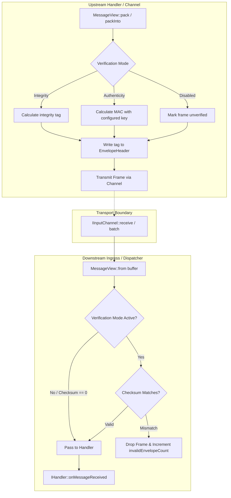

# System Hardening & Message Verification Plan

## 1. Overview & Objectives

This document establishes the architectural plan for hardening the message transmission pipeline across all transport backends (`backend-socket`, `backend-shm`, `backend-uds`, `backend-file`, `backend-inproc`).

The primary goals are:
1. **Safe framing**: Bound frame sizes, validate lengths and arithmetic before accessing payloads, and reject truncated or malformed input before it reaches handlers.
2. **Accidental corruption detection (data integrity)**: Detect damaged or torn frames where the transport does not already provide the required guarantee.
3. **Adversarial authenticity and replay protection**: Optionally authenticate messages and reject unauthorized or replayed messages on explicitly configured trust boundaries.
4. **Resource limits**: Bound parser work, queue pressure, and security-event logging in proportion to deployment requirements.
5. **Measured performance**: Preserve low-latency paths where practical, and validate overhead with benchmarks rather than assuming hardware acceleration eliminates cost.

Integrity checks are not a substitute for safe framing, authenticated message tags, or application-level idempotency. CRCs do not provide authenticity. MACs do not provide confidentiality.

---

## 2. Integrity vs. Authenticity: Comparison & Use Cases

| Dimension | Data Integrity (CRC32-C / xxHash64) | Data Authenticity (SipHash / HMAC-SHA256) |
| :--- | :--- | :--- |
| **Primary Goal** | Detect **accidental / environmental corruption**. | Detect **intentional manipulation, injection, or spoofing**. |
| **Adversary Model** | Non-adversarial (network drops, torn memory, software bugs). | Active adversary with access to channel buffers or network ports. |
| **Secret Key Required?** | **No**. Public algorithm with fixed polynomial/seed. | **Yes**. Pre-shared key (PSK) shared between authorized handlers. |
| **Tamper Resistance** | **Trivial to forge**. An attacker altering payload bytes can recompute a valid CRC. | Depends on a sound MAC, adequate tag length, secret-key protection, and correct verification. |
| **Performance** | Measure implementation and end-to-end impact on supported hardware. | Measure implementation and end-to-end impact on supported hardware. |
| **Key Management** | None. | Requires secure key provisioning, access control, and rotation policy. |

### Target Use Cases in Proxy

- **Data Integrity (CRC32-C)**:
  - Consider only where an explicit end-to-end accidental-corruption requirement exists. It is not a substitute for validating frame lengths, ring-buffer publication, transport checksums, or file-record boundaries.
  - UDP already has a transport checksum in typical configurations; establish a concrete threat/requirement before adding an application checksum.

- **Data Authenticity (SipHash / HMAC-SHA256)**:
  - Consider for explicitly untrusted network or local-process boundaries, with a defined key-management and identity model.
  - A message MAC authenticates a message under a shared key; it does not identify a unique sender when multiple senders share the key, encrypt content, or prove that stored audit records were not modified later.

---

## 3. Performance Impact Analysis

### Computational Cost

No fixed latency or throughput estimates are specified here: cost depends on CPU, implementation, message size, cache state, compiler, and available acceleration. Benchmark candidate algorithms and the complete ingress path on supported targets before making performance or capacity claims.

### Memory Bandwidth & CPU Cache Locality

1. **Sender and receiver**: Hashing reads the covered bytes and therefore has a memory-bandwidth and cache cost in addition to computation. Do not assume buffers are warm or that verification automatically improves later cache behavior.
2. **Throughput impact**: Estimate CPU cost from measured cycles per byte/message on target hardware and expected traffic. Revisit estimates when the algorithm, tag length, or implementation changes.

---

## 4. Proposed Architectural Design



### 4.1 Wire Format Evolution (`EnvelopeHeader.hpp`)

`EnvelopeHeader` is currently an 18-byte packed header:
```cpp
#pragma pack(push, 1)
struct EnvelopeHeader {
    std::uint16_t magic { EnvelopeMagic };      // 2 bytes: 0x5058 ('PX')
    std::uint8_t  version { EnvelopeVersion };  // 1 byte
    ProtocolId    protocol { RawProtocol };     // 1 byte
    std::uint16_t metadataLength { 0 };         // 2 bytes
    std::uint32_t payloadLength { 0 };          // 4 bytes
    std::uint64_t timestampNs { 0 };            // 8 bytes
}; // exactly 18 bytes
#pragma pack(pop)
```

#### Candidate Wire Layout (24 bytes; packed and not naturally 64-bit aligned):
```cpp
#pragma pack(push, 1)
struct EnvelopeHeader {
    std::uint16_t magic { EnvelopeMagic };      // 2 bytes: 0x5058 ('PX')
    std::uint8_t  version { EnvelopeVersion };  // 1 byte: increment to 2
    ProtocolId    protocol { RawProtocol };     // 1 byte
    std::uint16_t metadataLength { 0 };         // 2 bytes
    std::uint32_t payloadLength { 0 };          // 4 bytes
    std::uint64_t timestampNs { 0 };            // 8 bytes
    std::uint16_t flags { 0 };                  // 2 bytes: verification mode flags
    std::uint32_t checksum { 0 };               // 4 bytes: suitable for CRC32-C, not a full MAC
}; // exactly 24 bytes
#pragma pack(pop)
static_assert(sizeof(EnvelopeHeader) == 24, "EnvelopeHeader must be exactly 24 bytes packed");
```

- **Encoding and alignment**: The wire format is a byte sequence, not a native in-memory struct contract. Serialize and parse fields explicitly in network byte order; do not rely on packed-struct loads, host endianness, or the claimed 64-bit alignment. Consider a larger fixed header only if alignment is a measured requirement.
- **Checksum coverage**: Compute over the canonical serialized header with the tag field zeroed, followed by metadata and payload. Specify exactly which bytes are covered and how unknown fields and flags are handled.
- **Tag length**: The proposed 32-bit field is adequate for CRC32-C but is not an adequate full SipHash-2-4 tag. Do not truncate a MAC into this field and describe it as strong authentication. Choose an explicitly specified authentication algorithm and sufficiently long tag, then size and version the wire format accordingly.
- **Flags & Security Rule (Receiver Policy Enforcement)**:
  - `0x0000`: No integrity/authentication tag (unverified).
  - `0x0001`: CRC32-C data integrity checksum.
  - `0x0002`: Authenticated mode with a separately specified algorithm and tag length.
  - > [!CAUTION]
  - > **Downgrade Attack Prevention**: The receiver **must not** trust incoming wire flags alone to decide whether verification is required. If local policy requires integrity or authentication, any incoming message with no tag or a mismatched mode is rejected.
  - The `flags` field is included in the checksummed/authenticated bytes so an adversary cannot alter flags without detection. CRC does not prevent an attacker from recalculating the CRC; only a valid MAC under the configured key provides authenticity.
  - Reject unknown flags, unsupported versions, mismatched configured modes, and missing required authentication. A receiver must enforce local policy rather than trusting a mode declared by the sender.

---

## 5. Prioritized Hardening Tasks

Implement and verify these tasks in order. Each task should have focused tests and a clear acceptance criterion before moving on.

1. **Bounded framing and truncation handling (P0)** — Enforce the shared 65,535-byte total envelope ceiling, with transport-specific lower bounds where needed. Reject oversized, truncated, undersized, and malformed frames before allocation, copy, or handler dispatch. Check length arithmetic and prevent narrowing when packing metadata/payload lengths. Detect datagram truncation explicitly.
2. **Shared-memory mapping validation and permissions (P0)** — Restrict creation and access of backing files. Validate existing mapping size, header magic/version, power-of-two capacity, and slot size before use. Use the validated local capacity for bounded slot indexing, reject inconsistent occupancy readings, and reject malformed slot lengths instead of trusting or silently truncating them.
3. **Parser input/resource limits (P1)** — Set maximum input sizes and depth/work limits for JSON/XML conversion and validation. Preserve and test existing network/entity protections; test external entities, schema resolution, deeply nested input, and oversized documents.
4. **Threat-boundary and trust policy (P1)** — Document which transports are trusted, which are exposed to untrusted senders, and the consequences of unauthenticated `Raw` payloads. Keep safe framing mandatory regardless of integrity/authentication configuration.
5. **Authenticated messages and replay protection (P2, where required)** — Specify key provisioning, rotation, sender/channel identity, tag length, sequence-number scope, restart/epoch behavior, and replay-window policy before changing the wire format. Enforce required local policy and test downgrade, forgery, and replay cases. Do not use CRC as authentication.
6. **Backpressure, quotas, and observability (P2)** — Define overload behavior and resource quotas for queues and network ingress. Reuse existing dropped-message metrics and rate-limited invalid-envelope logging; add reason-specific metrics where they provide actionable operational value.
7. **Peer identity and filesystem/path hardening (P3)** — Assess platform-specific UDS credential checks and secure socket/backing-file paths and parent directories. Apply only where the transport and deployment model support a meaningful identity check.
8. **Benchmarks and operational documentation (P3)** — Benchmark checksums/MACs, parser limits, and backpressure under representative workloads; document compatibility/versioning and operator configuration.

**Priority meanings:** P0 is a correctness/safety prerequisite for processing untrusted or corrupted input; P1 limits parser/resource-exhaustion risks; P2 is deployment-dependent threat protection and overload handling; P3 is defense-in-depth and measured follow-up.

**P0 status:** The bounded framing and SHM validation changes are implemented and covered by the local regression suite (122,132 assertions across 119 cases on macOS arm64, GCC 16, C++20). Linux-specific `recvmmsg`/io_uring paths still require CI validation.

---

## 6. Implementation Roadmap

### Phase 1: Bounded Framing (`backend/interface`, transports)
- Enforce the shared 65,535-byte total envelope ceiling and validate all lengths, arithmetic, and packing conversions before allocating, copying, or dispatching.
- Detect and reject truncated datagrams, including batched receives. `MessageView::from()` requires the declared frame to consume the entire input span.
- Add tests for undersized, oversized, truncated, overflowing, and unrepresentable frame lengths.

### Phase 2: Shared-Memory Validation and Permissions (`backend-shm`)
- Validate mapped-file size, header, capacity, and slot size before use. Keep slot selection bounded by the validated local capacity, reject inconsistent occupancy readings, and validate slot lengths before copying.
- Restrict backing-file permissions and handle existing files and parent-directory/path safety.
- Add tests for malformed and incompatible mappings and ensure malformed slot lengths are rejected rather than truncated.

### Phase 3: Parser Limits and Trust Policy (`core`, handlers)
- Bound JSON/XML input size and nesting/work; test entity and schema resource policies for every enabled parser.
- Document trust boundaries and the handling of raw and unauthenticated payloads.

### Phase 4: Optional Integrity, Authentication, and Replay (`common`, `backend/interface`, `core`)
- Add CRC32-C only if an end-to-end accidental-corruption requirement remains after P0 validation.
- If CRC32-C is required, implement a portable fallback and runtime-safe hardware acceleration where supported; test known vectors and alignment boundaries under the repository's `test/` tree.
- Before changing the wire format, specify tag length and encoding, algorithm, key provisioning/rotation, sender/channel identity, sequence scope, replay window, and restart behavior.
- Enforce receiver-side policy; reject unknown modes, unsupported versions, missing required tags, and invalid tags before dispatch.
- Add focused tests for corruption, forgery, downgrade, replay, key change, and restart behavior.

### Phase 5: Backpressure, Telemetry, and Documentation
- Define per-transport overload behavior and resource quotas. Reuse existing dropped-message metrics and rate-limited invalid-envelope logging; add reason-specific telemetry only where operationally useful.
- Create chronological documentation under `docs/features/message/` following project documentation rules (`AGENTS.md`).
- Update living architecture guides under `docs/architecture/`.
- Benchmark candidate integrity/authentication algorithms and the full ingress path; publish measured, reproducible results rather than assumed estimates.
