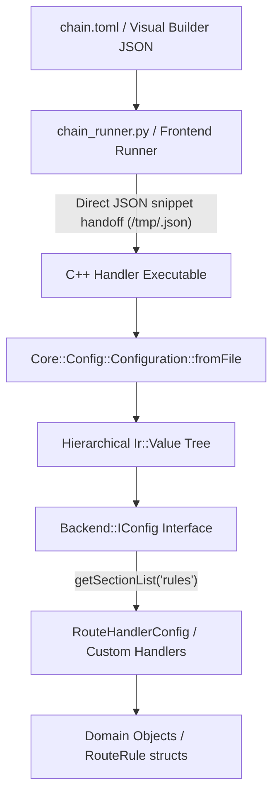

# Architecture Plan: Hierarchical & Format-Agnostic Configuration Refactor (Option 1)

## Overview & Motivation
Currently, pipeline chains are authored in structured formats (TOML files and JSON in the Visual Builder), but the C++ configuration layer (`Core::Config::Configuration`) is a flat INI key-value parser. This design forced:
1. Python runners (`chain_runner.py`, `scripts/proxy_runner/config.py`) to perform ad-hoc, lossy flattening of arrays of objects (such as `route_handler` rules).
2. Handlers to write custom CSV parsers (`route.rules=r1,r2`) and reconstruct structured objects manually.
3. Multiline configurations (e.g. embedded Lua scripts) to undergo brittle flattening and character escaping.

Option 1 modernizes the configuration layer by introducing **hierarchical, structured querying** in `Backend::IConfig` backed by `Core::Serialization::Ir::Value` and JSON/TOML ingestion in `Core::Config::Configuration`.

---

## Architecture Specification



### 1. `Backend::IConfig` Interface Modernization
Update `include/backend/core/IConfig.hpp` to expose hierarchical and structured queries without exposing raw pointers:

```cpp
namespace Backend {

class IConfig {
public:
    virtual ~IConfig() = default;

    // Existing strongly-typed scalar getters
    template <typename T>
    std::optional<T> get(std::string_view key) const;

    template <typename T>
    T getOr(std::string_view key, const T& defaultValue) const;

    // Direct section navigation (supports dot paths like "route.default_action" or "rules")
    [[nodiscard]] virtual Common::Memory::ObserverPtr<const IConfig> getSection(std::string_view path) const = 0;

    // Array of sections (for lists of objects like "rules")
    [[nodiscard]] virtual std::vector<Common::Memory::ObserverPtr<const IConfig>> getSectionList(std::string_view path) const = 0;

    // Primitive list queries (e.g. comma-separated or JSON string arrays)
    [[nodiscard]] virtual std::vector<std::string> getStringList(std::string_view path) const = 0;
};

} // namespace Backend
```

### 2. `Core::Config::Configuration` Ingestion & Representation
- **Underlying Storage**: Backed by `Core::Serialization::Ir::Value` (which natively represents null, bool, int, uint, double, string, array, and object).
- **Dual Format Ingestion**:
  - `Configuration::fromFile(path)` checks file extension or contents:
    - If JSON (`.json`) or TOML: parses via `nlohmann::json` directly into `Ir::Value`.
    - If INI (`.conf`): parses key-value lines and synthesizes a dot-separated `Ir::Value` object hierarchy for complete backward compatibility.
- **Section Views**: `ConfigSectionView` implements `Backend::IConfig` pointing to a subtree of `Ir::Value`.

### 3. Pipeline Runner Handoff (`scripts/proxy_runner/config.py`)
- Eliminate custom flattening rules for `rules` and complex handler parameters.
- When generating individual handler configs, emit either a structured `.json` file or a clean TOML subsection.
- Handlers receive their configuration 1:1 matching their UI schema definition.

### 4. Handler Adoption (`RouteHandlerConfig.cpp`)
Refactor `RouteHandlerConfig::load` to directly consume the structured `rules` section:
```cpp
void RouteHandlerConfig::load(const Backend::IConfig& config) {
    m_defaultAction = parseAction(config.getOr<std::string>("default_action", "drop"));

    for (const auto& ruleConfig : config.getSectionList("rules")) {
        RouteRule rule;
        rule.name = ruleConfig->getOr<std::string>("name", "");
        rule.type = ruleConfig->getOr<std::string>("type", "pattern");
        rule.pattern = ruleConfig->getOr<std::string>("pattern", "");
        rule.expr = ruleConfig->getOr<std::string>("expression", "");
        rule.script = ruleConfig->getOr<std::string>("script", "");
        rule.target = ruleConfig->getOr<std::string>("target", "");
        rule.actionType = ruleConfig->getOr<std::string>("action", "forward");
        m_rules.push_back(rule.toRouteRule());
    }
}
```

---

## Actionable Implementation Checklist (When Scheduled)

- [ ] **Phase 1: `Backend::IConfig` Abstraction**
  - [ ] Add `getSection`, `getSectionList`, and `getStringList` to `include/backend/core/IConfig.hpp`.
  - [ ] Implement `ConfigSectionView` wrapping an `ObserverPtr<const Core::Serialization::Ir::Value>`.

- [ ] **Phase 2: `Core::Config::Configuration` Upgrades**
  - [ ] Adapt `Configuration` to store `Core::Serialization::Ir::Value m_root`.
  - [ ] Implement `Configuration::fromJson(std::string_view jsonStr)`.
  - [ ] Implement `Configuration::fromJsonFile(const std::filesystem::path& path)`.
  - [ ] Maintain legacy `.conf` flat parser with automatic dot-key nesting.
  - [ ] Add unit tests in `test/TestConfiguration.cpp` verifying nested object and array queries.

- [ ] **Phase 3: Handler Config Modernization**
  - [ ] Refactor `RouteConfig.hpp` to query `config.getSectionList("rules")` directly with fallback to legacy flat keys.
  - [ ] Simplify `scripts/proxy_runner/config.py` by removing custom rule-flattening hacks.

- [ ] **Phase 4: End-to-End Verification & Docs**
  - [ ] Run full Catch2 and Python regression suites.
  - [ ] Update `docs/architecture/` and create feature document `docs/features/config/`.

