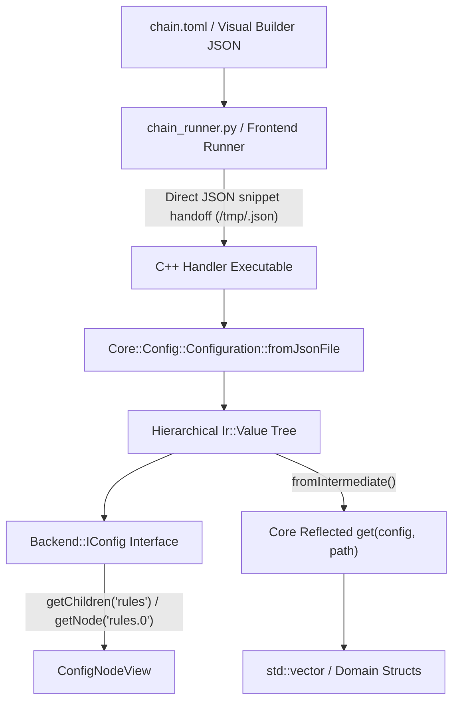

# Architecture Plan: Hierarchical & Format-Agnostic Configuration Refactor (Option 1)

## Overview & Motivation
Currently, pipeline chains are authored in structured formats (TOML files and JSON in the Visual Builder), but the C++ configuration layer (`Core::Config::Configuration`) is a flat INI key-value parser. This design forced:
1. Python runners (`chain_runner.py`, `scripts/proxy_runner/config.py`) to perform ad-hoc, lossy flattening of arrays of objects (such as `route_handler` rules).
2. Handlers to write custom CSV parsers (`route.rules=r1,r2`) and reconstruct structured objects manually.
3. Multiline configurations (e.g. embedded Lua scripts) to undergo brittle flattening and character escaping.

Option 1 modernizes the configuration layer by introducing **hierarchical, structured querying** in `Backend::IConfig` backed by `Core::Serialization::Ir::Value` and pure JSON ingestion in `Core::Config::Configuration`. Backward compatibility with legacy `.conf`/`.ini` files is explicitly dropped in favor of a clean, consistent JSON schema.

---

## Architecture Specification



### 1. Architectural Layering & The Two-Tier Query System
To preserve strict layer decoupling (`AGENTS.md` Section 8: `backend/*` cannot depend on `core`), type queries are divided into two complementary tiers:

#### Tier 1: `Backend::IConfig` (`backend-interface`)
Provides transport-agnostic navigation and primitive scalar parsing:
- **Dot-Notation Path Resolution**: Uniform JSON-pointer style for objects (`"route.default_action"`) and array elements (`"rules.0.pattern"`).
- **Primitive Scalars**: `get<T>(path)` / `getOr<T>(path, default)` for standard scalar types (`bool`, `int8_t`..`uint64_t`, `float`, `double`, `std::string`, `std::string_view`).
- **Subtree Navigation**:
  - `getNode(path)` &rarr; `Common::Memory::ObserverPtr<const IConfig>` representing any sub-node (object or array element).
  - `getChildren(path)` &rarr; `std::vector<Common::Memory::ObserverPtr<const IConfig>>` for standard range-based `for` loop traversal.

```cpp
namespace Backend {

class IConfig {
public:
    virtual ~IConfig() = default;

    template <typename T>
    std::optional<T> get(std::string_view path) const;

    template <typename T>
    T getOr(std::string_view path, const T& defaultValue) const;

    [[nodiscard]] virtual Common::Memory::ObserverPtr<const IConfig> getNode(std::string_view path) const = 0;
    [[nodiscard]] virtual std::vector<Common::Memory::ObserverPtr<const IConfig>> getChildren(std::string_view path = "") const = 0;
};

} // namespace Backend
```

#### Tier 2: Reflected Type Deserialization (`core`)
`core` leverages its reflection system (`Core::Serialization::TypeTraits` and `Core::Serialization::Ir::fromIntermediate`) to allow single-line struct and vector deserialization:
- **Reflected Structs (`TypeTraits<T>::isReflected == true`)**: Deserializes directly into domain structs.
- **Vectors (`std::vector<T>`)**: Deserializes an array node into a vector of scalars or reflected structs.
- **Syntax**: Exposed via `Core::Config::get<T>(config, path)` and direct convenience methods on `Core::Config::Configuration`.

```cpp
// Direct one-line deserialization in handlers:
auto rules = Core::Config::getOr<std::vector<RouteRule>>(config, "rules", {});
auto defaultRule = Core::Config::get<RouteRule>(config, "rules.0");
```

---

### 2. `Core::Config::Configuration` Ingestion & Representation
- **Underlying Storage**: Backed by `Core::Serialization::Ir::Value` (which natively represents null, bool, int, uint, double, string, array, and object).
- **Pure JSON Ingestion**: `Configuration::fromJson(std::string_view jsonStr)` and `Configuration::fromJsonFile(const std::filesystem::path& path)`. Legacy `.conf` and `.ini` parsing is completely removed.
- **Node Views**: `ConfigNodeView` implements `Backend::IConfig` wrapping a non-owning `Common::Memory::ObserverPtr<const Core::Serialization::Ir::Value>`.

---

### 3. Pipeline Runner Handoff (`scripts/proxy_runner/config.py`)
- Eliminate custom flattening rules and CSV stringification for `rules` and complex handler parameters.
- When generating individual handler configs, emit clean structured `.json` files.
- Handlers receive their configuration 1:1 matching their UI schema definition.

---

### 4. Handler Adoption (`RouteHandlerConfig.cpp`)
Handlers can either iterate using `getChildren` or directly deserialize the reflected struct array:
```cpp
void RouteHandlerConfig::load(const Backend::IConfig& config) {
    m_defaultAction = parseAction(config.getOr<std::string>("default_action", "drop"));

    // Option A: Single-line reflected deserialization
    auto rules = Core::Config::get<std::vector<RouteRule>>(config, "rules");
    if (rules) {
        m_rules = std::move(*rules);
        return;
    }

    // Option B: Traversal via getChildren
    for (const auto& ruleConfig : config.getChildren("rules")) {
        if (!ruleConfig) {
            continue;
        }
        RouteRule rule;
        rule.name = ruleConfig->getOr<std::string>("name", "");
        rule.type = ruleConfig->getOr<std::string>("type", "pattern");
        rule.pattern = ruleConfig->getOr<std::string>("pattern", "");
        rule.expr = ruleConfig->getOr<std::string>("expression", "");
        rule.script = ruleConfig->getOr<std::string>("script", "");
        rule.target = ruleConfig->getOr<std::string>("target", "");
        rule.actionType = ruleConfig->getOr<std::string>("action", "forward");
        m_rules.push_back(rule.toRouteRule());
    }
}
```

---

## Actionable Implementation Checklist (When Scheduled)

- [ ] **Phase 1: `Backend::IConfig` Abstraction**
  - [ ] Update `include/backend/IConfig.hpp` to define `getNode(path)` and `getChildren(path)`.
  - [ ] Implement dot-notation path traversal (`"path.to.key"` and `"array.0.key"`).
  - [ ] Implement `ConfigNodeView` wrapping `ObserverPtr<const Core::Serialization::Ir::Value>`.

- [ ] **Phase 2: `Core::Config::Configuration` & Reflection Integration**
  - [ ] Adapt `Configuration` to store `Core::Serialization::Ir::Value m_root`.
  - [ ] Implement `Configuration::fromJson(std::string_view jsonStr)` and `Configuration::fromJsonFile(...)`.
  - [ ] Implement `Core::Config::get<T>(config, path)` supporting `TypeTraits<T>::isReflected` and `std::vector<T>` via `Ir::fromIntermediate<T>()`.
  - [ ] Remove legacy `.conf`/`.ini` parsing logic and associated backward-compatibility bridges.
  - [ ] Add unit tests in `test/TestConfiguration.cpp` verifying dot-notation navigation, nested object queries, array traversal, and reflected struct deserialization.

- [ ] **Phase 3: Runner & Handler Modernization**
  - [ ] Refactor `RouteConfig.hpp` / `RouteHandlerConfig.cpp` to use the modernized config queries.
  - [ ] Clean up `scripts/proxy_runner/config.py` and `chain_runner.py` by removing custom flattening rules and emitting pure JSON configuration files.

- [ ] **Phase 4: End-to-End Verification & Docs**
  - [ ] Run full test suites (`ctest` and Python tests).
  - [ ] Update `docs/architecture/` specifications and create chronological feature document in `docs/features/config/`.
