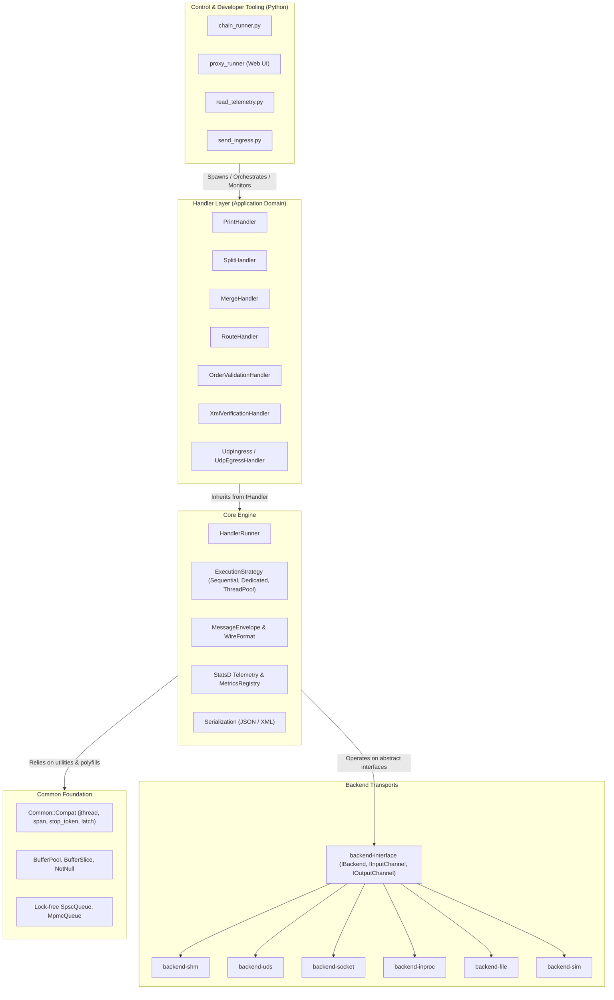

# Proxy: High-Performance Message Routing & Telemetry Pipeline

**Proxy** is a modular, ultra-low-latency message processing and routing framework written in C++20 (with a zero-dependency C++17 compatibility layer) paired with a rich Python orchestration, interactive simulation, and real-time telemetry ecosystem.

The system decouples message processing business logic from underlying transport layers (Shared Memory, Unix Domain Sockets, UDP, POSIX Files, In-Process ring buffers, or Step-wise Simulation), allowing components to be configured, benchmarked, and orchestrated across independent processes or isolated containers without recompiling business handlers.

---

## Table of Contents

1. [Key Features](#key-features)
2. [High-Level Architecture](#high-level-architecture)
3. [Repository Layout](#repository-layout)
4. [Coding Styles & Design Decisions](#coding-styles--design-decisions)
5. [Prerequisites & Dependencies](#prerequisites--dependencies)
6. [Building the Project](#building-the-project)
7. [Running Handlers & Pipelines](#running-handlers--pipelines)
   - [Individual Handlers](#individual-handlers)
   - [Pipeline Orchestration (`chain_runner.py`)](#pipeline-orchestration-chain_runnerpy)
8. [Script Tooling & Developer Workflows](#script-tooling--developer-workflows)
   - [Interactive Step-wise Simulation & Web UI (`proxy_runner`)](#interactive-step-wise-simulation--web-ui-proxy_runner)
   - [Live Telemetry & Dashboard (`read_telemetry.py`)](#live-telemetry--dashboard-read_telemetrypy)
   - [Ingress Traffic Generator (`send_ingress.py`)](#ingress-traffic-generator-send_ingresspy)
   - [OCI Container Packaging (`build-oci.sh`)](#oci-container-packaging-build-ocish)
9. [Documentation Index](#documentation-index)

---

## Key Features

- **Transport Agnostic Business Logic**: Handlers inherit strictly from `IHandler` (`core/include/core/handler/IHandler.hpp`). Transport mechanics are dynamically bound at compile-time or runtime without handler-level `#ifdef` directives.
- **Multiple High-Throughput Backends**:
  - `shm`: Low-latency POSIX Shared Memory ring buffers with atomic futex/event signaling.
  - `uds`: Local inter-process Unix Domain Sockets (`SOCK_DGRAM` / `SOCK_SEQPACKET`).
  - `socket`: Network UDP transport with cross-platform event polling (`io_uring`, `kqueue`, `epoll`/POSIX).
  - `inproc`: In-process multi-threaded lock-free queues for monolithic deployment.
  - `file`: Directory/file-based message queues for offline testing or auditing.
  - `sim`: Interactive simulation backend providing step-by-step channel interception, holding, and event reflection.
- **Zero-Allocation Core Memory Primitives**: Custom buffer pools (`BufferPool`), segmented slices (`BufferSlice`), small-span stack buffers (`SmallSpanBuffer`), and lockless queues (`SpscQueue`, `MpmcQueue`).
- **Binary Wire Format & Envelopes**: Structured binary framing (`MessageEnvelope` in `core/include/core/message/MessageEnvelope.hpp`) with checksum validation, timestamping, ingress metadata, and protocol tagging.
- **Pluggable Concurrency Models**: Sequential, Dedicated-Thread-per-Channel, or Thread-Pool execution strategies managed via `HandlerRunner` (`core/include/core/handler/HandlerRunner.hpp`).
- **Comprehensive Python Control Plane**: Declarative pipeline runners, interactive step-by-step PCAP debugging web UI, StatsD telemetry ingestion, and live browser dashboards.

---

## High-Level Architecture

The framework is organized into decoupled layers:



---

## Repository Layout

```
.
├── backend/                  # Transport implementations
│   ├── interface/            # Abstract transport interfaces (IBackend, IInputChannel, IOutputChannel)
│   ├── file/                 # Directory/file polling & writing backend
│   ├── inproc/               # High-speed in-process queue backend
│   ├── shm/                  # POSIX shared memory ring buffer backend
│   ├── sim/                  # Step-by-step interactive simulation backend
│   ├── socket/               # UDP datagram backend with platform-native pollers
│   └── uds/                  # Unix Domain Socket transport backend
├── chains/                   # Declarative pipeline configurations (.toml / .json)
├── cmake/                    # Build system helpers & Conan dependency provider
├── common/                   # Zero-dependency utilities, memory pools, & C++17/20 polyfills
├── core/                     # Handlers foundation, runners, threading, wire framing, telemetry
├── docs/                     # Feature specifications, architectural decision records, and checklists
├── handler/                  # Concrete handler implementations (Print, Split, Route, XML, etc.)
├── log/                      # Logging abstraction layer encapsulating spdlog (proxylog)
├── scripts/                  # Tooling, orchestration, telemetry dashboard, and simulation UI
│   ├── chain_runner.py       # Multi-process pipeline supervisor
│   ├── read_telemetry.py     # Live StatsD metrics collector & WebSocket server
│   ├── send_ingress.py       # High-throughput packet generator & PCAP replayer
│   ├── build-oci.sh          # Container build script for multi-backend handlers
│   └── proxy_runner/         # Interactive simulation coordinator & browser UI backend
└── test/                     # Unit, integration, and performance test suites
```

---

## Coding Styles & Design Decisions

All code in this repository adheres to the rules defined in `AGENTS.md`:

1. **C++ Standard & Compatibility Layer (`Common::Compat`)**:
   - Built against **C++20** by default, but written to ensure C++17 portability.
   - Any C++20 standard library type (`span`, `jthread`, `stop_token`, `latch`, `atomic_wait`, etc.) must be accessed via `Common::Compat::` and never injected directly into `namespace std`.
2. **Layering & Abstract Interfaces**:
   - Header files (`.hpp`) expose only abstract interfaces (`IBackend`, `IInputChannel`, `IOutputChannel`, `IHandler`).
   - Concrete implementations are strictly encapsulated in `.cpp` files and private headers.
   - Handlers **never** include concrete backend transport headers or rely on compile-time transport `#ifdef`s.
3. **Single Class Per File Policy**:
   - Standalone classes, validators, converters, and strategies reside in dedicated `<ClassName>.hpp` and `<ClassName>.cpp` pairs.
4. **Code Formatting**:
   - Enforced via **clang-format** using the WebKit base style specified in `.clang-format`.
   - Prefer early returns, guards, and flat indentation over deep nesting.
5. **Git & Branching Workflow**:
   - All work is developed on dedicated feature branches (`feat/<feature-name>`).
   - Commits follow Conventional Commits (`feat:`, `fix:`, `refactor:`, `chore:`).
6. **Feature Documentation & Task Checklists**:
   - Non-trivial features or architecture changes are documented in `docs/<feature-name>.md` with high-level design rationales and interactive task checklists (`- [ ]`).

---

## Prerequisites & Dependencies

### System Requirements
- **C++ Compiler**: GCC 11+ or Clang 14+ (C++20 support)
- **CMake**: 4.0 or higher
- **Conan**: 2.x
- **Python**: Python 3.10+ (for orchestration, simulation, and dashboard scripts)
  - Python dependencies: `websockets`, `aiohttp` (optional, for browser UI)
- **Platform**: Linux (x86_64 / arm64) or macOS (arm64 / x86_64)

---

## Building the Project

### Using CMake Presets (Recommended)

1. **Configure (Debug or Release)**:
   ```bash
   cmake --preset debug
   # or
   cmake --preset release
   ```
   *Note: `conan_provider.cmake` automatically invokes Conan 2 to resolve and install required libraries (such as `spdlog`, `libxml2`, `catch2`).*

2. **Build**:
   ```bash
   cmake --build --preset debug
   # or
   cmake --build --preset release
   ```

### Manual Configuration
```bash
cmake -B build -S . \
  -DCMAKE_PROJECT_TOP_LEVEL_INCLUDES=cmake/conan_provider.cmake \
  -DCMAKE_BUILD_TYPE=Debug
cmake --build build
```

Compiled handler executables are emitted to the `bin/` directory, named with their backend suffix (e.g. `bin/print_handler_file`, `bin/split_handler_socket`, `bin/order_validation_handler_shm`).

---

## Running Handlers & Pipelines

### Individual Handlers
Handlers can be run as standalone binaries by providing an INI-style configuration file:

```bash
./bin/dummy_send_file --config proxy.conf
```

A sample configuration format:
```ini
[channel.input]
path = /tmp/proxy_in

[channel.output]
path = /tmp/proxy_out

[telemetry]
enabled = true
statsd_host = 127.0.0.1
statsd_port = 8125
```

### Pipeline Orchestration (`chain_runner.py`)
To execute an entire multi-process pipeline composed of distinct handlers communicating over a shared transport backend, use `scripts/chain_runner.py`:

```bash
# Run a file-based pipeline
./scripts/chain_runner.py chains/example_file_chain.toml

# Run a shared-memory pipeline pointing to your build directory
./scripts/chain_runner.py chains/example_shm_full_proxy_chain.toml --bin-dir ./build/debug/bin
```

When interrupted with `Ctrl+C` (`SIGINT`), `chain_runner.py` safely orchestrates graceful termination across all active subprocesses.

---

## Script Tooling & Developer Workflows

The repository includes a suite of developer and operations tools located in `scripts/`:

### 1. Interactive Step-wise Simulation & Web UI (`proxy_runner`)
Allows stepping packets through native compiled C++ handlers one step at a time, inspecting state outcomes (`Forwarded`, `Consumed`, `Dropped`) and modifying messages in flight.

```bash
# Start simulation coordinator & server with a PCAP packet source
./scripts/chain_runner.py chains/example_socket_chain.toml --pcap sample_orders.pcap
```
Then navigate to `http://localhost:8090` to inspect packets, step execution, and observe branch decisions.

### 2. Live Telemetry & Dashboard (`read_telemetry.py`)
Runs an embedded UDP StatsD metrics receiver alongside a built-in HTTP server (`http.server` on default port `8126`) that serves the live dashboard and exposes JSON REST endpoints (`/api/metrics` and `/api/topology`):

```bash
# Start telemetry collector and web server
./scripts/read_telemetry.py --port 8125 --web-port 8126
```
Open `http://localhost:8126` in your browser (or open `scripts/telemetry_dashboard.html`) to inspect live throughput charts, latency percentiles, and active pipeline topologies polled every second.

### 3. Ingress Traffic Generator (`send_ingress.py`)
Generates synthetic traffic or replays recorded PCAP captures to an ingress UDP or socket channel:

```bash
# Replay captured traffic with rate limiting
./scripts/send_ingress.py --pcap sample_orders.pcap --host 127.0.0.1 --port 9001 --rate 1000
```

### 4. OCI Container Packaging (`build-oci.sh`)
Packages handlers into lightweight, stripped Distroless container images (`gcr.io/distroless/cc-debian12:nonroot`):

```bash
# Build all discovered handler container images
./scripts/build-oci.sh

# Build a specific target
./scripts/build-oci.sh print_handler_socket
```

---

## Documentation Index

### Architectural Specifications (`docs/architecture/`)
- [System Overview & Core Principles](docs/architecture/system-overview.md): High-level system architecture, orthogonal layer separation, and foundational technical decisions.
- [Transport Layer & Channel Abstractions](docs/architecture/transport-and-channel-abstractions.md): Detailed mechanics of `shm`, `socket`, `uds`, `inproc`, and `sim` backends.
- [Handler Catalog & Routing Architecture](docs/architecture/handler-catalog-and-routing.md): Catalog of production handlers, ingress/egress provenance, fan-out/fan-in, and content-based routing.
- [Handler Manifests, Roles & Protocol Classification](docs/architecture/handler-manifests-roles-and-protocols.md): Decoupled sidecar JSON descriptors, `HandlerRole` and `HandlerProtocol` enums, and CMake generation.
- [Memory Management & Lock-Free Concurrency](docs/architecture/memory-and-lockfree-concurrency.md): Zero-allocation pools (`BufferPool`), cache-line aligned queues (`SpscQueue`, `MpmcQueue`), and RAII ownership.
- [Concurrency Models & Lifecycle Supervision](docs/architecture/concurrency-and-lifecycle-supervision.md): `HandlerRunner`, execution models (`Sequential`, `DedicatedThread`, `ThreadPool`), and async-signal-safe shutdown.
- [Message Framing, Provenance & Envelope Wire Format](docs/architecture/message-envelope-and-framing.md): Binary envelope structure, `UdpMetadata`, and origin-preserving return routing.
- [Deterministic Simulation & Native PCAP Engine](docs/architecture/simulation-and-pcap-engine.md): Zero-dependency binary PCAP parser, virtualized simulation clock, and mock channels.
- [Control Plane, Simulation & Telemetry](docs/architecture/control-plane-simulation-and-telemetry.md): Interactive browser simulation, StatsD telemetry ingestion, and multi-process supervisor.
- [Testing Architecture & Catch2 Framework Guide](docs/architecture/testing-architecture-and-catch2.md): Catch2 test organization, section isolation, mock backend injection, and micro-benchmarking.
- [Deterministic Execution Tracing & Semantic Assertions](docs/architecture/deterministic-execution-tracing.md): Trace normalization, topology embedding, semantic diffing, and source file line attribution.
- [Build System, Dependency Management & OCI Packaging](docs/architecture/build-system-and-packaging.md): Modern CMake 4.x, Conan 2 dependency provider, dynamic CI pipelines, and Distroless containers.
- [CI/CD & Dynamic Pipeline Architecture](docs/architecture/ci-cd-and-dynamic-pipelines.md): Dynamic GitLab CI child pipeline generation, manifest exports, and container workflows.

### Developer Guides (`docs/guides/`)
- [Developer Extension Guide](docs/guides/developer-extension-guide.md): Step-by-step tutorial on creating new handlers, writing Catch2 tests, and implementing transport backends.
- [Standalone Benchmark Suite & Runner](docs/guides/benchmark-suite-and-runner.md): Architecture of `proxy_benchmark`, comparative transport testing (`shm`, `uds`, `inproc`, `socket`), and percentile profiles.
- [Tools & Synthetic Traffic Generation](docs/guides/tools-and-synthetic-traffic-generation.md): Building and using `generate_sample_pcap` to create synthetic PCAP test captures with mixed valid/corrupted traffic.
- [Performance Tuning & Profiling Guide](docs/guides/performance-tuning-and-profiling.md): Linux kernel sysctl socket tuning, CPU affinity pinning, memory slab sizing, and perf flame graph profiling.

### Feature Specifications & Implementation Records (`docs/features/`)
- [ByteView Convenience Value Type (`Common::Memory::ByteView`)](docs/features/byte-span-helper.md)
- [Configuration Subsystem & Strongly-Typed Resolution](docs/features/configuration-subsystem.md)
- [Logging Subsystem & Sinks (`proxylog`)](docs/features/logging-subsystem.md)
- [Shared Memory Transport Architecture](docs/features/shm-transport.md)
- [Socket Poller & Platform Multiplexing Architecture](docs/features/socket-poller-architecture.md)
- [Trait-Based Serialization & Intermediate Representation](docs/features/serialization-framework.md)
- [Multi-Process Pipeline Orchestration](docs/features/chain-runner-orchestration.md)
- [C++17 Compatibility & Polyfill Architecture](docs/features/cpp17-common-library.md)
- [Message Envelope Wire Format Specification](docs/features/message-envelope-wire-format.md)
- [Centralized Message Validation & Ingress Accounting](docs/features/centralized-message-validation-ingress-accounting.md)
- [In-Process Pipeline Runner Design](docs/features/inproc-pipeline-runner.md)
- [Handler Channel Thread Safety](docs/features/handler-channel-thread-safety.md)
- [Live Telemetry Dashboard Plan](docs/features/live-telemetry-dashboard-plan.md)
- [Benchmark Results & Performance Profile](BENCHMARK.md)
