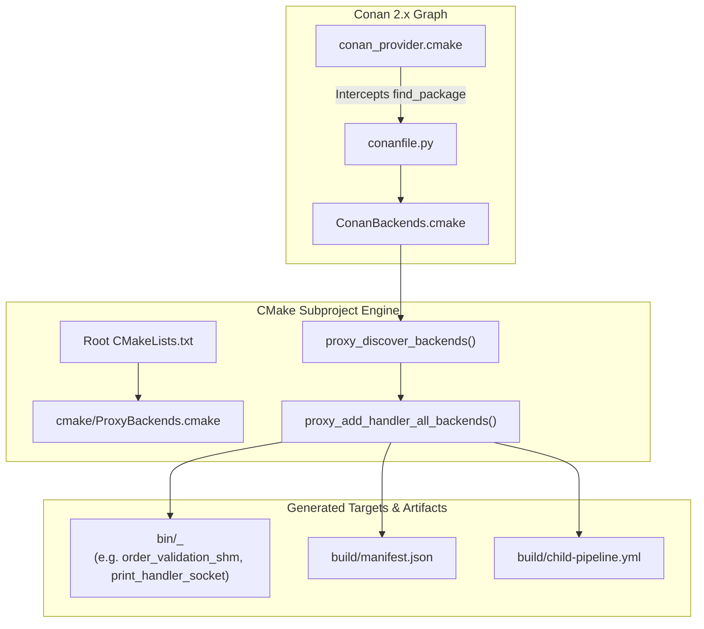
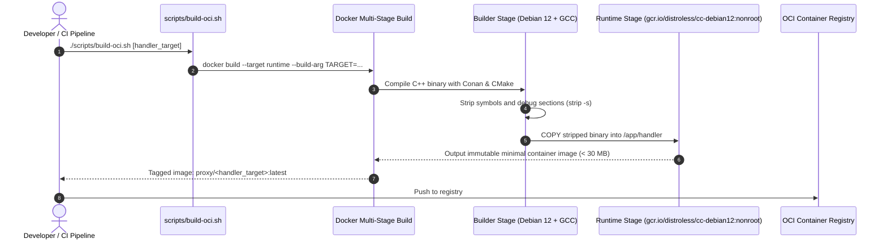

# Build System, Dependency Management & OCI Packaging

## 1. Overview & Problem Statement

### Why It's Needed
In a project containing multiple independent transport backends (`shm`, `uds`, `socket`, `inproc`, `sim`, `file`) and a diverse catalog of message handlers:
- **Build Matrix Explosion**: Generating binaries for every combination ($M$ handlers $\times$ $N$ backends) traditionally requires hundreds of lines of repetitive CMake targets or fragile scripts.
- **Dependency Drift**: Manually managing third-party libraries (`spdlog`, `pugixml`, `libxml2`, `catch2`) across developer machines (Linux, macOS) and CI runners causes subtle build breaks.
- **Heavy Deployment Containers**: Packaging full development environments into production containers results in multi-gigabyte images with unnecessary security attack surfaces (compilers, package managers, shells).

### The Solution
The Proxy repository integrates **Modern CMake 4.x**, **Conan 2.x CMake Dependency Provider (`conan_provider.cmake`)**, and automated **OCI Distroless Packaging**:
1. **Dynamic Backend Matrix Generation (`ProxyBackends.cmake`)**: Automatic discovery and target generation.
2. **Transparent Dependency Fetching**: CMake transparently resolves external dependencies on first configure.
3. **Dynamic CI Child Pipelines**: CMake writes `manifest.json` and `child-pipeline.yml`, dynamically generating the GitLab CI matrix.
4. **Stripped Minimal Container Images**: Multi-stage `Dockerfile` outputs distroless non-root runtime images.

---

## 2. CMake Architecture & Target Generation

### Key CMake Functions (`cmake/ProxyBackends.cmake`)
- **`proxy_discover_backends()`**:
  Queries `ConanBackends.cmake` generated by `conanfile.py`. For in-tree backends, it adds subdirectories automatically; for external backends, it links the Conan target.
- **`proxy_add_handler_all_backends(<handler_name> SOURCES ...)`**:
  Loops through all registered backends and declares an executable target named `<handler_name>_<backend_name>`, linking `core` and the specific backend library.
- **`proxy_export_targets_manifest(<output_path>)`**:
  Exports the registered handler executable list into a machine-readable JSON manifest and generates dynamic GitLab CI child pipeline configurations.

---

## 3. OCI Containerization & Distribution

### Distroless Image Advantages:
- **Zero Package Managers / Shells**: Images contain only the stripped binary and runtime C++ libraries (`glibc`, `libstdc++`), mitigating shell injection vulnerabilities.
- **Non-Root Execution**: Runs under the default unprivileged UID `65532:65532` (`nonroot`).
- **Tiny Footprint**: Image sizes are typically under 30 MB, enabling sub-second container pull and startup times.

