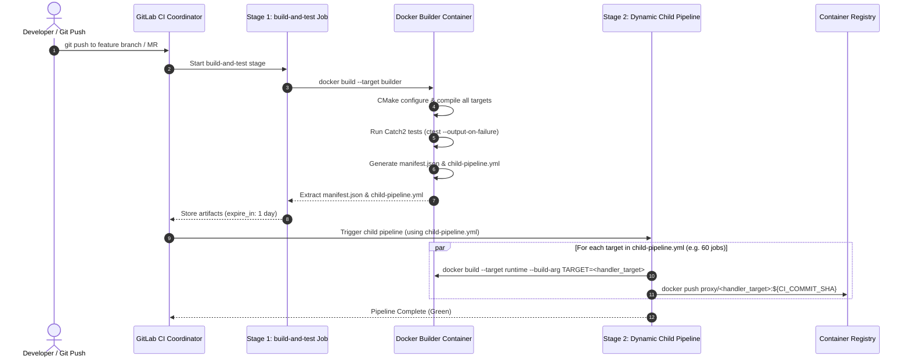

# CI/CD & Dynamic Pipeline Architecture

## 1. Overview & Problem Statement

### Why It's Needed
In a project with $M$ handlers (e.g. 10 handlers) and $N$ backends (e.g. 6 backends), the combinatorial matrix yields $60$ distinct standalone binary targets.
Traditional CI architectures suffer from significant maintenance bottlenecks:
- **Hardcoded CI Configurations**: Every time a developer adds a new handler or backend, `.gitlab-ci.yml` or GitHub Actions workflows must be manually edited to add new build and container packaging jobs.
- **Merge Conflicts**: Multiple feature branches frequently conflict on the central CI configuration file.
- **Slow Monolithic Builds**: Packaging all 60 container images in a single sequential CI job takes over 45 minutes and fails completely if any single upload times out.

### The Solution
The repository employs a **Dynamic Child Pipeline Architecture** driven by Modern CMake:
1. **Automated Discovery**: During CMake configuration, `ProxyBackends.cmake` calculates the exact set of compiled handler executables.
2. **Artifact Generation**: CMake outputs two artifacts:
   - `build/manifest.json`: Machine-readable array of target names.
   - `build/child-pipeline.yml`: A fully-formed GitLab CI child pipeline YAML document defining parallel packaging jobs.
3. **Dynamic Orchestration**: The root `.gitlab-ci.yml` executes tests, extracts the generated child pipeline, and dynamically triggers GitLab to execute parallel container packaging jobs without hardcoded job matrices.

---

## 2. Pipeline Execution Sequence



---

## 3. Deep Dive: Dynamic Pipeline Generation (`ProxyBackends.cmake`)

When `proxy_export_targets_manifest(<output_file>)` is invoked in CMake:
1. It queries the global property `PROXY_HANDLER_TARGETS`, which accumulates targets during calls to `proxy_add_handler_all_backends`.
2. It generates `manifest.json`:
   ```json
   [
     "dummy_receive_file",
     "dummy_receive_socket",
     "dummy_receive_shm",
     "order_validation_handler_shm",
     "xml_verification_handler_socket"
   ]
   ```
3. It constructs `child-pipeline.yml`:
   ```yaml
   stages:
     - package

   .package_template: &package_template
     stage: package
     image: docker:24.0.5
     services:
       - docker:24.0.5-dind
     script:
       - ./scripts/build-oci.sh ${TARGET_NAME}
       - docker tag proxy/${TARGET_NAME}:latest ${CI_REGISTRY_IMAGE}/${TARGET_NAME}:${CI_COMMIT_SHA}
       - docker push ${CI_REGISTRY_IMAGE}/${TARGET_NAME}:${CI_COMMIT_SHA}

   package:order_validation_handler_shm:
     <<: *package_template
     variables:
       TARGET_NAME: "order_validation_handler_shm"

   package:xml_verification_handler_socket:
     <<: *package_template
     variables:
       TARGET_NAME: "xml_verification_handler_socket"
   ```

---

## 4. Root `.gitlab-ci.yml` Specification

The parent `.gitlab-ci.yml` remains clean, minimal, and **requires zero maintenance when adding handlers or backends**:

```yaml
stages:
  - build
  - trigger-packaging

build-and-test:
  stage: build
  image: docker:24.0.5
  services:
    - docker:24.0.5-dind
  script:
    - docker build --target builder -t "${CI_REGISTRY_IMAGE}/builder:${CI_COMMIT_SHA}" .
    - docker run --rm "${CI_REGISTRY_IMAGE}/builder:${CI_COMMIT_SHA}" ctest --test-dir /workspace/build --output-on-failure
    - docker run --rm "${CI_REGISTRY_IMAGE}/builder:${CI_COMMIT_SHA}" cat /workspace/build/manifest.json > manifest.json
    - docker run --rm "${CI_REGISTRY_IMAGE}/builder:${CI_COMMIT_SHA}" cat /workspace/build/child-pipeline.yml > child-pipeline.yml
  artifacts:
    paths:
      - manifest.json
      - child-pipeline.yml
    expire_in: 1 day

package-handlers:
  stage: trigger-packaging
  needs:
    - job: build-and-test
      artifacts: true
  trigger:
    include:
      - artifact: child-pipeline.yml
        job: build-and-test
    strategy: depend
```

---

## 5. Troubleshooting & Local Inspection

To inspect the generated child pipeline locally without pushing to GitLab:

```bash
# 1. Run local CMake build
cmake --preset release
cmake --build --preset release

# 2. Inspect the generated dynamic manifest and child pipeline
cat build/release/manifest.json
cat build/release/child-pipeline.yml
```
If a new handler does not appear in `manifest.json`, verify that its `CMakeLists.txt` calls `proxy_add_handler_all_backends` and that the directory is added via `add_subdirectory` in `handler/CMakeLists.txt`.

