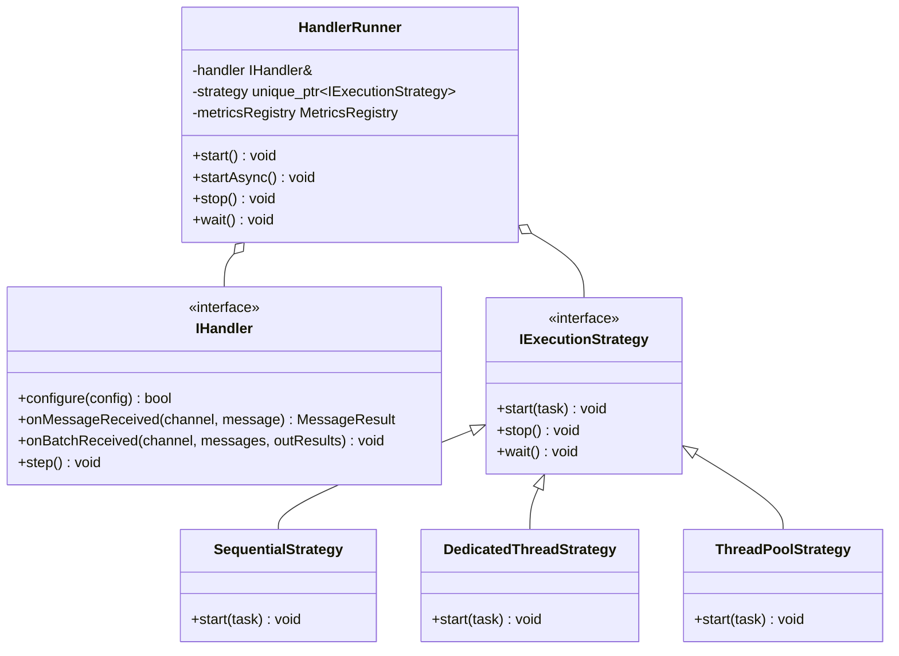
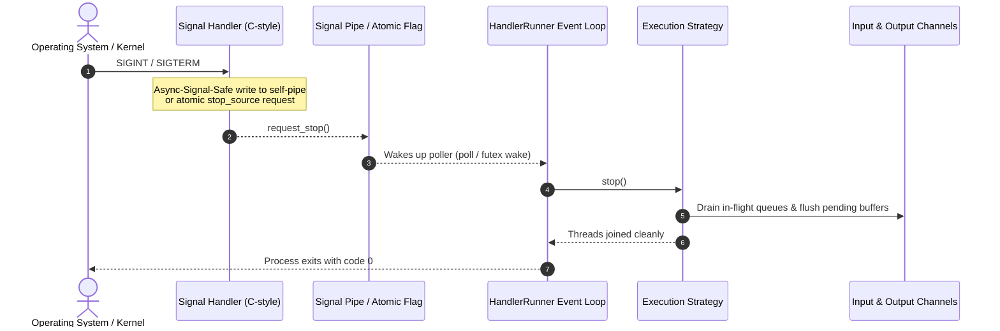

# Concurrency Models & Lifecycle Supervision

## 1. Overview & Problem Statement
In message-driven pipelines, workloads exhibit vastly different execution characteristics:
- Some handlers are **I/O bound** (e.g. socket ingress/egress, file polling).
- Some handlers are **CPU bound** (e.g. XML schema verification via libxml2, complex order matching).
- Other handlers are **strictly ordered** (e.g. sequence-number generators, audit loggers).

Hardcoding thread loops or concurrency models directly inside handler classes leads to rigid, untestable code. The Proxy architecture resolves this by separating the **business processing contract** (`IHandler`) from the **concurrency execution strategy** (`IExecutionStrategy`), all managed under the supervision of `HandlerRunner`.

---

## 2. Architecture: HandlerRunner & Execution Strategies

---

## 3. Concurrency Execution Models

### 1. `SequentialStrategy` (`execution.model = "sequential"`)
- **How It Works**: A single thread polls input channels in round-robin sequence and immediately executes `onMessageReceived` / `onBatchReceived` synchronously.
- **Use Cases**:
  - Deterministic unit and integration testing.
  - Interactive simulation where execution proceeds packet-by-packet.
  - Low-throughput strictly ordered pipelines.
- **Advantages**: Zero synchronization overhead, completely deterministic, zero cache-line invalidation between worker threads.

### 2. `DedicatedThreadStrategy` (`execution.model = "dedicated"`)
- **How It Works**: Spawns an independent OS thread (using `Common::Compat::jthread`) for each registered `IInputChannel`.
- **Use Cases**:
  - Ingress and egress gateways where separate network interfaces or shared memory rings must be drained concurrently without blocking one another.
- **Advantages**: Eliminates channel cross-talk; a slow or bursty channel cannot starve other channels.

### 3. `ThreadPoolStrategy` (`execution.model = "thread_pool"`)
- **How It Works**: An I/O poller thread drains batches of messages from input channels and dispatches them across a pre-allocated pool of worker threads via lock-free queues (`Common::Queue::SpscQueue`).
- **Use Cases**:
  - Heavy CPU-bound workloads, such as `XmlVerificationHandler` or cryptographic signature checking.
- **Tuning**: Configured via `execution.threads` (defaults to hardware concurrency).

---

## 4. Signal Safety & Graceful Shutdown

Handling operating system termination signals (`SIGINT`, `SIGTERM`) cleanly in multi-threaded C++ applications is notoriously tricky:
- Performing non-async-signal-safe operations (such as acquiring mutexes, heap allocations, or socket flushes) inside a signal handler causes deadlocks or undefined behavior.

### Proxy Shutdown Protocol

1. **Async-Signal-Safe Signal Handler**: Installs a POSIX signal handler that exclusively sets an atomic stop flag or writes a single byte to a self-pipe.
2. **Cooperative Interruption (`Common::Compat::stop_token`)**: Polling loops monitor `stop_token::stop_requested()`. When signaled, pollers terminate immediately without lingering in blocking system calls.
3. **Queue Draining**: In-flight messages in lock-free queues are processed and output channels flushed before worker threads are joined.
4. **Channel Unlinking**: Destructors run deterministically on process exit, ensuring shared memory files (`/dev/shm`) and Unix domain sockets (`/tmp/*.sock`) are unlinked cleanly.

