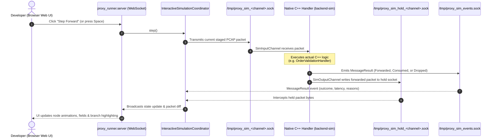
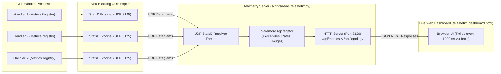

# Control Plane, Interactive Simulation & Telemetry

## 1. Overview & Problem Statement
Distributed, multi-process message pipelines are notoriously difficult to observe, test, and debug:
- **Observability Gap**: When processing hundreds of thousands of messages per second across independent processes, understanding channel backlog depths, packet drop rates, and p99 latencies requires a lightweight telemetry aggregation mechanism that does not degrade pipeline throughput.
- **The "Black Box" Debugging Problem**: When an order is dropped or misrouted four hops into an IPC pipeline, attaching debuggers (`gdb`/`lldb`) across five active processes simultaneously is virtually impossible and destroys timing relationships.
- **Deterministic Replay**: Verifying that a new routing rule or validator behaves identically across edge-case packets requires reproducible execution traces.

The Proxy system addresses this with a comprehensive **Python and Web-based Control Plane**:
1. **Interactive Step-Wise Simulation Coordinator (`proxy_runner`)**
2. **Real-Time StatsD Ingestion & Telemetry Dashboard (`read_telemetry.py`)**
3. **Multi-Process Pipeline Supervisor (`chain_runner.py`)**

---

## 2. Interactive Step-Wise Simulation (`proxy_runner`)

The simulation architecture allows developers to step real compiled C++ binaries packet-by-packet in a browser GUI.

### How It Works:
1. **The `sim` Backend (`backend-sim`)**:
   - Native C++ handlers are compiled with the `sim` backend (`<handler>_sim`).
   - Instead of writing directly to downstream channels, `SimOutputChannel` redirects outgoing messages into a UNIX hold socket (`/tmp/proxy_sim_hold_<channel>.sock`).
   - Handlers emit their exact internal `MessageResult` (e.g. `Forwarded`, `Consumed`, `Dropped` with error codes) to `/tmp/proxy_sim_events.sock`.
2. **The Coordinator (`InteractiveSimulationCoordinator`)**:
   - Manages packet queues loaded from `.pcap` files or synthetic generators.
   - Holds in-flight messages between pipeline stages. When the user clicks "Step Forward" (or triggers an automated test step), the coordinator releases the held message into the next handler's input channel.
3. **The Web Dashboard**:
   - Renders a live SVG DAG of the active pipeline topology.
   - Highlights packet movements, visualizes field-level payload diffs, and displays dropped packet diagnostics.

---

## 3. Real-Time Telemetry & Metrics Architecture

### Metrics Pipeline Highlights:
- **Lock-Free Hot Path**: C++ handlers record counters, gauges, and timing histograms (`MetricsRegistry`) without mutexes.
- **Decoupled Exporter Thread**: A background thread flushes batched StatsD UDP datagrams (`statsd.host:statsd.port`), having zero impact on packet processing latency.
- **Embedded Web Dashboard**: `read_telemetry.py` serves the static HTML/CSS dashboard and exposes lightweight `/api/metrics` JSON endpoints, polled every second by `telemetry_dashboard.html`.

---

## 4. Multi-Process Pipeline Orchestration (`chain_runner.py`)

- Coordinates running arbitrary topologies defined in `.toml` or `.json` files across any backend.
- Automatically handles binary resolution, isolated process groups, environment variable propagation, and unified `Ctrl+C` graceful termination.
- Supports trace assertion mode: captures deterministic execution traces and compares them against reference artifacts in CI regression suites.

