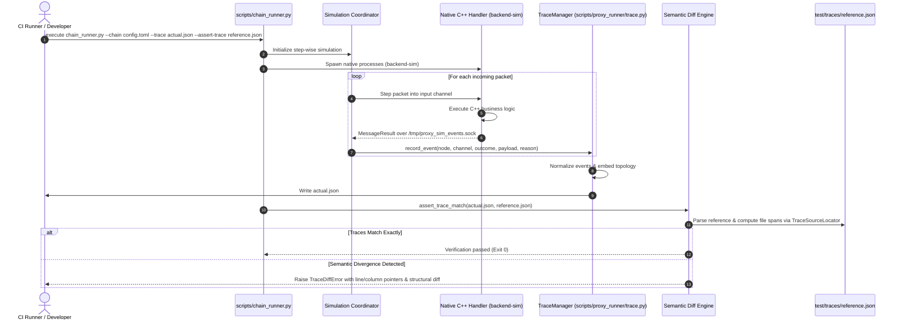

# Deterministic Execution Tracing & Semantic Assertions

## 1. Overview & Problem Statement

### Why It's Needed
In multi-process, multi-stage proxy pipelines:
- **Asynchronous Nondeterminism**: Traditional integration tests inspect log outputs using regular expressions or grep. When four processes run concurrently, log entries interleave unpredictably, making assertion tests fragile and prone to false negatives.
- **Silent Routing Corruptions**: A subtle bug in a routing table or XML validator might cause 1 out of 10,000 packets to take the wrong branch or be dropped without failing the test runner.
- **Tedious Debugging in CI**: When an integration test fails in a headless CI runner, developers are left with thousands of lines of raw text logs with no indication of exactly which packet diverged or where in the pipeline graph the failure occurred.

### The Solution
The system provides a **deterministic execution tracing engine** (`scripts/proxy_runner/trace.py`) paired with `chain_runner.py`:
1. **Canonical Event Normalization**: Every handler outcome (`MessageResult`: Forwarded, Consumed, Dropped) is emitted and captured as an immutable structured trace event.
2. **Topology Embedding**: Trace files embed the exact pipeline graph (node types, channel bindings, backend transport) alongside execution events.
3. **Semantic Tree Diffing**: Trace comparisons ignore transient timing jitter and memory addresses, strictly validating logical event sequences, payload checksums, and drop reasons.
4. **Exact File & Line Attribution**: When an assertion fails, `TraceSourceLocator` points developers to the exact line, column, and field in the expected reference artifact (`test/traces/*.json`).

---

## 2. Tracing Architecture & Workflow



---

## 3. Deep Dive: Trace Schema & Normalization

### Trace Document Structure
An exported trace document contains two primary blocks: `topology` and `events`.

```json
{
  "topology": {
    "chainId": "full_proxy_pipeline",
    "backend": "sim",
    "nodes": [
      { "name": "ingress", "type": "udp_ingress_handler" },
      { "name": "validator", "type": "xml_verification_handler" },
      { "name": "egress", "type": "udp_egress_handler" }
    ],
    "edges": [
      { "from": "ingress", "to": "validator", "channel": "orders_raw" },
      { "from": "validator", "to": "egress", "channel": "orders_verified" }
    ]
  },
  "events": [
    {
      "eventId": 1,
      "packetId": 101,
      "node": "ingress",
      "channel": "orders_raw",
      "action": "Forwarded",
      "payloadLength": 128,
      "payloadCrc32": "0x3f8a91b2"
    },
    {
      "eventId": 2,
      "packetId": 101,
      "node": "validator",
      "channel": "orders_raw",
      "action": "Forwarded",
      "targetChannel": "orders_verified",
      "payloadLength": 128,
      "payloadCrc32": "0x3f8a91b2"
    },
    {
      "eventId": 3,
      "packetId": 102,
      "node": "validator",
      "channel": "orders_raw",
      "action": "Dropped",
      "reason": "XML Schema validation failed: missing required element <price>",
      "errorCode": 400
    }
  ]
}
```

### Deterministic Normalization Rules
1. **Volatile Timestamps Stripped**: Microsecond execution times and wall-clock timestamps are omitted from assertion passes to ensure traces are 100% reproducible across different CPUs.
2. **Payload Checksums (`payloadCrc32`)**: Rather than embedding large binary payloads directly in trace JSON, the engine hashes payload bytes using hardware CRC32-C. This keeps trace files compact while guaranteeing payload integrity.
3. **Sorted Node & Edge Sets**: Topology graphs are canonicalized by sorting node names and channel bindings, preventing false diffs caused by dictionary hashing order.

---

## 4. Deep Dive: Semantic Diffing & Source Attribution

When an assertion fails, `TraceManager` does not merely output a raw text `diff`. It performs semantic analysis:

### 1. Structural Comparison
- Identifies whether the failure is an **unexpected event**, a **missing event**, or a **field mismatch** (e.g. wrong destination channel or different error code).

### 2. Precise Source File Location (`TraceSourceLocator`)
- `TraceSourceLocator` performs character-offset scanning on the reference JSON file:
  - Scans byte offsets for `"events"` array boundaries.
  - Maps each JSON event index to its starting line number and column number in the reference file.
  - Generates clear error messages:
    ```
    TraceDiffError: Event #2 mismatch at test/traces/expected_trace.json:42:7:
      Expected: action="Forwarded", targetChannel="orders_verified"
      Actual:   action="Dropped", reason="Schema validation failed" (errorCode: 400)
    ```

---

## 5. Running Trace Assertions & Recording New Baselines

### Running Trace Assertions in CI:
```bash
./scripts/chain_runner.py chains/example_socket_chain.toml \
  --trace actual_trace.json \
  --assert-trace test/traces/expected_socket_trace.json
```

### Recording or Updating a Baseline:
When intentionally introducing a new handler or modifying pipeline behavior:
```bash
# Execute chain and export the actual trace as the new golden reference
./scripts/chain_runner.py chains/example_socket_chain.toml \
  --trace test/traces/expected_socket_trace.json
```
Review the resulting git diff to verify that only the expected changes were recorded.

