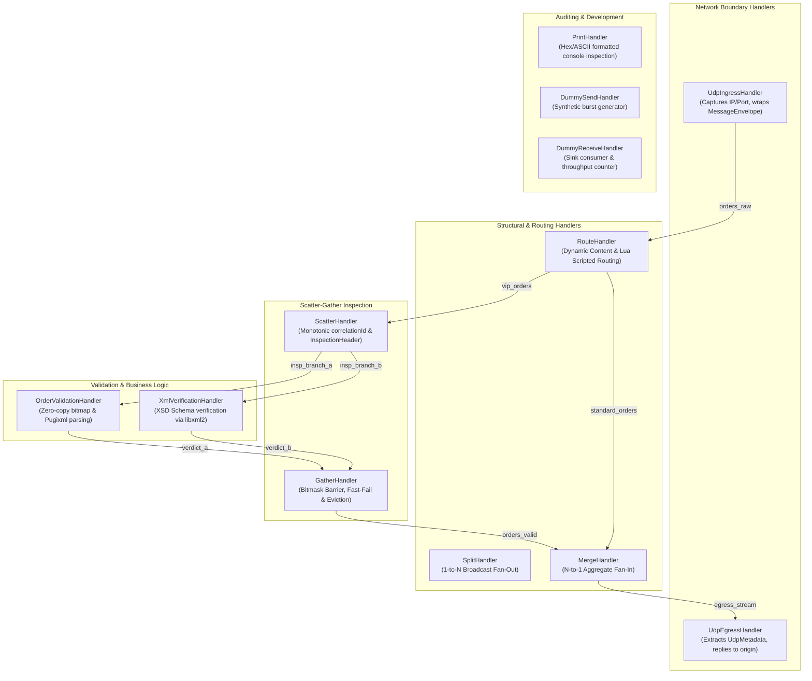

# Handler Catalog & Routing Architecture

## 1. Overview & Problem Statement

### Why It's Needed
In modern event-driven architectures, different processing stages have divergent operational requirements:
- **Ingress & Egress Gateways** must interface with external networks (UDP datagrams), record client provenance, and guarantee return-path routing without stateful connection caches.
- **Content-Based Routers** must inspect message envelopes or payload headers (e.g. priority tags, asset classes, protocol IDs) and dynamically steer messages toward specialized processing clusters.
- **Validation Engines** must parse and verify complex business rules (e.g., XML/XSD schemas, financial FIX/ITCH orders, bitmap price/quantity checks) at wire speed while providing deterministic outcome accounting.

### The Solution
The system provides a standardized catalog of production and utility handlers. Every handler strictly implements `Core::Handler::IHandler`, ensuring it can be dynamically linked against any transport backend (`shm`, `uds`, `socket`, `inproc`, `sim`, `file`) without modifying handler source code.

---

## 2. Handler Catalog & Topological Taxonomy



---

## 3. Handler Specifications & Configuration Contracts

### 1. `UdpIngressHandler` (`handler/udp_ingress_handler`)
- **Role**: Listens for raw UDP datagrams on a network socket, extracts origin client IPv4/IPv6 address and port into `UdpMetadata`, prepends an `EnvelopeHeader`, and forwards the framed `MessageEnvelope` to an internal output channel.
- **Configuration Keys**:
  ```ini
  [handlers.config]
  ingress.host = 127.0.0.1
  ingress.port = 9123
  ingress.protocol = xml    ; Options: raw, xml, json, itch, ouch, fix
  ```

### 2. `UdpEgressHandler` (`handler/udp_egress_handler`)
- **Role**: Consumes `MessageEnvelope` frames from an internal pipeline channel, extracts the `UdpMetadata` header to recover the client's original socket address, and transmits the payload back to the client via UDP.
- **Configuration Keys**:
  ```ini
  [handlers.config]
  egress.reply_to_origin = true
  egress.default_dest_host = 127.0.0.1  ; Used if envelope lacks origin metadata
  egress.default_dest_port = 9124
  ```

### 3. `RouteHandler` (`handler/route_handler`)
- **Role**: Performs dynamic content-based message routing and policy filtering by evaluating composable rules against incoming messages. Matches can be evaluated using composable C++ conditions (`and`, `or`, `not`, substring counts, prefix, client port, protocol ID), inline expressions (`expr = "..."`), or dynamic embedded Lua scripts (`type = "lua"`, `script = "..."`). Supports both forwarding to downstream channels and early rejection (`action = "reject"`) with custom error messages and codes returning `Backend::Dropped`.
- **Configuration Keys**:
  ```ini
  [handlers.config]
  route.input_channel = route_in
  route.default_output = fallback_out
  route.rules = dos_guard,rule_admin,rule_lua

  # Rule 1: Inline boolean expression with reject action
  route.rule.dos_guard.action = reject
  route.rule.dos_guard.reason = Exceeded newline limit
  route.rule.dos_guard.error_code = 429
  route.rule.dos_guard.expr = contains("\n", 5) or (prefix("BLOCK:") and not port == 9999)

  # Rule 2: Composable expression forwarding to target channel
  route.rule.rule_admin.action = forward
  route.rule.rule_admin.target = admin_cluster
  route.rule.rule_admin.expr = prefix("HDR:") and (port == 5000 or port == 8080) and not contains("BAD")

  # Rule 3: Dynamic Lua script predicate (when PROXY_ENABLE_LUA is ON)
  route.rule.rule_lua.type = lua
  route.rule.rule_lua.action = forward
  route.rule.rule_lua.target = lua_processed
  route.rule.rule_lua.script = return msg.port == 7777 and string.find(msg.payload, "VIP") ~= nil
  ```

### 4. `SplitHandler` & `MergeHandler`
- **`SplitHandler` (Fan-Out)**: Receives from a single `input_channel` and duplicates/broadcasts messages to multiple comma-separated `output_channels` (`channel_a,channel_b`).
- **`MergeHandler` (Fan-In)**: Registers multiple `input_channels` and multiplexes all arriving traffic into a single consolidated `output_channel`.

### 5. `ScatterHandler` & `GatherHandler` (Fork-Join Inspection Pipeline)
- **`ScatterHandler` (Parallel Workload Dispatcher)**:
  - Dispatches an incoming message across $M$ parallel inspection branches while stamping an `InspectionHeader` (`0x50585F494E535043ULL`) into metadata.
  - Embeds monotonic `correlationId`, `totalSplits`, and `splitIndex` without modifying the application `ProtocolId`.
- **`GatherHandler` (Bitmask Convergence Barrier & Fast Rejection)**:
  - Collects branch results using a 32-bit convergence bitmask barrier (`receivedMask == requiredMask`).
  - Implements fast-fail rejection: drops immediately upon any branch returning `InspectionVerdict::Reject` or `Error`.
  - Automatically sweeps and purges expired pending records older than `gather.timeout_ms`.
  - Un-tunnels original metadata bytes and restores the original untouched `ProtocolId` before forwarding to `output_channel`.
- **Configuration Keys**:
  ```ini
  [handlers.config]
  gather.timeout_ms = 5000
  ```

### 6. `OrderValidationHandler` & `XmlVerificationHandler`
- **`OrderValidationHandler`**: Benchmarked high-speed trading order validator. Implements zero-copy string views, Pugixml in-place DOM parsing, and compile-time bitmask validations (`price > 0`, `quantity > 0`, known symbol).
- **`XmlVerificationHandler`**: Validates XML message payloads against a target W3C XSD schema using `libxml2`. Invalid XML messages are safely dropped with explicit `MessageResult::Dropped` error reporting.

---

## 4. Message Outcome Accounting (`MessageResult`)

Handlers communicate the fate of each message to the framework via strongly-typed outcome variants:
1. **`Backend::Forwarded`**: Message was successfully processed and emitted to one or more output channels.
2. **`Backend::Consumed`**: Message reached its terminal destination and was safely consumed (e.g. `PrintHandler` or sink logger).
3. **`Backend::Dropped`**: Message was rejected by business validation (carries a descriptive string reason and integer error code). Feeds directly into `MetricsRegistry` drop counters and simulation event streams.

