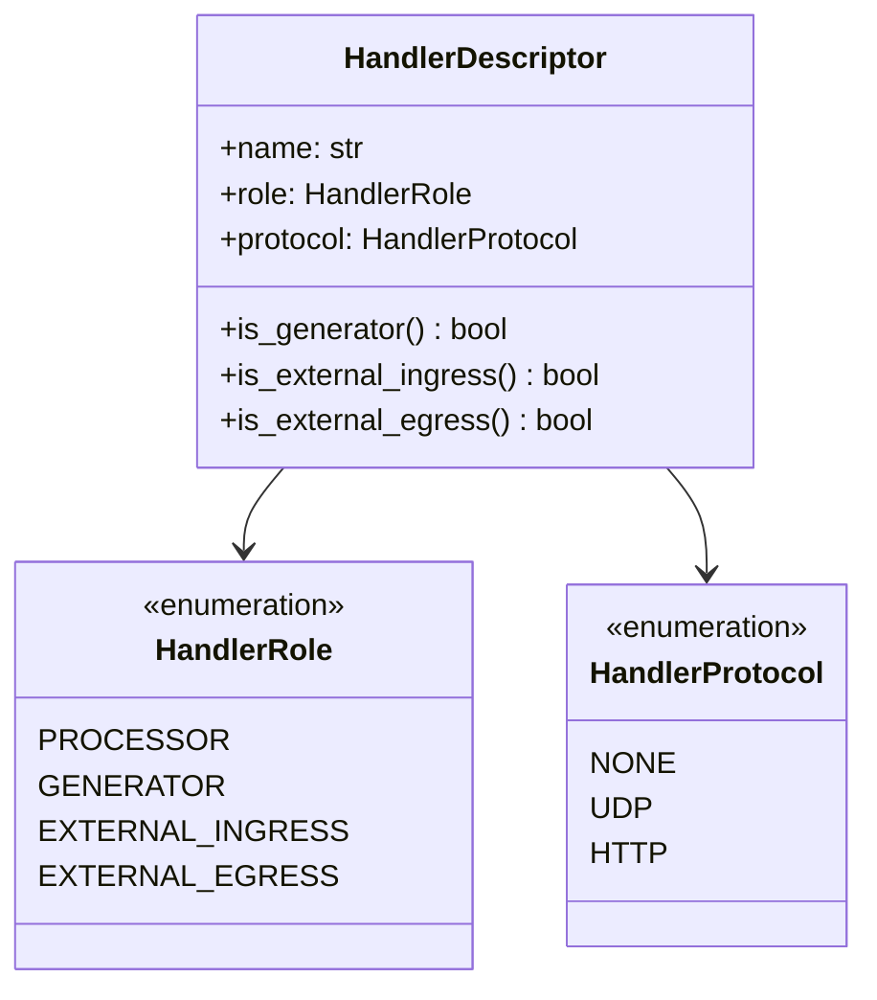
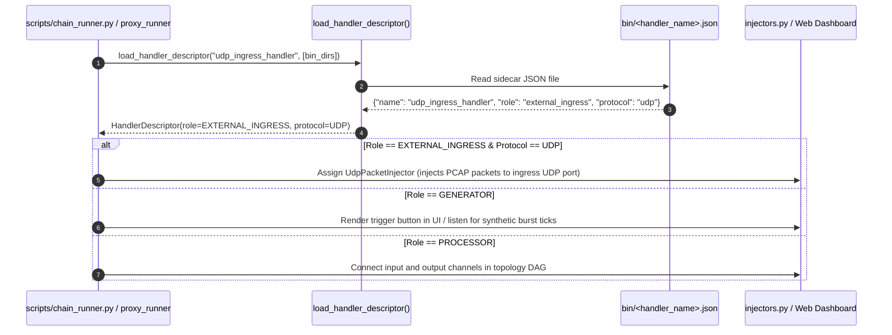

# Handler Metadata Manifests, Roles & Protocol Classification

## 1. Overview & Problem Statement

### Why It's Needed
In declarative multi-stage messaging pipelines:
- **Topology Ambiguity**: Orchestrators (`chain_runner.py`), simulation engines (`proxy_runner`), and web dashboards need to understand the topological function of each handler in a pipeline. For example, which node is the external network ingress gateway? Which node is a synthetic burst generator? Which nodes are standard intermediate processors?
- **Protocol Discovery**: Ingress gateways receive traffic from specific external protocols (e.g. UDP, HTTP, WebSocket) rather than internal pipeline channels. Without explicit protocol metadata, automated injectors cannot determine whether to send raw UDP packets, HTTP requests, or file records.
- **Decoupled Inspection**: Inspection tools (such as Python runners or Docker container managers) should not need to parse C++ headers, load shared libraries (`dlopen`), or execute binaries with `--help` just to discover a handler's operational role.

### The Solution
The framework implements a **decoupled sidecar metadata manifest architecture**:
1. **Strongly-Typed Taxonomy in C++ (`Core::Handler::HandlerRole` & `HandlerProtocol`)**: Formal enums in `core/include/core/handler/HandlerTraits.hpp`.
2. **Automated Manifest Emission in CMake (`proxy_add_handler_all_backends`)**: When CMake compiles a handler, it automatically emits a `<handler_name>.json` sidecar manifest file into the `bin/` directory alongside the binaries.
3. **Automated Consumption in Tooling (`scripts/proxy_runner/handlers.py`)**: The simulation coordinator and topology visualizer read this manifest to dynamically assign packet injectors, categorize nodes, and render appropriate graph icons.

---

## 2. Handler Classification Taxonomy



### Handler Roles (`HandlerRole`)

| Role | Canonical String | Description | Example Handlers |
| :--- | :--- | :--- | :--- |
| **`Processor`** | `"processor"` | Standard intermediate pipeline node. Receives messages from one or more `input_channels` and forwards/drops them to `output_channels`. Default role if unspecified. | `order_validation_handler`, `route_handler`, `xml_verification_handler`, `split_handler`, `merge_handler`, `print_handler`, `dummy_receive` |
| **`Generator`** | `"generator"` | Autonomous message producer. Driven by internal timers or recurring `step()` ticks rather than incoming input channels. | `dummy_send` |
| **`ExternalIngress`** | `"external_ingress"` | Gateway boundary node. Listens on external network interfaces (UDP socket, HTTP server), encapsulates incoming datagrams into `MessageEnvelope` frames with origin metadata, and pushes into pipeline channels. | `udp_ingress_handler` |
| **`ExternalEgress`** | `"external_egress"` | Terminal gateway node. Consumes `MessageEnvelope` frames from pipeline channels, extracts client provenance (`UdpMetadata`), and transmits payloads outbound across external network protocols. | `udp_egress_handler` |

### Handler Protocols (`HandlerProtocol`)

| Protocol | Canonical String | Description |
| :--- | :--- | :--- |
| **`None`** | `"none"` | Operates exclusively on internal pipeline channels (`shm`, `uds`, `inproc`, `file`, `sim`). No external network protocol. |
| **`Udp`** | `"udp"` | External network communication uses raw UDP datagrams. |
| **`Http`** | `"http"` | External communication uses HTTP/REST or WebSockets. |

---

## 3. Sidecar Manifest Generation via CMake

When a handler is declared in CMake, developers specify its role and protocol using the `ROLE` and `PROTOCOL` arguments of `proxy_add_handler_all_backends`:

```cmake
# handler/udp_ingress_handler/CMakeLists.txt
proxy_add_handler_all_backends(udp_ingress_handler
    ROLE external_ingress
    PROTOCOL udp
    SOURCES ${SOURCES}
    INCLUDE_DIRS "${CMAKE_CURRENT_SOURCE_DIR}/include"
)

# handler/dummy_send/CMakeLists.txt
proxy_add_handler_all_backends(dummy_send
    ROLE generator
    PROTOCOL none
    SOURCES ${SOURCES}
    INCLUDE_DIRS "${CMAKE_CURRENT_SOURCE_DIR}/include"
)

# handler/order_validation_handler/CMakeLists.txt
# Defaults to: ROLE processor, PROTOCOL none
proxy_add_handler_all_backends(order_validation_handler
    SOURCES ${SOURCES}
    INCLUDE_DIRS "${CMAKE_CURRENT_SOURCE_DIR}/include"
)
```

### Generated Sidecar JSON (`bin/<handler_name>.json`)
CMake automatically writes a descriptor file directly next to the compiled executables in the runtime directory:

```json
// bin/udp_ingress_handler.json
{
  "name": "udp_ingress_handler",
  "role": "external_ingress",
  "protocol": "udp"
}
```

```json
// bin/dummy_send.json
{
  "name": "dummy_send",
  "role": "generator",
  "protocol": "none"
}
```

```json
// bin/order_validation_handler.json
{
  "name": "order_validation_handler",
  "role": "processor",
  "protocol": "none"
}
```

---

## 4. How Tooling Consumes the Manifest



### Discovery & Fallbacks (`scripts/proxy_runner/handlers.py`)
1. **Dynamic File Lookup**: `load_handler_descriptor` inspects all active binary directories (e.g. `build/debug/bin`, `build/release/bin`, or custom paths) for `<handler_type>.json`.
2. **Safe Fallbacks**: If running before compilation or if the sidecar is absent, intelligent built-in defaults preserve backwards compatibility:
   - `udp_ingress_handler` $\rightarrow$ `ExternalIngress`, `Udp`
   - `udp_egress_handler` $\rightarrow$ `ExternalEgress`, `Udp`
   - `dummy_send` $\rightarrow$ `Generator`, `None`
   - All others $\rightarrow$ `Processor`, `None`

---

## 5. Architectural Benefits

1. **Zero-Overhead Reflection**: No runtime reflection libraries, virtual method lookups, or symbol table parsing.
2. **Single Source of Truth**: The handler's `CMakeLists.txt` defines its topological role, which is compiled directly into the binary distribution directory.
3. **Decoupled Python Tooling**: Simulation coordinators and dashboards dynamically adapt to new handlers without requiring hardcoded lists in Python code.

