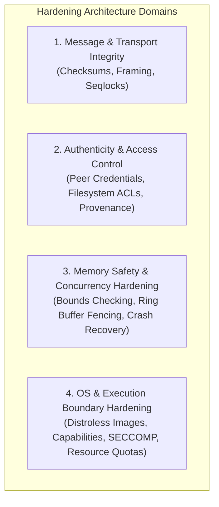
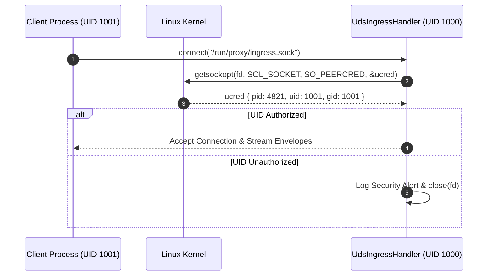
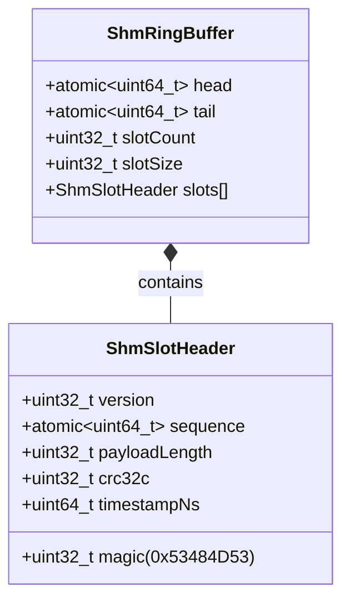
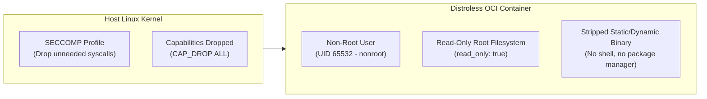
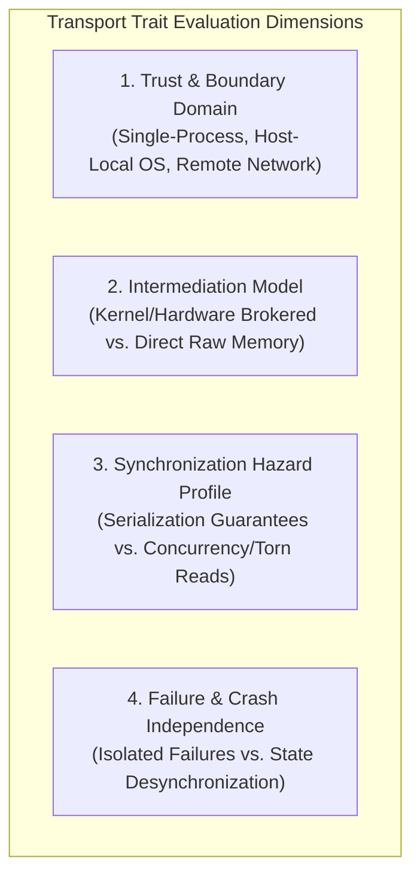

# Hardening & Defensive Engineering Architecture

## 1. Executive Summary & Philosophy

In low-latency distributed pipeline architectures, "hardening" cannot be treated as a single binary switch or an indiscriminate layer of cryptographic primitives. Indiscriminately adding cryptographic signatures, HMACs, or hashing functions across every communication channel severely degrades latency, cache efficiency, and throughput—often without mitigating the actual failure modes of the underlying transport.

Instead, the Proxy architecture adopts a **threat-model-driven hardening philosophy**:
1. **Defend against realistic threat vectors**: Differentiate clearly between *accidental hardware/synchronization faults* (torn reads, aborted writes, buffer overflows) and *malicious, adversarial tampering* (forged origins, unauthorized injections, MITM).
2. **Align defenses with the physical transport**: What is critical for Shared Memory (`shm`) is entirely redundant for In-Process (`inproc`) ring buffers and Unix Domain Sockets (`uds`).
3. **Preserve ultra-low latency & zero-copy guarantees**: Where integrity checks are required on the hot path, employ hardware-accelerated non-cryptographic primitives (CRC32C, xxHash3) and seqlock synchronization rather than costly cryptographic operations.
4. **Enforce hard security boundaries at edges, not within trusted cores**: Isolate perimeter ingress/egress points using OS-enforced isolation, capabilities, and sandboxing, while maintaining lean, cache-optimal paths inside trusted execution stages.

---

## 2. Taxonomy of Hardening Domains

Hardening across the Proxy ecosystem is divided into four concrete domains:



---

## 3. Deep Dive: Message Passing Integrity & Authenticity

### 3.1 Transport Threat Matrix

The following matrix contrasts the failure modes and threat profiles of the primary transports supported by `Backend::IBackend`:

| Dimension / Threat | In-Process (`inproc`) | Unix Domain Sockets (`uds`) | Shared Memory (`shm`) | Network UDP (`socket`) |
| :--- | :--- | :--- | :--- | :--- |
| **Trust Boundary** | Single process (No boundary) | Cross-process (OS kernel boundary) | Cross-process (Shared address space) | Network edge (Untrusted boundary) |
| **Accidental Corruption (RAM/Bitflips)** | Handled by ECC RAM; software checksums cannot save corrupted execution stack | Handled by kernel buffer copies (`copy_to_user` / `copy_from_user`) | Negligible bitflip risk, but high risk of **torn reads** during concurrent writes | Transmission errors, packet truncation, hardware NIC offload faults |
| **Synchronization Hazards** | Controlled by internal thread atomics / SPSC ring head-tail pointers | Fully serialized by OS kernel socket queues | **High**: Producer crash mid-write, ring buffer wraparound, desynchronized atomics | Packet drop, out-of-order delivery, duplicate delivery |
| **Malicious Tampering** | N/A (Any compromise owns the full memory space) | Low (Guarded by OS filesystem permissions and kernel isolation) | **Critical**: Any attached writer can overwrite any segment, control headers, or peer slots | High: Spoofing, injection, packet replay |
| **Primary Hardening Mechanism** | Type safety, `Common::Memory` bounds, invariants | Filesystem ACLs, `SO_PEERCRED` / `getpeereid` | **Seqlock generation counters, atomic commit flags, hardware CRC32C** | `MessageEnvelope` framing, network firewalls, optional HMAC/TLS |

---

### 3.2 In-Process Transport (`inproc`)

#### What Hardening Entails
- Strict type boundaries using `Common::Memory::ObserverPtr`, `Common::Memory::Borrow`, and `Common::Compat::span`.
- Bounds checking in internal circular buffers (`SpscQueue`, `MpmcQueue`).

#### Why We Do NOT Use Checksums or Hashes
- **Architectural Rationale**: Threads in the same process share an address space. If memory corruption occurs (e.g., wild pointer, stack corruption), the checking logic and the data structures are equally corrupted. Computing a CRC32 or SHA-256 for a pointer passed via an SPSC ring adds several hundred nanoseconds of latency and cache thrashing without offering any meaningful protection.

---

### 3.3 Unix Domain Sockets (`uds`)

#### What Hardening Entails
1. **Length-Delimited Wire Framing**:
   - For stream sockets (`SOCK_STREAM`), message framing is mandatory to prevent message boundary slippage. We leverage `EnvelopeHeader` with explicit `PayloadLength` and `MetadataLength`.
2. **Filesystem Access Control**:
   - Restrict socket files to dedicated system users/groups (`0660` or `0600`) in protected runtime directories (e.g., `/run/proxy/` or `/tmp/proxy-uds/`).
3. **Peer Credential Authentication (`SO_PEERCRED` / `LOCAL_PEERCRED`)**:
   - On connection establishment, the server verifies the connecting client's UID, GID, and PID directly from the operating system kernel.



#### Why We Do NOT Use Checksums or Hashes
- **Data Integrity**: The OS kernel memory subsystem is authoritative. Data transferred via `AF_UNIX` buffers never traverses a physical network wire or NIC; byte stream corruption does not occur under normal operating conditions.
- **Authenticity**: Kernel-level peer credentials provide unforgeable identity verification without the computational cost of cryptographic signatures or pre-shared keys.

---

### 3.4 Shared Memory (`shm`)

Shared memory presents the most complex hardening challenges because it bypasses the OS kernel for data transfers, meaning that bad synchronization or hostile peers can directly corrupt shared state.



#### What Hardening Entails

1. **Seqlock Pattern for Torn-Read Detection**:
   - When passing variable-length payloads across an SHM ring buffer without heavy kernel locks, readers must never consume partially written slots.
   - **Protocol**:
     1. Producer atomically updates slot `sequence` from even to odd (indicating write-in-progress) using `std::memory_order_release`.
     2. Producer copies data into the slot buffer and computes a CRC32C.
     3. Producer increments `sequence` from odd to even (indicating commit complete).
     4. Consumer checks that `sequence` is even before reading, copies the payload to private memory, and verifies that `sequence` has not changed after reading.
2. **Hardware-Accelerated CRC32C Checksums**:
   - Fast 32-bit CRC (using CPU instructions: `_mm_crc32_u64` on x86-64 or `__crc32cd` on ARM64) is included in each slot header.
   - Detects incomplete writes, crashed producers, and memory overwrites at sub-nanosecond speeds.
3. **Producer Crash Recovery (Heartbeats & Robust Futexes)**:
   - If a producer dies midway through writing a slot (leaving `sequence` odd), consumer threads must not deadlock or spin infinitely.
   - Use timeout-bounded polling, `PTHREAD_MUTEX_ROBUST` futexes, or heartbeats in the control block to mark slots as abandoned if the producer PID terminates.
4. **Memory Permission Isolation (Unidirectional Rings)**:
   - When isolation between stages is required, configure **two independent SHM mappings**:
     - *Ring A (Ingress $\to$ Worker)*: Ingress has read/write (`PROT_READ | PROT_WRITE`); Worker has read-only (`PROT_READ`).
     - *Ring B (Worker $\to$ Egress)*: Worker has read/write; Egress has read-only.
   - This prevents downstream workers from tampering with ingress buffers or corrupting upstream ring head/tail pointers.

#### Why We Do NOT Use Cryptographic Hashes (SHA-256 / HMAC)
- **Performance Rationale**: Computing SHA-256 on a 1 KB payload takes ~1.5 to 3 microseconds, whereas memory copy and ring enqueue takes < 100 nanoseconds. Adding SHA-256 erases the entire 10x–30x latency advantage of shared memory over sockets.
- **Architectural Rationale**: If a peer process with write access to shared memory is actively hostile, cryptographic hashing inside the shared buffer does not secure the system; the hostile process can overwrite the hash or tamper with ring control pointers. Security must be enforced via OS process isolation and memory mapping permissions (`mprotect`).

---

## 4. Pipeline-Wide Hardening Measures

### 4.1 Wire Envelope Hardening (`MessageEnvelope`)

As specified in [`message-envelope-and-framing.md`](file:///Users/zainahmad/Workspace/Proxy/docs/architecture/message-envelope-and-framing.md), messages entering and moving through Proxy pipelines are wrapped in a structured envelope:

1. **Magic Bytes Validation**: `EnvelopeHeader::Magic` (`0x5058` / `'PX'`) provides immediate synchronization recovery and rejection of malformed or misdirected packets.
2. **Strict Protocol Versioning**: `Version` enforcement prevents parsing mismatched or obsolete serialization layouts.
3. **Length Validation & Clamp Bounds**:
   - `PayloadLength` and `MetadataLength` are validated against maximum configured limits (e.g. `max_payload_size = 65536`) prior to copying or slice allocation.
   - Rejects integer overflow and negative wrap-around attacks before handing data to business logic decoders.
4. **Provenance Metadata Retention**:
   - `UdpMetadata` retains original socket addresses (`source_ip`, `source_port`, `dest_port`) across internal SHM or InProc stages, eliminating spoofed source attributes during egress replies.

---

### 4.2 Application-Level Parser Hardening

Handlers that ingest complex message formats (e.g. XML, JSON) represent significant attack surfaces:

1. **Schema Pre-Validation (`XmlVerificationHandler`)**:
   - XML payloads are validated against rigid XSD schemas using `libxml2` before entering business processing.
   - Protection against XML Entity Expansion (Billion Laughs attack) and external entity injection (XXE) by disabling entity resolution:
     ```cpp
     xmlCtxtUseOptions(ctxt, XML_PARSE_NOENT | XML_PARSE_NONET | XML_PARSE_DTDLOAD);
     ```
2. **Buffer Safety Primitives**:
   - Elimination of raw `char*` or C-style string functions.
   - All string and binary slicing operations utilize `Common::Compat::span<const uint8_t>` and `std::string_view` with boundary checks.

---

### 4.3 Container & Host OS Boundary Hardening

In accordance with Section 9 of `AGENTS.md`, production Proxy binaries are deployed using the following OS-level hardening:



1. **Distroless Base Image**:
   - Runtime images use `gcr.io/distroless/cc-debian12:nonroot`. No shell (`/bin/sh`), utilities (`curl`, `nc`), or package managers exist inside the container, eliminating live living-off-the-land attacks.
2. **Non-Root Execution**:
   - All handlers run under unprivileged UID `65532:65532`.
3. **Read-Only Root Filesystem**:
   - Containers are mounted with read-only root filesystems (`read_only: true`). Dynamic temporary storage is limited to explicitly configured memory-backed `tmpfs` mounts (e.g. `/tmp/proxy-uds` or `/dev/shm`).
4. **Linux Capability Stripping**:
   - All capabilities are dropped (`--cap-drop=ALL`). Network ingress handlers that require binding to privileged ports (< 1024) use `CAP_NET_BIND_SERVICE` granted explicitly via file capabilities or socket activation rather than running as root.

---

## 5. Generic Transport Characterization & Decision Framework

Rather than hard-coupling hardening policies to specific transport brand names (`shm`, `uds`, `inproc`), the decision framework evaluates any transport—current or future (e.g. RDMA, io_uring ring-buffers, PCIe BARs, shared file logs, TLS sockets, named pipes)—against four **intrinsic physical and architectural traits**:



---

### 5.1 Trait Classification Matrix

Every new backend evaluated for inclusion in `Backend::IBackend` must first be scored across these four dimensions:

| Dimension | Trait Options | Architectural Implication & Required Defense |
| :--- | :--- | :--- |
| **Trust Boundary** | **Same Process** | No boundary. Zero wire/payload hardening. Rely on C++ type safety and bounds. |
| | **Host-Isolated (OS-guarded)** | Protect via OS access control (ACLs, filesystem permissions, process credentials). Wire checksums not needed for integrity. |
| | **Untrusted / Network** | Mandatory framing boundaries, magic synchronization, protocol versioning, length clamping, network firewalls, and optional cryptographic authentication. |
| **Intermediation** | **Brokered (OS Kernel / Driver Managed)** | Memory copies and buffer bounds are guaranteed by the mediator (`copy_to_user`, kernel queue). No torn reads. Payload checksums redundant for local transport. |
| | **Direct / Unbrokered (Raw Mappings, Shared VMA, DMA buffers)** | High risk of torn reads and mutual buffer corruption. **Mandatory**: Memory fencing, sequence counters (seqlock), slot CRC32C/xxHash, and separate read/write permission mappings. |
| **Synchronization** | **Serialized / FIFO Queued** | Ordered delivery guaranteed by channel substrate. Simple length-delimited framing is sufficient. |
| **& Ordering** | **Non-atomic Slots / Circular Ring** | Requires explicit commit-phase validation (odd/even seqlock or monotonic commit counters) before consuming. |
| **Crash Semantics** | **Clean Disconnect (EOF / Hangup)** | Channel signals peer termination naturally (e.g. socket EOF, pipe broken). Standard error handlers handle recovery. |
| | **Dirty / Shared State Exposure** | Peer termination can leave shared slots, locks, or control blocks in a half-written state. Requires crash recovery mechanisms: robust futexes, heartbeats, or latch timeout reclamation. |

---

### 5.2 Universal Hardening Decision Flowchart

When implementing or configuring any backend, apply this property-based decision tree:

```
[Step 1: Is execution confined to a single address space (same process)?]
  ├── YES ──> [In-Process / Threaded Memory]
  │           • ZERO wire or payload hardening.
  │           • Strictly enforce memory bounds via Common::Memory and Common::Compat::span.
  │
  └── NO  ──> [Step 2: Does the transport cross an untrusted host or network boundary?]
               ├── YES ──> [Untrusted / Network Edge Transport (e.g. UDP, TCP, WAN RDMA)]
               │           • Mandatory Wire Framing: Magic bytes + protocol version + length clamping.
               │           • Retain provenance metadata (source endpoint / identity).
               │           • Network-level filtering (firewalls, rate limiting).
               │           • Cryptographic authentication / HMAC / TLS if untrusted network transit.
               │
               └── NO  ──> [Step 3: Host-Local IPC. Is communication directly unbrokered in user space?]
                            │
                            ├── YES (Direct User-Space Memory / SHM / Shared VMA / DMA) ──>
                            │   • Concurrency Hardening: Monotonic seqlock (odd/even) commit sequence.
                            │   • Data Integrity: Fast hardware CRC32C or xxHash per slot.
                            │   • Access Hardening: Segregate unidirectional rings (PROT_READ vs PROT_WRITE).
                            │   • Resilience: Robust futexes, latch timeouts, or peer heartbeats.
                            │   • AVOID: Heavy cryptographic hashes (SHA-256) on the hot path.
                            │
                            └── NO (Kernel/OS Brokered IPC: Sockets, Pipes, Character Devices) ──>
                                • Access Control: OS-level permissions (filesystem chmod 0600) on endpoints.
                                • Authenticity: Kernel-verified peer credentials (UID/GID/PID checks).
                                • Framing: Explicit length-delimited header framing (for stream-oriented channels).
                                • AVOID: Payload hashing/checksums (redundant with kernel buffer safety).
```

---

### 5.3 Applying the Framework to New / Future Transports

Here is how the generic framework applies to prospective backends without needing bespoke rules:

- **io_uring Shared Ring Buffers (Kernel-Brokered Direct Memory)**:
  - *Traits*: Host-isolated, kernel-brokered submission/completion queues, shared memory mapped ring.
  - *Action*: OS permissions protect the ring fd; kernel brokers buffer bounds, eliminating torn reads. No payload checksums needed; rely on completion status.
- **RDMA / InfiniBand (Kernel-Bypass Hardware Intermediation)**:
  - *Traits*: Untrusted network boundary, direct hardware memory mapping, potential for remote torn reads or connection resets.
  - *Action*: Apply network-edge framing, hardware memory region protection keys (R_Key / L_Key), and transport CRC/generation tracking.
- **Shared Memory-Mapped File Logs (`mmap` persistent ring)**:
  - *Traits*: Host-local, direct unbrokered memory, dirty crash vulnerability on power loss.
  - *Action*: Requires seqlock commit sequence, slot-level CRC32C to detect partial flush/crash corruption, and robust file lock reclamation.

---

## 6. Implementation Checklist & Future Roadmap

- [x] Wire `EnvelopeHeader` with magic bytes (`0x5058`), protocol IDs, and explicit length boundaries.
- [x] Origin provenance tracking via `UdpMetadata` to prevent spoofing across internal pipeline stages.
- [x] Distroless non-root OCI runtime container packaging.
- [ ] **SHM Seqlock & CRC32C Header**: Integrate `sequence` and `crc32c` into `backend-shm` slot allocation headers.
- [ ] **UDS Peer Credential Verification**: Implement automated `SO_PEERCRED` validation in `UdsInputChannel`.
- [ ] **SECCOMP Default Profile**: Define a minimal syscall allowlist for container execution across handler pipelines.
