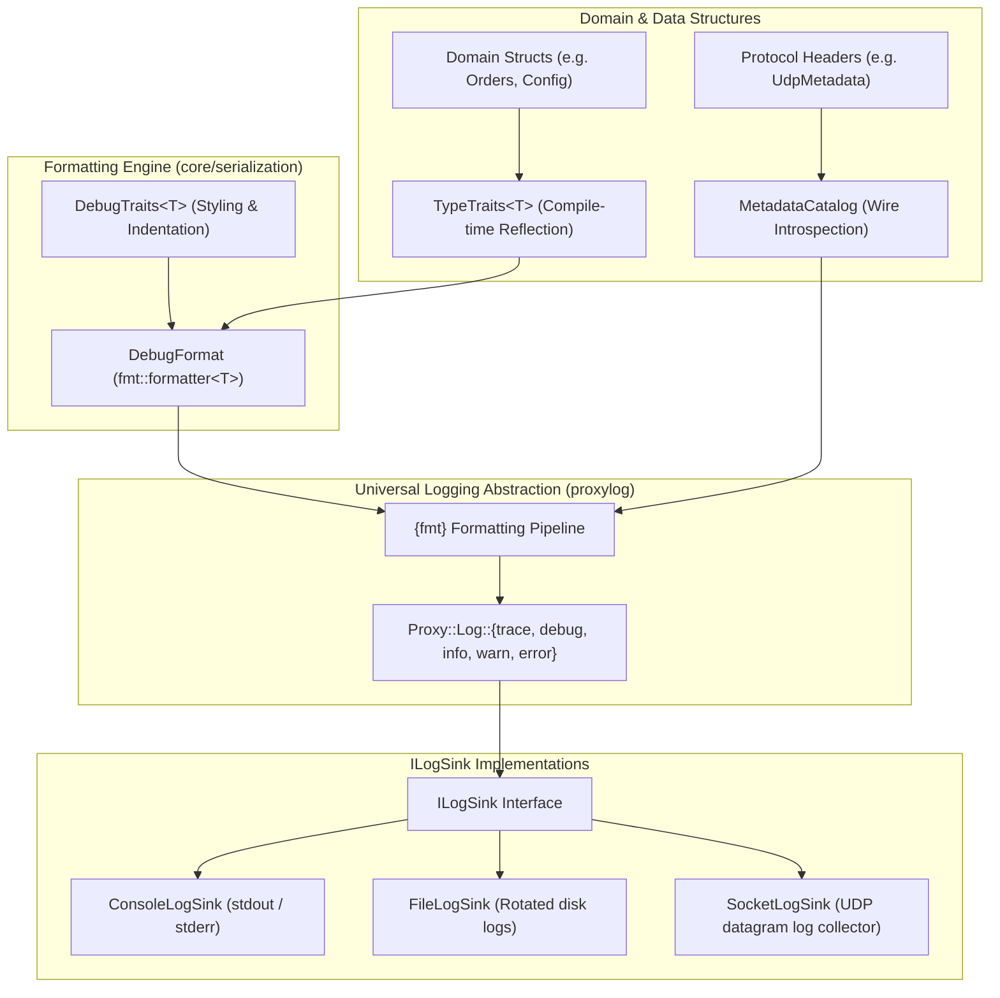

# Logging, Formatting & Diagnostic Architecture

## 1. Overview & Architectural Philosophy

The Proxy platform processes high-velocity binary and textual message streams across distributed and multi-process topologies. Diagnosing routing issues, latency spikes, and payload errors requires a multi-tier observability stack:
1. **Low-Latency Structured Logging**: Abstract, sink-pluggable logging with negligible overhead in hot paths (`Proxy::Log`).
2. **Zero-Allocation Type Formatting**: Direct terminal and string inspection of reflected domain models and protocol structures without heap allocation or manual string builders (`Core::Serialization::DebugFormat`).
3. **Decentralized Protocol Reflection**: Dynamic introspection and JSON extraction for wire headers and packet metadata (`MetadataCatalog`).

By strictly separating **logging sinks** (where bytes go) from **formatting engines** (how objects render), handlers and core engines remain decoupled from concrete logging libraries and terminal I/O.

---

## 2. System Topology & Layering



---

## 3. The Universal Logging Subsystem (`proxylog`)

### Architectural Boundary
Application handlers and core libraries **never include `<spdlog/...>` directly**. Instead, all components interact through the lightweight facade in `"log/Log.hpp"`.

### The `ILogSink` Abstraction
Logging destinations implement the abstract `ILogSink` interface:

```cpp
class ILogSink {
public:
    virtual ~ILogSink() = default;
    virtual void log(Level level, std::string_view message) = 0;
    virtual void flush() = 0;
    virtual void setLevel(Level level) = 0;
    [[nodiscard]] virtual Level getLevel() const = 0;
};
```

Transport backends configure the active sink during their lifecycle:
- **`backend-file`**: Initializes `FileLogSink` targeting a configured directory path with optional console mirroring.
- **`backend-socket`**: Initializes `SocketLogSink` forwarding logs over UDP to an aggregation server.
- **Standalone binaries / CLI tools**: Default to `ConsoleLogSink` with color-coded log levels.

---

## 4. Reflection-Driven Debug Formatting (`DebugFormat`)

### Motivation & Design Criteria
Traditional logging of C++ domain structures suffers from three common pitfalls:
- **Manual Boilerplate**: Developers write hundreds of lines of `to_string()` or format functions that easily drift out of date when struct members change.
- **Heavy Allocations**: Serializing objects to temporary JSON or XML strings allocates memory and introduces unnecessary CPU cache thrashing.
- **Unreadable Log Dumps**: In terminal consoles, large structures logged on a single line are impossible to scan quickly.

The `DebugFormat` subsystem solves this by integrating `{fmt}` directly with `Core::Serialization::TypeTraits`.

### Key Characteristics
1. **Zero-Allocation Streaming**:
   Struct reflection is evaluated via compile-time fold expressions directly into the output iterator of `fmt::format_context`. No intermediate heap buffers are created.
2. **Opt-In Customization (`DebugTraits<T>`)**:
   Types can customize their display name, indentation width, and default multi-line layout without touching their core struct definition.

### Format Specifiers Reference

When formatting a reflected type with `{fmt}` or `Proxy::Log`, the following specifiers are supported:

| Specifier | Behavior | Example Output |
| :--- | :--- | :--- |
| `{}` | **Default**: Single-line compact debug representation (or type default from `DebugTraits`). | `Point { x: 10, y: 20 }` |
| `{:#}` or `{:pretty}` | **Multi-line Tree**: Indents each field on its own line; recursively indents nested structs. | `Point {\n  x: 10,\n  y: 20\n}` |
| `{:compact}` | **Forced Compact**: Overrides `multiline = true` traits to print single-line. | `Point { x: 10, y: 20 }` |
| `{:color}` | **ANSI Highlighting**: Colorizes type names in bold cyan, field keys in yellow, strings in green, numbers in blue. | `\033[1;36mPoint\033[0m { ... }` |
| Combinations | Supports compounding specifiers (e.g. `{:#c}`, `{:pretty,color}`). | Indented multi-line tree with ANSI syntax colors. |

---

## 5. Developer Guide: Enabling Formatting on Custom Types

### Step 1: Define Your Data Structure

Define your domain struct without macros, intrusive base classes, or special members:

```cpp
struct TradeOrder {
    uint32_t orderId;
    std::string symbol;
    double price;
    uint32_t quantity;
};
```

### Step 2: Register Reflection in `TypeTraits`

Add the static `fields()` specialization in `Core::Serialization`:

```cpp
#include "core/serialization/TypeTraits.hpp"

template <>
struct Core::Serialization::TypeTraits<TradeOrder> {
    static constexpr auto fields()
    {
        return std::make_tuple(
            Core::Serialization::field("orderId", &TradeOrder::orderId),
            Core::Serialization::field("symbol", &TradeOrder::symbol),
            Core::Serialization::field("price", &TradeOrder::price),
            Core::Serialization::field("quantity", &TradeOrder::quantity)
        );
    }
};
```

### Step 3 (Optional): Customize Display via `DebugTraits`

If you want to configure an explicit display name, default to multi-line tree view, or customize indentation:

```cpp
#include "core/serialization/DebugTraits.hpp"

template <>
struct Core::Serialization::DebugTraits<TradeOrder> : Core::Serialization::DebugTraitsBase {
    static constexpr std::string_view name = "TradeOrder";
    static constexpr bool multiline = false; // default to compact inline
    static constexpr unsigned int indentSpaces = 4;
};
```

### Step 4: Include `DebugFormat.hpp` and Log

Include the formatter header at any call site using `fmt::format`, `fmt::print`, or `Proxy::Log`:

```cpp
#include "core/serialization/fmt/DebugFormat.hpp"
#include "log/Log.hpp"

TradeOrder order{1001, "NVDA", 125.75, 50};

// 1. Standard compact log:
Proxy::Log::info("Received order: {}", order);
// Output: Received order: TradeOrder { orderId: 1001, symbol: "NVDA", price: 125.75, quantity: 50 }

// 2. Indented tree inspection on warning/error:
Proxy::Log::warn("Validation warning for order:\n{:#}", order);
// Output:
// Validation warning for order:
// TradeOrder {
//     orderId: 1001,
//     symbol: "NVDA",
//     price: 125.75,
//     quantity: 50
// }

// 3. Direct console print with ANSI syntax colors:
fmt::print("{:#c}\n", order);
```

### Nested Structs and Standard Collections Example

`DebugFormat` natively handles compositions of reflected types, standard library containers, and optionals without extra code:

```cpp
struct OrderBookSnapshot {
    std::string market;
    std::vector<TradeOrder> activeOrders;
    std::optional<std::string> notes;
};

template <>
struct Core::Serialization::TypeTraits<OrderBookSnapshot> {
    static constexpr auto fields()
    {
        return std::make_tuple(
            Core::Serialization::field("market", &OrderBookSnapshot::market),
            Core::Serialization::field("activeOrders", &OrderBookSnapshot::activeOrders),
            Core::Serialization::field("notes", &OrderBookSnapshot::notes)
        );
    }
};

OrderBookSnapshot snapshot{
    "NASDAQ",
    { { 101, "AAPL", 185.0, 10 }, { 102, "MSFT", 420.0, 25 } },
    std::nullopt
};

// Formats nested structs, lists, and optionals seamlessly:
fmt::print("{}\n", snapshot);
// Output: { market: "NASDAQ", activeOrders: [TradeOrder { orderId: 101, ... }, TradeOrder { orderId: 102, ... }], notes: none }
```

---

## 6. Architectural Balance & Responsibilities

To maintain clean module boundaries and fast compilation times:

| Subsystem | Location | Role & Dependencies |
| :--- | :--- | :--- |
| **`proxylog`** | `log/` | Abstract logging sink interface (`ILogSink`), level dispatch, and integration with `spdlog`. Does not depend on `core`. |
| **`TypeTraits`** | `core/include/core/serialization/TypeTraits.hpp` | Pure compile-time struct reflection (`FieldDescriptor`). Zero dependencies. |
| **`DebugTraits`** | `core/include/core/serialization/DebugTraits.hpp` | Optional styling traits for formatting. Zero external dependencies. |
| **`DebugFormat`** | `core/include/core/serialization/fmt/DebugFormat.hpp` | `{fmt}` formatter adapter bridging `TypeTraits` and `{fmt}`. Included only in compilation units that format or print types. |
| **`MetadataCatalog`** | `core/include/core/metadata/MetadataCatalog.hpp` | Runtime introspection of binary protocol envelopes and metadata buffers. |

---

## 7. Structured Logging Guidelines & Placeholder Conventions

To preserve clean terminal prose while emitting strongly-typed, predictable JSON schemas for downstream log aggregators (e.g., Datadog, ClickHouse, Elastic), all code in `core` and application handlers must adhere to the following logging conventions:

### Placeholder Patterns

| Pattern | Syntax | When to Use | Output (Console vs JSON) |
| :--- | :--- | :--- | :--- |
| **Named Placeholders** *(Standard / Default)* | `PROXY_LOG_INFO("Channel {channel} received {bytes} bytes", ch, n);` | **Default for production & core code.** Whenever dynamic variables are woven into the sentence. Always use `{snake_case}` keys. | **Console**: Natural prose (`"Channel eth0 received 512 bytes"`).<br>**JSON**: Clean semantic fields (`{"channel": "eth0", "bytes": 512}`). |
| **Trailing Key-Values** *(Event Summaries & Telemetry)* | `PROXY_LOG_WARN("Dropped invalid packet", reason, packetId);` | **Lifecycle events, error summaries, or state dumps** where the prose describes the *event*, and trailing parameters provide structured context. | **Console**: `Dropped invalid packet [reason=CORRUPT_CRC packetId=1024]`<br>**JSON**: `{"message": "Dropped invalid packet", "reason": "CORRUPT_CRC", "packetId": 1024}` |
| **Plain Text** *(Milestones & Transitions)* | `PROXY_LOG_INFO("Event loop started");` | **Static milestones** without dynamic parameters (startup, shutdown, mode change). | **Console**: `"Event loop started"`<br>**JSON**: `{"message": "Event loop started"}` |
| **Anonymous `{}`** *(Quick Debugging Only)* | `PROXY_LOG_DEBUG("x = {}, y = {}", x, y);` | **Temporary trace/debug during development.** The macro auto-extracts keys from C++ variable names. Discouraged in `core` production paths. | **Console**: Formatted prose.<br>**JSON**: Inferred keys (`{"x": 10, "y": 20}`). |

### Guidelines for Core and Handlers
1. **Always Use `{snake_case}` for Named Placeholders**:
   Keys like `{channel_name}`, `{worker_count}`, `{error_message}` produce a clean, uniform schema across multiple modules and languages.
2. **Never Expose Internal Variable Naming**:
   Avoid anonymous `{}` when passing expressions like `m_workerThreads.size()`; use `All {worker_count} worker thread(s) active` to produce `{ "worker_count": 3 }` instead of `{ "workerThreads.size()": 3 }`.
3. **Keep Format String Prose Grammatical**:
   Placeholders should read naturally in English so terminal logs are immediately understandable without decoding brackets or JSON fields.

---

## 8. Best Practices for Developers

1. **Avoid Manual `to_string()`**: When creating new domain models, specialize `Core::Serialization::TypeTraits<T>`. This automatically provides serialization (JSON/XML) AND terminal debug printing (`fmt` / `Proxy::Log`).
2. **Use Multi-Line `{:#}` for Diagnostics**: In error handling and warning logs, format complex structs with `{:#}` so nested objects and arrays render cleanly in log files.
3. **Keep Headers Decoupled**: Do not include `<fmt/format.h>` or `"core/serialization/fmt/DebugFormat.hpp"` in public header files of handlers or libraries. Include `DebugFormat.hpp` in `.cpp` implementation files where logging calls actually happen.
