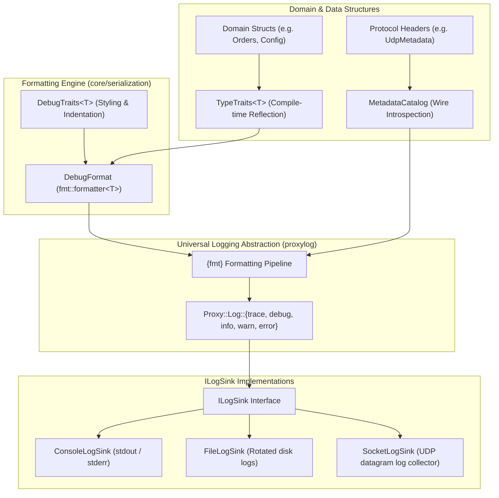

# Logging, Formatting & Diagnostic Architecture

## 1. Overview & Architectural Philosophy

The Proxy platform processes high-velocity binary and textual message streams across distributed and multi-process topologies. Diagnosing routing issues, latency spikes, and payload errors requires a multi-tier observability stack:
1. **Low-Latency Structured Logging**: Abstract, sink-pluggable logging with negligible overhead in hot paths (`Proxy::Log`).
2. **Zero-Allocation Type Formatting**: Direct terminal and string inspection of reflected domain models and protocol structures without heap allocation or manual string builders (`Core::Serialization::DebugFormat`).
3. **Decentralized Protocol Reflection**: Dynamic introspection and JSON extraction for wire headers and packet metadata (`MetadataCatalog`).

By strictly separating **logging sinks** (where bytes go) from **formatting engines** (how objects render), handlers and core engines remain decoupled from concrete logging libraries and terminal I/O.

---

## 2. System Topology & Layering



---

## 3. The Universal Logging Subsystem (`proxylog`)

### Architectural Boundary
Application handlers and core libraries **never include `<spdlog/...>` directly**. Instead, all components interact through the lightweight facade in `"log/Log.hpp"`.

### The `ILogSink` Abstraction
Logging destinations implement the abstract `ILogSink` interface:

```cpp
class ILogSink {
public:
    virtual ~ILogSink() = default;
    virtual void log(Level level, std::string_view message) = 0;
    virtual void flush() = 0;
    virtual void setLevel(Level level) = 0;
    [[nodiscard]] virtual Level getLevel() const = 0;
};
```

Transport backends configure the active sink during their lifecycle:
- **`backend-file`**: Initializes `FileLogSink` targeting a configured directory path with optional console mirroring.
- **`backend-socket`**: Initializes `SocketLogSink` forwarding logs over UDP to an aggregation server.
- **Standalone binaries / CLI tools**: Default to `ConsoleLogSink` with color-coded log levels.

---

## 4. Reflection-Driven Debug Formatting (`DebugFormat`)

### Motivation & Design Criteria
Traditional logging of C++ domain structures suffers from three common pitfalls:
- **Manual Boilerplate**: Developers write hundreds of lines of `to_string()` or format functions that easily drift out of date when struct members change.
- **Heavy Allocations**: Serializing objects to temporary JSON or XML strings allocates memory and introduces unnecessary CPU cache thrashing.
- **Unreadable Log Dumps**: In terminal consoles, large structures logged on a single line are impossible to scan quickly.

The `DebugFormat` subsystem solves this by integrating `{fmt}` directly with `Core::Serialization::TypeTraits`.

### Key Characteristics
1. **Zero-Allocation Streaming**:
   Struct reflection is evaluated via compile-time fold expressions directly into the output iterator of `fmt::format_context`. No intermediate heap buffers are created.
2. **Opt-In Customization (`DebugTraits<T>`)**:
   Types can customize their display name, indentation width, and default multi-line layout without touching their core struct definition.

### Format Specifiers Reference

When formatting a reflected type with `{fmt}` or `Proxy::Log`, the following specifiers are supported:

| Specifier | Behavior | Example Output |
| :--- | :--- | :--- |
| `{}` | **Default**: Single-line compact debug representation (or type default from `DebugTraits`). | `Point { x: 10, y: 20 }` |
| `{:#}` or `{:pretty}` | **Multi-line Tree**: Indents each field on its own line; recursively indents nested structs. | `Point {\n  x: 10,\n  y: 20\n}` |
| `{:compact}` | **Forced Compact**: Overrides `multiline = true` traits to print single-line. | `Point { x: 10, y: 20 }` |
| `{:color}` | **ANSI Highlighting**: Colorizes type names in bold cyan, field keys in yellow, strings in green, numbers in blue. | `\033[1;36mPoint\033[0m { ... }` |
| Combinations | Supports compounding specifiers (e.g. `{:#c}`, `{:pretty,color}`). | Indented multi-line tree with ANSI syntax colors. |

---

## 5. Developer Guide: Enabling Formatting on Custom Types

### Step 1: Define Your Data Structure

Define your domain struct without macros, intrusive base classes, or special members:

```cpp
struct TradeOrder {
    uint32_t orderId;
    std::string symbol;
    double price;
    uint32_t quantity;
};
```

### Step 2: Register Reflection in `TypeTraits`

Add the static `fields()` specialization in `Core::Serialization`:

```cpp
#include "core/serialization/TypeTraits.hpp"

template <>
struct Core::Serialization::TypeTraits<TradeOrder> {
    static constexpr auto fields()
    {
        return std::make_tuple(
            Core::Serialization::field("orderId", &TradeOrder::orderId),
            Core::Serialization::field("symbol", &TradeOrder::symbol),
            Core::Serialization::field("price", &TradeOrder::price),
            Core::Serialization::field("quantity", &TradeOrder::quantity)
        );
    }
};
```

### Step 3 (Optional): Customize Display via `DebugTraits`

If you want to configure an explicit display name, default to multi-line tree view, or customize indentation:

```cpp
#include "core/serialization/DebugTraits.hpp"

template <>
struct Core::Serialization::DebugTraits<TradeOrder> : Core::Serialization::DebugTraitsBase {
    static constexpr std::string_view name = "TradeOrder";
    static constexpr bool multiline = false; // default to compact inline
    static constexpr unsigned int indentSpaces = 4;
};
```

### Step 4: Include `DebugFormat.hpp` and Log

Include the formatter header at any call site using `fmt::format`, `fmt::print`, or `Proxy::Log`:

```cpp
#include "core/serialization/fmt/DebugFormat.hpp"
#include "log/Log.hpp"

TradeOrder order{1001, "NVDA", 125.75, 50};

// 1. Standard compact log:
Proxy::Log::info("Received order: {}", order);
// Output: Received order: TradeOrder { orderId: 1001, symbol: "NVDA", price: 125.75, quantity: 50 }

// 2. Indented tree inspection on warning/error:
Proxy::Log::warn("Validation warning for order:\n{:#}", order);
// Output:
// Validation warning for order:
// TradeOrder {
//     orderId: 1001,
//     symbol: "NVDA",
//     price: 125.75,
//     quantity: 50
// }

// 3. Direct console print with ANSI syntax colors:
fmt::print("{:#c}\n", order);
```

### Nested Structs and Standard Collections Example

`DebugFormat` natively handles compositions of reflected types, standard library containers, and optionals without extra code:

```cpp
struct OrderBookSnapshot {
    std::string market;
    std::vector<TradeOrder> activeOrders;
    std::optional<std::string> notes;
};

template <>
struct Core::Serialization::TypeTraits<OrderBookSnapshot> {
    static constexpr auto fields()
    {
        return std::make_tuple(
            Core::Serialization::field("market", &OrderBookSnapshot::market),
            Core::Serialization::field("activeOrders", &OrderBookSnapshot::activeOrders),
            Core::Serialization::field("notes", &OrderBookSnapshot::notes)
        );
    }
};

OrderBookSnapshot snapshot{
    "NASDAQ",
    { { 101, "AAPL", 185.0, 10 }, { 102, "MSFT", 420.0, 25 } },
    std::nullopt
};

// Formats nested structs, lists, and optionals seamlessly:
fmt::print("{}\n", snapshot);
// Output: { market: "NASDAQ", activeOrders: [TradeOrder { orderId: 101, ... }, TradeOrder { orderId: 102, ... }], notes: none }
```

---

## 6. Architectural Balance & Responsibilities

To maintain clean module boundaries and fast compilation times:

| Subsystem | Location | Role & Dependencies |
| :--- | :--- | :--- |
| **`proxylog`** | `log/` | Abstract logging sink interface (`ILogSink`), level dispatch, and integration with `spdlog`. Does not depend on `core`. |
| **`TypeTraits`** | `core/include/core/serialization/TypeTraits.hpp` | Pure compile-time struct reflection (`FieldDescriptor`). Zero dependencies. |
| **`DebugTraits`** | `core/include/core/serialization/DebugTraits.hpp` | Optional styling traits for formatting. Zero external dependencies. |
| **`DebugFormat`** | `core/include/core/serialization/fmt/DebugFormat.hpp` | `{fmt}` formatter adapter bridging `TypeTraits` and `{fmt}`. Included only in compilation units that format or print types. |
| **`MetadataCatalog`** | `core/include/core/metadata/MetadataCatalog.hpp` | Runtime introspection of binary protocol envelopes and metadata buffers. |

---

## 7. Structured Logging Philosophy: Balancing Human & Machine Readability

The Proxy platform adopts a **machine-readable first, human-observable** structured logging architecture. In high-throughput messaging proxies, log streams are ingested, indexed, and aggregated by automated systems (Datadog, ClickHouse, Elasticsearch, Grafana Loki), while developers and operators simultaneously monitor console streams during incidents and development.

### The 3 Roles of a Log Entry: "Subject vs. Metric"

To achieve the ideal balance, every log statement decomposes into three clear roles:

```
[WHAT HAPPENED] on [WHICH ENTITY] with [MEASUREMENTS & CONTEXT]
     │                    │                         │
Static Event        Target Subject           Metadata & Metrics
(Template)          (In Message)             (Trailing Fields)
```

1. **The Static Event (Template Prefix)**:
   A greppable, static action or state classifier (e.g., `"Invalid envelope received"`, `"Starting thread pool"`).
2. **The Target Subject (In Message `{named}`)**:
   The primary resource or entity being acted upon (e.g., `'{channel}'`, `{host}:{port}`, `'{filePath}'`). This gives humans immediate context in console streams without clutter.
3. **Measurements, Counters & Context (Structured Fields)**:
   Dynamic counts, byte sizes, retry numbers, durations, and diagnostic errors (e.g., `bytes`, `droppedCount`, `workerCount`, `errorMessage`). These belong **in structured fields only** to avoid string duplication and keep log fingerprinting stable.

#### Before vs. After Example

- ❌ **Conversational / Unbalanced (Redundant Metrics in Prose)**:
  ```cpp
  PROXY_LOG_WARN("Invalid envelope received on channel '{channel}' ({bytes} bytes, total dropped: {droppedCount})",
      channelName, bytes, droppedCount);
  ```
  - **Console Sink**: `[warning] [MessageDispatcher] Invalid envelope received on channel 'accounting' (16 bytes, total dropped: 1)`
  - *Downside*: Full-text string duplicates numerical measurements; log clustering and fingerprinting engines create noisy buckets instead of a single canonical event type.

-  **Balanced Machine-First (Hybrid Subject + Structured Metrics)**:
  ```cpp
  PROXY_LOG_WARN("Invalid envelope received on channel '{channel}'",
      channelName, bytes, droppedCount);
  ```
  - **Console Sink**: `[warning] [MessageDispatcher] Invalid envelope received on channel 'accounting' [bytes=16 droppedCount=1]`
  - **JSON Sink**:
    ```json
    {
      "message": "Invalid envelope received on channel 'accounting'",
      "channel": "accounting",
      "bytes": 16,
      "droppedCount": 1
    }
    ```
  - *Benefit*: Human operator sees target entity in prose with metrics bracketed at the end; machine ingestors parse typed JSON attributes without regex extraction.

### Placeholder Patterns Reference

| Pattern | Syntax | When to Use | Output (Console vs JSON) |
| :--- | :--- | :--- | :--- |
| **Hybrid Named + Trailing** *(Standard / Default)* | `PROXY_LOG_WARN("Invalid envelope received on channel '{channel}'", channelName, bytes, droppedCount);` | **Default for events with a subject and metrics.** Subject is interpolated in prose; trailing parameters become bracketed fields in console and typed JSON fields. | **Console**: `... on channel 'accounting' [bytes=512 droppedCount=1]`<br>**JSON**: `{"message": "... on channel 'accounting'", "channel": "accounting", "bytes": 512, "droppedCount": 1}` |
| **Trailing Key-Values** *(Event Summaries & Telemetry)* | `PROXY_LOG_INFO("Starting thread pool", LogField("workerCount", m_numWorkerThreads), channelCount);` | **Pure event notifications** where the event is static and all variables are secondary metrics or state counters. | **Console**: `Starting thread pool [workerCount=4 channelCount=2]`<br>**JSON**: `{"message": "Starting thread pool", "workerCount": 4, "channelCount": 2}` |
| **Plain Text** *(Milestones & Transitions)* | `PROXY_LOG_INFO("Event loop started");` | **Static milestones** without dynamic parameters (startup, shutdown, state transitions). | **Console**: `"Event loop started"`<br>**JSON**: `{"message": "Event loop started"}` |
| **Anonymous `{}`** *(Internal Debugging Only)* | `PROXY_LOG_DEBUG("x = {}, y = {}", x, y);` | **Temporary development tracing only.** Discouraged in `core` and production handler paths because schema keys are inferred from local variable names. | **Console**: Formatted prose.<br>**JSON**: Best-effort inferred keys. |

### Field Naming Conventions: Consistent `camelCase`

To eliminate impedance mismatch between C++ source code, JSON configuration schemas, and structured logging attributes, all field names and placeholder keys throughout the Proxy platform strictly use **`camelCase`**:

- Identifiers: `{channel}`, `{routeName}`, `{correlationId}`, `{filePath}`
- Counts & Metrics: `bytes`, `workerCount`, `droppedCount`, `channelCount`, `pollerCount`
- Endpoints: `{host}`, `{port}`, `{targetHost}`, `{targetPort}`, `{destinationPath}`
- Diagnostics: `errorMessage`, `cause`

This ensures trailing variables in C++ (`..., channelCount, bytesRead`) seamlessly match explicit format placeholders (`{channelCount}`) without requiring casing conversions or causing key bifurcation in log databases.

### Explicit Fields for Expressions and Member Variables: `LogField`

When logging a metric or field derived from a method call or member variable with a prefix (e.g. `m_workerThreads.size()` or `m_numWorkerThreads`), passing the expression directly causes the preprocessor to stringify the expression itself (e.g., `[m_workerThreads.size()=3]`).

To guarantee clean `camelCase` keys without declaring redundant temporary variables, pass an explicit `Proxy::Log::LogField`:

```cpp
// Explicit LogField guarantees the key is clean camelCase:
PROXY_LOG_INFO("Dedicated worker threads active",
    Proxy::Log::LogField("workerCount", m_workerThreads.size()));

// Multiple metrics can mix explicit LogField and direct camelCase variables:
PROXY_LOG_INFO("Starting thread pool",
    Proxy::Log::LogField("workerCount", m_numWorkerThreads), channelCount);
```

- **Console Sink**: `[info] [DedicatedThreadStrategy] Dedicated worker threads active [workerCount=3]`
- **JSON Sink**:
  ```json
  {
    "message": "Dedicated worker threads active",
    "workerCount": 3
  }
  ```

---

## 8. Best Practices for Developers

1. **Avoid Manual `to_string()`**: When creating new domain models, specialize `Core::Serialization::TypeTraits<T>`. This automatically provides serialization (JSON/XML) AND terminal debug printing (`fmt` / `Proxy::Log`).
2. **Use Multi-Line `{:#}` for Diagnostics**: In error handling and warning logs, format complex structs with `{:#}` so nested objects and arrays render cleanly in log files.
3. **Keep Headers Decoupled**: Do not include `<fmt/format.h>` or `"core/serialization/fmt/DebugFormat.hpp"` in public header files of handlers or libraries. Include `DebugFormat.hpp` in `.cpp` implementation files where logging calls actually happen.
