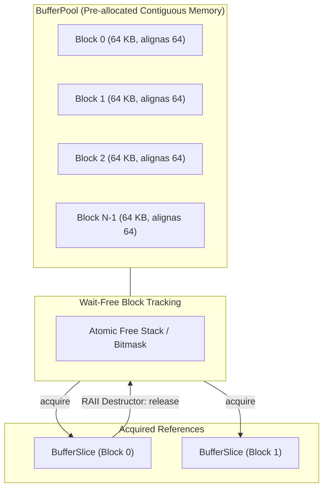
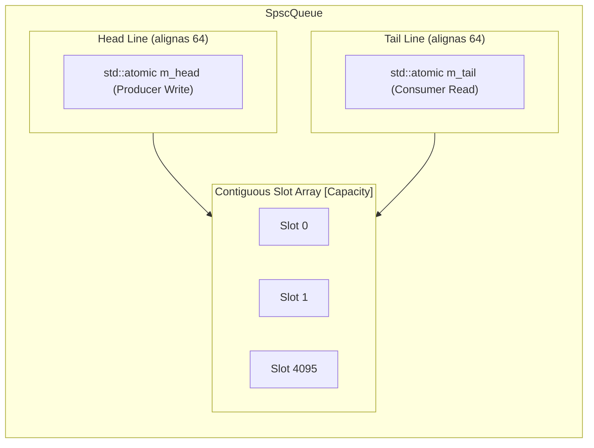

# Memory Management & Lock-Free Concurrency Primitives

## 1. Overview & Problem Statement

### Why It's Needed
In low-latency proxy environments handling burst traffic (e.g., 1,000,000+ packets/sec), traditional C++ dynamic memory management (`std::vector`, `std::string`, `malloc`/`free`) and thread synchronization primitives (`std::mutex`, `std::condition_variable`) introduce severe bottlenecks:
- **Heap Contention**: Dynamic memory allocation requires synchronizing across threads via allocator bucket locks, introducing unbounded latency spikes.
- **Cache Invalidation & False Sharing**: Multiple CPU cores updating adjacent memory addresses in the same 64-byte hardware cache line causes repeated bus cache-coherence flushes (MESI protocol).
- **Context Switches**: Mutex contention forces the operating system to park threads, causing expensive kernel context switches (taking 1,000 to 5,000 nanoseconds per block).

### The Solution
The `common/` library provides a high-performance foundation of **zero-allocation memory pools** and **lock-free concurrency primitives**:
- **`BufferPool` & `BufferSlice`**: Fixed-block slab allocator avoiding heap allocations on ingress hot paths.
- **`SpscQueue` & `MpmcQueue`**: Hardware cache-line aligned (alignas(64)) circular ring queues with power-of-two bitmask indexing.
- **Safe RAII Primitives**: `NotNull`, `Borrow`, `ObserverPtr`, and `UniqueFd` providing compile-time ownership guarantees without shared-pointer overhead.

---

## 2. Memory Pool Architecture (`BufferPool` & `BufferSlice`)

### Key Characteristics:
- **Contiguous Allocation**: Memory is allocated once during initialization as a single contiguous block, eliminating memory fragmentation.
- **Wait-Free Acquisition**: Acquiring a block slice is wait-free via atomic stack operations.
- **Deterministic Lifetime via `BufferSlice`**: A lightweight RAII wrapper that automatically returns the block index to the pool when destructed or moved.

---

## 3. Lock-Free Queue Primitives

### Single-Producer Single-Consumer Queue (`SpscQueue`)
Used for intra-process thread pipelining (such as feeding `ThreadPoolStrategy` workers from an I/O polling thread):

1. **Strict False-Sharing Elimination**:
   - `m_head` (modified by producer) and `m_tail` (modified by consumer) are declared with `alignas(64)` and separated by cache-line padding. A write by the producer never invalidates the consumer's cache line.
2. **Power-of-Two Fast Indexing**:
   - Queue capacity is statically enforced to be a power of two (`Capacity & (Capacity - 1) == 0`).
   - Wrapping indices avoids expensive division/modulo CPU instructions:
     $$\text{slotIndex} = \text{head} \ \& \ (\text{Capacity} - 1)$$
3. **Atomic Wait / Notify Wakeup**:
   - Integrated with `Common::Compat::atomic_wait` and `atomic_notify_one` using monotonic sequence numbers, ensuring instant thread wakeups on enqueue without busy-spinning CPU cores when the pipeline is idle.

---

## 4. RAII Memory & Ownership Primitives

- **`Common::Memory::NotNull<T*>`**:
  A non-nullable pointer wrapper guaranteeing at compile-time and debug-assertion time that a pointer cannot be null, eliminating defensive null checks in inner loops.
- **`Common::Memory::ObserverPtr<T>`**:
  Represents non-owning, non-dangling pointer references to long-lived objects (e.g. channel references in handlers).
- **`Common::Memory::Borrow<T>`**:
  Explicit move-only reference token enforcing borrowing semantics without copy overhead.
- **`Common::IO::UniqueFd`**:
  Strict RAII wrapper for POSIX file descriptors (`int fd`). Automatically invokes `close()` on destruction, preventing descriptor leaks on socket or file errors.

