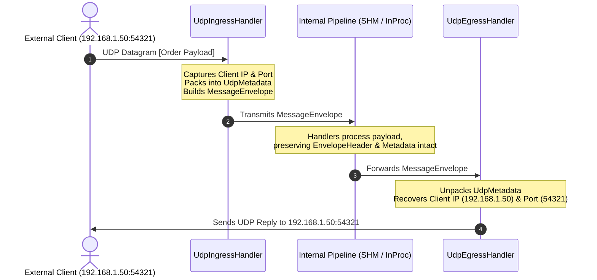

# Message Framing, Provenance & Envelope Wire Format

## 1. Overview & Problem Statement

### Why It's Needed
In multi-stage distributed message pipelines, passing naked application payloads (such as raw XML or JSON text) creates severe operational hurdles:
- **Missing Origin Information**: Once an ingress handler receives a UDP datagram and forwards the XML order to a shared-memory validation worker, the original client's IP address and UDP port are lost. An egress gateway at the end of the pipeline cannot reply to the client without maintaining external state or querying a database.
- **Payload Corruption**: Without a standardized wire envelope, memory corruptions or truncated network packets are only detected deep inside business logic parsers.
- **Protocol Ambiguity**: Pipelines processing multiple simultaneous protocols (e.g. FIX, ITCH/OUCH, XML) cannot inspect protocol identity without parsing each message's internal payload.

### The Solution
The system encapsulates every message in a standardized, compact binary **`MessageEnvelope`**. The envelope prepends a fixed-size header containing integrity checksums, timestamps, protocol IDs, and an extensible metadata section (**`UdpMetadata`**) that preserves network origin across arbitrary pipeline stages.

---

## 2. Binary Wire Format & Layout

An encoded `MessageEnvelope` on the wire consists of three contiguous segments:

```
+-------------------------------------------------------------------------------+
| EnvelopeHeader (Fixed 18 bytes, Big-Endian)                                   |
|   Magic: uint16_t (0x5058 - 'PX')                                             |
|   Version: uint8_t (Current = 1)                                              |
|   ProtocolId: uint8_t (Common::Types::StrongType<uint8_t, ProtocolIdTag>)     |
|   MetadataLength: uint16_t (Size of metadata section in bytes)                |
|   PayloadLength: uint32_t (Size of payload in bytes)                          |
|   TimestampNs: uint64_t (Unix epoch ingress timestamp in nanoseconds)         |
+-------------------------------------------------------------------------------+
| Metadata Block (Variable size, indicated by MetadataLength)                   |
|   e.g. UdpMetadata: IPv4/IPv6 source address, source port, destination port   |
+-------------------------------------------------------------------------------+
| Application Payload (Variable size, indicated by PayloadLength)               |
|   Raw XML text, JSON string, or binary order structure                         |
+-------------------------------------------------------------------------------+
```

---

## 3. Origin-Preserving Egress Workflow



1. **Ingress Ingestion**:
   - `UdpIngressHandler` receives a datagram from a client socket.
   - It captures the sender's `SocketAddress` and packs it into `UdpMetadata`.
   - It constructs a `MessageEnvelope` (with `MetadataTraits<UdpMetadata>::protocol` = 17 / `IPPROTO_UDP`) and sends it downstream.
2. **Intermediate Pipeline Invariance & Payload Mutation**:
   - Validation handlers (e.g. `XmlVerificationHandler`) unpack the envelope into a non-owning `MessageView`.
   - Business logic inspects `messageView.payload()`.
   - If payload transformation is needed, `view.withPayload(newPayload)` generates a non-allocating rebound `MessageView` preserving protocol and metadata, which `IOutputChannel` frames on egress.
   - When forwarding valid messages, handlers invoke `m_outputChannel->send(messageView)`, passing the entire envelope with metadata unchanged.
3. **Egress Dispatch**:
   - `UdpEgressHandler` queries `message.getMetadata<UdpMetadata>()`.
   - It recovers the destination IP and port, and transmits the response payload back to the client via `m_udpOut->sendTo()`. In forward mode, `UdpEgressHandler::onBatchReceived()` vectorizes payloads using `SmallSpanBuffer` and `sendBatch()`.

---

## 4. Key Design Decisions

1. **Contiguous Single-Buffer Framing**:
   - Header, metadata, and payload reside in a single contiguous byte span. This eliminates vector-write allocations (`writev`) and allows writing entire envelopes directly into shared memory slots (`ShmSlot`) or ring buffers with a single `memcpy`.
2. **Non-Owning `MessageView`**:
   - When receiving a message, handlers receive a `MessageView` that points directly into the channel's receive buffer without heap allocation.
   - Accessors (`view.payload()`, `view.metadata()`, `view.rawBuffer()`) return lightweight `Common::Compat::span<const std::byte>` slices.
   - Strongly-typed metadata is accessed via `view.getMetadata<T>()` through traits (`MetadataTraits<T>`) using alignment-safe copies.
### 3. Open Protocol Identification & Decentralized Reflection (`MetadataCatalog`)
- Replaced fixed enum identifiers with `Common::Types::StrongType<std::uint8_t, ProtocolIdTag>` aligned with standard IANA 8-bit protocol numbers (e.g. `IPPROTO_UDP` = 17, `RawProtocol` = 0) and `MetadataTraits<T>`.
- **Decentralized Protocol Reflection (`Core::Metadata::MetadataCatalog`)**: Protocol metadata structures (e.g. `Core::Net::UdpMetadata`) register with `MetadataCatalog` via `PROXY_REGISTER_METADATA(Type)` without creating circular dependencies on handlers or scripting engines.
- **Direct Field Extraction & Dynamic Inspection**: Handlers and condition evaluators can inspect fields (`MetadataCatalog::getField(...)`) or format JSON diagnostics (`MetadataCatalog::formatJson(...)`) from raw metadata spans without full object instantiation.

### 4. Parallel Inspection Tunneling (`InspectionHeader`)
- In scatter-gather topologies (`ScatterHandler` and `GatherHandler`), parallel branches tunnel the orchestration envelope inside metadata via `InspectionHeader` (`0x50585F494E535043ULL`), preserving the original `ProtocolId` and underlying metadata intact.

### 5. Clock Domain Specification for `timestampNs`
   - The 64-bit `timestampNs` field in `EnvelopeHeader` records **nanoseconds since UNIX epoch (`std::chrono::system_clock`)**.
   - **Cross-Host and Distributed Tracing**: Because `MessageEnvelope` traverses physical network sockets (UDP, TCP) and inter-process boundaries where producer and consumer processes may run on separate hosts or containers without a shared monotonic timebase, epoch wall-clock time is required for distributed correlation and simulation replay (e.g. PCAP captures, JSON traces).
   - **Intra-Host Monotonic Latency**: For internal hop timeouts, poller deadlines, and ring buffer synchronization, channels and execution strategies strictly use `std::chrono::steady_clock` to prevent clock shifts or NTP skew from causing deadlocks or erratic timeout behavior.

