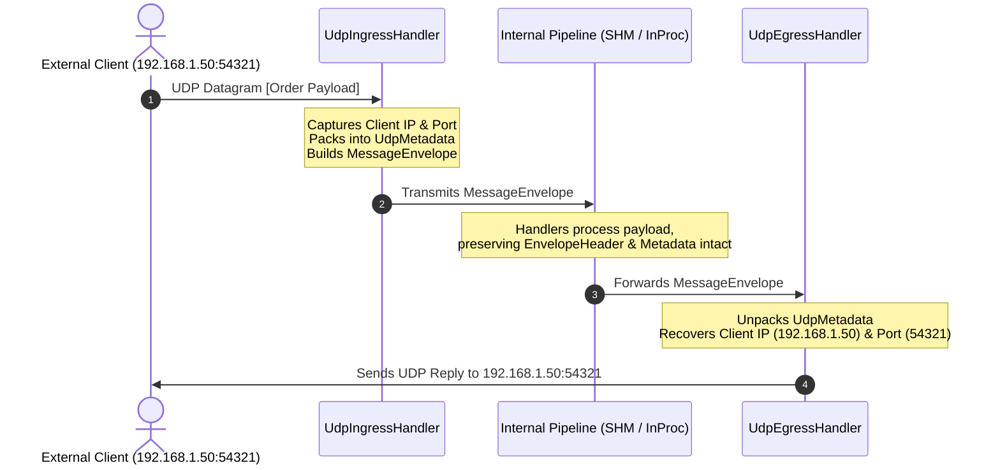

# Message Framing, Provenance & Envelope Wire Format

## 1. Overview & Problem Statement

### Why It's Needed
In multi-stage distributed message pipelines, passing naked application payloads (such as raw XML or JSON text) creates severe operational hurdles:
- **Missing Origin Information**: Once an ingress handler receives a UDP datagram and forwards the XML order to a shared-memory validation worker, the original client's IP address and UDP port are lost. An egress gateway at the end of the pipeline cannot reply to the client without maintaining external state or querying a database.
- **Payload Corruption**: Without a standardized wire envelope, memory corruptions or truncated network packets are only detected deep inside business logic parsers.
- **Protocol Ambiguity**: Pipelines processing multiple simultaneous protocols (e.g. FIX, ITCH/OUCH, XML) cannot inspect protocol identity without parsing each message's internal payload.

### The Solution
The system encapsulates every message in a standardized, compact binary **`MessageEnvelope`**. The envelope prepends a fixed-size header containing integrity checksums, timestamps, protocol IDs, and an extensible metadata section (**`UdpMetadata`**) that preserves network origin across arbitrary pipeline stages.

---

## 2. Binary Wire Format & Layout

An encoded `MessageEnvelope` on the wire consists of three contiguous segments:

```
+-------------------------------------------------------------------------------+
| EnvelopeHeader (Fixed 32 bytes)                                                |
|   Magic: uint32_t (0x50525859 - 'PRXY')                                       |
|   Version: uint16_t (Current = 1)                                             |
|   Flags: uint16_t (Bit 0: HasMetadata, Bit 1: IsBatch, etc.)                  |
|   ProtocolId: uint32_t (Raw, XML, JSON, ITCH, OUCH, FIX)                       |
|   PayloadLength: uint32_t (Size of payload in bytes)                          |
|   MetadataLength: uint32_t (Size of metadata section in bytes)                |
|   TimestampNs: uint64_t (Unix epoch ingress timestamp in nanoseconds)         |
|   PayloadCrc32: uint32_t (CRC32-C integrity checksum of payload)              |
|   Reserved: uint32_t (Alignment padding)                                      |
+-------------------------------------------------------------------------------+
| Metadata Block (Variable size, indicated by MetadataLength)                   |
|   e.g. UdpMetadata: IPv4/IPv6 source address, source port, destination port   |
+-------------------------------------------------------------------------------+
| Application Payload (Variable size, indicated by PayloadLength)               |
|   Raw XML text, JSON string, or binary order structure                         |
+-------------------------------------------------------------------------------+
```

---

## 3. Origin-Preserving Egress Workflow



1. **Ingress Ingestion**:
   - `UdpIngressHandler` receives a datagram from a client socket.
   - It captures the sender's `SocketAddress` and packs it into `UdpMetadata`.
   - It constructs a `MessageEnvelope` with `ProtocolId::Xml` (or raw/configured protocol) and sends it downstream.
2. **Intermediate Pipeline Invariance**:
   - Validation handlers (e.g. `XmlVerificationHandler`) unpack the envelope into a non-owning `MessageView`.
   - Business logic inspects `messageView.payload()`.
   - When forwarding valid messages, handlers invoke `m_outputChannel->send(messageView.rawBytes())`, passing the entire envelope with metadata unchanged.
3. **Egress Dispatch**:
   - `UdpEgressHandler` checks `envelope.header().hasMetadata()`.
   - It deserializes `UdpMetadata`, recovers the destination IP and port, and transmits the response payload back to the client.

---

## 4. Key Design Decisions

1. **Contiguous Single-Buffer Framing**:
   - Header, metadata, and payload reside in a single contiguous byte span. This eliminates vector-write allocations (`writev`) and allows writing entire envelopes directly into shared memory slots (`ShmSlot`) or ring buffers with a single `memcpy`.
2. **Non-Owning `MessageView`**:
   - When receiving a message, handlers receive a `MessageView` that points directly into the channel's receive buffer without heap allocation.
   - Accessors (`view.payload()`, `view.metadata()`, `view.header()`) return lightweight `Common::Compat::span<const std::byte>` slices.
3. **Hardware CRC32-C Checksum**:
   - The header stores a CRC32-C checksum calculated over the payload. On modern x86 and ARM CPUs, this uses hardware acceleration instructions (`CRC32` / `__builtin_ia32_crc32`), verifying data integrity at wire speed.

