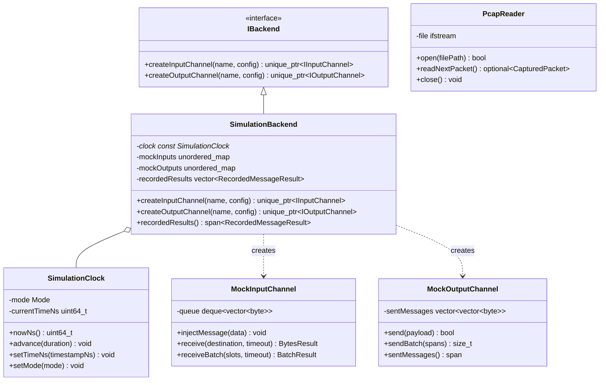
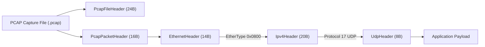

# Deterministic Simulation, Virtual Time & Native PCAP Engine

## 1. Overview & Problem Statement

### Why It's Needed
Testing high-throughput, low-latency messaging pipelines with live networking or sleeping timers presents major difficulties:
- **Flaky & Non-Deterministic Tests**: Tests relying on wall-clock `sleep()` or live UDP sockets suffer from OS scheduling jitter, port conflicts, and race conditions.
- **External Dependency Overhead**: Requiring `libpcap` or external network packet replay tools complicates cross-platform CI environments (Linux and macOS) and slows down test execution.
- **Inability to Control Time**: Verifying rate limiters, timeout handling, and packet inter-arrival latency requires precise control over timestamps without actually waiting real seconds or minutes.

### The Solution
`core/simulation` provides a **self-contained, 100% deterministic simulation engine** implemented in native C++:
1. **Zero-Dependency PCAP Engine (`PcapReader` & `PcapWriter`)**: Directly parses classical Ethernet/IPv4/UDP packet captures at binary speed without `libpcap`.
2. **Deterministic Virtual Clock (`SimulationClock`)**: Allows advancing simulated time manually in nanoseconds (`advance()`, `step()`) or scaling against recorded timestamps.
3. **In-Memory Simulation Backend (`SimulationBackend`)**: Implements `IBackend` using `MockInputChannel` and `MockOutputChannel`, capturing exact `MessageResult` audit histories.

---

## 2. Architecture & Class Relationships



---

## 3. Native PCAP Binary Wire Parsing

`PcapReader` reads classical 24-byte PCAP file headers and 16-byte packet records, stripping the Ethernet, IPv4, and UDP link framing to deliver clean application payloads:



### Extracted `CapturedPacket` Structure:
- **`timestampNs`**: Nanosecond-resolution timestamp derived from PCAP seconds and microseconds/nanoseconds.
- **`srcIp` & `dstIp`**: Network-byte-order IPv4 addresses.
- **`srcPort` & `dstPort`**: Network-byte-order UDP ports.
- **`payload`**: Direct byte buffer representing the application datagram.

---

## 4. Virtual Time Modes (`SimulationClock`)

1. **`Mode::Virtual` (Default for Unit Tests)**:
   - Time does not progress automatically. It only moves forward when the test harness explicitly calls `clock.advance(duration)` or `clock.setTimeNs(timestamp)`.
   - Handlers relying on timeouts can be tested instantaneously without thread sleeps.
2. **`Mode::Realtime`**:
   - Time tracks actual wall-clock elapsed time via `std::chrono::steady_clock`.

---

## 5. Concrete Examples

### Example: Unit Testing a Handler with Mock Channels & Virtual Time
```cpp
#include "core/simulation/SimulationBackend.hpp"
#include "core/simulation/SimulationClock.hpp"
#include "core/config/Configuration.hpp"
#include "handler/order_validation_handler/OrderValidationHandler.hpp"

using namespace Proxy;

// 1. Initialize virtual clock and simulation backend
Core::Simulation::SimulationClock clock(Core::Simulation::SimulationClock::Mode::Virtual);
Core::Simulation::SimulationBackend backend(&clock);

// 2. Configure handler using in-memory channels
Core::Config::Configuration config;
config.set("order.input_channel", "raw_orders");
config.set("order.output_channel", "valid_orders");

Handler::OrderValidationHandler handler;
handler.setBackend(&backend);
handler.configure(config);

// 3. Inject message directly into the MockInputChannel
auto* inChan = dynamic_cast<Core::Simulation::MockInputChannel*>(
    backend.findInputChannel("raw_orders"));
std::string sampleXml = "<Order><orderId>1</orderId><price>10.5</price><quantity>100</quantity><symbol>AAPL</symbol></Order>";
inChan->injectMessage(sampleXml);

// 4. Step handler execution deterministically
handler.step();

// 5. Verify results on the MockOutputChannel
auto* outChan = dynamic_cast<Core::Simulation::MockOutputChannel*>(
    backend.findOutputChannel("valid_orders"));
assert(outChan->sentMessages().size() == 1);
```

---

## 6. Tasks / Checklist
- [x] Implement native PCAP binary parser (`PcapReader`)
- [x] Implement native PCAP writer for capture recording (`PcapWriter`)
- [x] Implement virtualized simulation clock (`SimulationClock`)
- [x] Implement `MockInputChannel` and `MockOutputChannel`
- [x] Implement `SimulationBackend` with audit tracking

