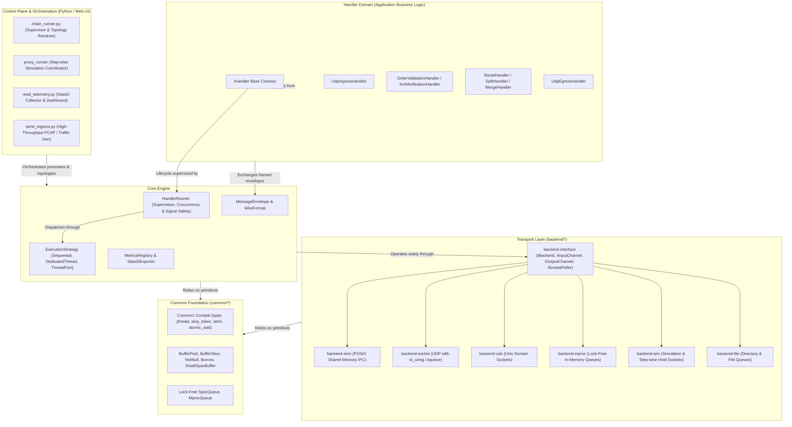

# System Overview & Core Principles

## 1. Executive Architecture Summary
The Proxy system is a modular, ultra-low-latency message processing and routing framework designed for high-throughput, latency-critical environments (financial order routing, market data processing, protocol conversion, and real-time telemetry).

The architecture is founded on strict **orthogonal separation**: business application logic (message parsing, validation, transformation, filtering, and routing) is completely decoupled from the transport mechanisms (Shared Memory, UDP, Unix Domain Sockets, In-Process ring buffers, or Step-Wise Simulation).

---

## 2. Core Architectural Pillars

### Pillar I: Transport-Agnostic Handlers
Handlers **never** include concrete backend transport headers (e.g. `SocketInputChannel.hpp` or `ShmRingBuffer.hpp`) and contain **no transport `#ifdef`s**. Instead:
- Handlers interact solely with `Backend::IInputChannel` and `Backend::IOutputChannel` obtained from `backend().createInputChannel()` / `backend().createOutputChannel()`.
- CMake automatically compiles each handler against each backend discovered in the Conan dependency graph, producing distinct executables (`<handler>_<backend>`, e.g., `order_validation_handler_shm` and `order_validation_handler_socket`).
- The same business logic runs identically across independent processes via shared memory, across distributed network nodes via UDP, or inside an interactive browser simulator via `backend-sim`.

### Pillar II: Zero-Allocation Hot Paths
Heap allocation (`malloc`/`new`) on packet ingress paths causes CPU cache thrashing and memory allocator lock contention. The architecture employs zero-allocation primitives:
- **`BufferPool` & `BufferSlice`**: Pre-allocated contiguous memory pools with reference-counted segmented slices.
- **`BufferSlot`**: Pre-sized, reusable spans used to drain batches of datagrams directly from kernel sockets or shared memory.
- **`MessageView`**: Non-owning span views over raw message bytes. Handlers parse payload fields directly in place via `std::string_view` without allocating `std::string`.

### Pillar III: Standardized Wire Framing & Origin Provenance
Messages moving across the pipeline are encapsulated in a binary wire format ([`MessageEnvelope`](message-envelope-and-framing.md)):
- **Envelope Header**: Encapsulates magic identifier (`0x50525859`), version, payload length, payload CRC32 checksum, timestamp, and protocol ID.
- **Ingress Metadata (`UdpMetadata`)**: When packets enter from an external UDP network, the ingress handler records the origin client IPv4/IPv6 address and port in the envelope metadata.
- **Origin-Preserving Routing**: Subsequent validation and transformation handlers forward the envelope preserving the metadata block intact, enabling egress gateways to reply directly to the original client without database lookups.

### Pillar IV: Pluggable Concurrency Models
Execution is decoupled from handler logic through `HandlerRunner` and `IExecutionStrategy`:
- **`SequentialStrategy`**: Deterministic, single-threaded execution ideal for unit testing, simulation, and strict sequential ordering.
- **`DedicatedThreadStrategy`**: One dedicated polling thread per input channel with lock-free handoff, maximizing throughput for independent streams.
- **`ThreadPoolStrategy`**: A worker thread pool fed by lock-free queues (`SpscQueue`), executing parallel batch processing for CPU-intensive tasks (e.g. schema verification).

### Pillar V: Zero-External-Dependency C++17/20 Portability
The codebase builds by default under C++20 while maintaining strict C++17 compatibility via `Common::Compat`:
- Primitives (`span`, `jthread`, `stop_token`, `latch`, `atomic_wait`) map directly to `std::` under C++20, and fall back to zero-dependency polyfills under C++17.
- Types remain qualified strictly under `Common::Compat::` and are never injected into `namespace std`.

---

## 3. High-Level Architectural Decisions

| Decision | Rationale | Alternatives Considered & Rejected |
| :--- | :--- | :--- |
| **Separate Executables per Backend (`<h>_<b>`)** | Eliminates virtual dispatch overhead on transport hot paths and allows minimal container footprints. | Single monolithic binary with dynamic plugin loading (adds dlopen overhead, runtime resolution failures, and larger binary footprints). |
| **Cache-Line Aligned SPSC Shared Memory Rings** | Sub-microsecond IPC with zero kernel boundary crossings; separate 64-byte aligned read/write indices prevent false sharing. | Unix Domain Sockets (requires kernel mode transitions); MPMC shared memory (requires atomic CAS contention). |
| **Declarative Multi-Process Topologies (`.toml`)** | Clear, version-controlled pipeline configuration decoupled from compiled binaries; reproducible in CI and production. | Hardcoded shell scripts (fragile, platform-dependent, error-prone signal handling). |
| **Interactive Step-Wise Simulation via Hold Sockets** | Allows native C++ binaries to be paused, inspected, and stepped packet-by-packet in a browser UI without modifying production C++ code. | Running in GDB/LLDB (slow, hard to coordinate across 5 simultaneous processes); pure Python mock simulation (fails to test actual C++ binary bugs). |

