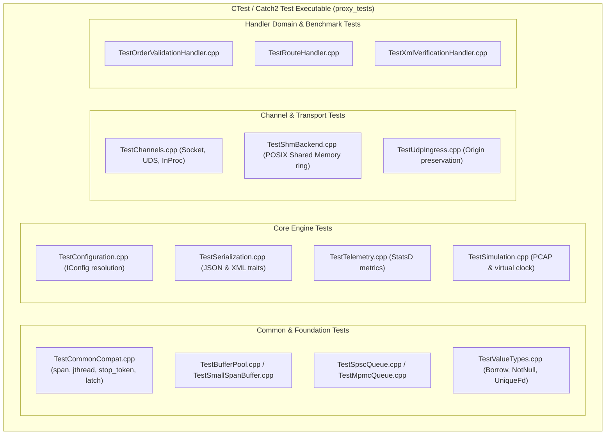

# Testing Architecture & Catch2 Framework Guide

## 1. Overview & Problem Statement

### Why It's Needed
In an asynchronous, low-latency messaging framework with multi-threaded execution models, POSIX shared memory, and hardware polling drivers, testing presents unique challenges:
- **Flaky Integration Tests**: Relying on wall-clock sleeps or real network interfaces creates race conditions and unpredictable test runs in CI environments.
- **Hidden Memory Corruptions**: Multi-channel handlers passing spans and raw pointers need strict memory isolation checks to detect buffer overruns or use-after-free conditions.
- **Benchmarking Hot-Paths**: Developers need immediate feedback on the nanosecond impact of memory copies, in-place DOM parsing, and lock-free queue contention.

### The Solution
The test architecture uses **Catch2 (v3.8.0)** integrated with CTest and CMake presets. Catch2 provides:
- Expressive BDD-style (`SCENARIO`, `GIVEN`, `WHEN`, `THEN`) and procedural (`TEST_CASE`, `SECTION`) test structures.
- Tag-based execution filtering (e.g. `[shm]`, `[order_validation]`, `[benchmark]`).
- Native sub-microsecond microbenchmarking macros (`BENCHMARK`).
- Clean integration with our zero-dependency C++17 compatibility polyfills (`Common::Compat`) and in-memory mock channels.

---

## 2. Testing Architecture & Test Suite Organization



---

## 3. Working with Catch2 in the Codebase

### Test Target Configuration (`test/CMakeLists.txt`)
All C++ test files are compiled into a unified executable (`proxy_tests`) that links against `Catch2::Catch2WithMain`:

```cmake
find_package(Catch2 3 REQUIRED)

file(GLOB_RECURSE TEST_SOURCES CONFIGURE_DEPENDS
    "${CMAKE_CURRENT_SOURCE_DIR}/*.cpp"
)

add_executable(proxy_tests ${TEST_SOURCES})
target_link_libraries(proxy_tests PRIVATE
    Catch2::Catch2WithMain
    common
    core
    proxylog
    backend-interface
    backend-inproc
    backend-file
    backend-socket
    backend-uds
    backend-shm
    backend-sim
)
```

### Pattern 1: Unit Testing with `SECTION` Isolation
Catch2 re-executes the `TEST_CASE` from the beginning for every `SECTION`, ensuring completely isolated fixtures:

```cpp
#include <catch2/catch_test_macros.hpp>
#include "common/queue/SpscQueue.hpp"

TEST_CASE("SpscQueue basic push and pop semantics", "[queue][spsc]")
{
    Common::Queue::SpscQueue<int, 4> queue;

    SECTION("Empty queue behavior") {
        REQUIRE(queue.empty());
        REQUIRE(queue.size() == 0);
        REQUIRE_FALSE(queue.pop().has_value());
    }

    SECTION("Pushing elements up to capacity") {
        REQUIRE(queue.push(10));
        REQUIRE(queue.push(20));
        REQUIRE(queue.push(30));
        REQUIRE(queue.size() == 3);

        // Pop elements in FIFO order
        auto val = queue.pop();
        REQUIRE(val.has_value());
        REQUIRE(*val == 10);
    }
}
```

### Pattern 2: Testing Handlers with `SimulationBackend`
Instead of spinning up physical network sockets, handlers are tested in-memory by injecting `Core::Simulation::SimulationBackend`:

```cpp
#include <catch2/catch_test_macros.hpp>
#include "handler/order_validation_handler/OrderValidationHandler.hpp"
#include "core/simulation/SimulationBackend.hpp"
#include "backend/MessageEnvelope.hpp"
#include "backend/MessageView.hpp"

TEST_CASE("OrderValidationHandler rejects malformed orders", "[handler][order]")
{
    Core::Simulation::SimulationBackend backend;
    Proxy::Handler::OrderValidationHandler handler(backend);

    Core::Config::Configuration config;
    config.set("order.input_channel", "orders_in");
    config.set("order.output_channel", "orders_out");
    REQUIRE(handler.configure(config));

    // Construct an invalid raw payload (negative price)
    std::string invalidXml = "<Order><orderId>1</orderId><price>-5.0</price><quantity>10</quantity><symbol>AAPL</symbol></Order>";
    auto envelope = Backend::MessageEnvelope::packRaw(Common::Memory::ByteView(invalidXml));

    auto view = Backend::MessageView::from(envelope);
    REQUIRE(view.has_value());

    // Process message and assert outcome
    auto result = handler.onMessageReceived("orders_in", *view);
    REQUIRE(std::holds_alternative<Backend::Dropped>(result));
    
    auto dropped = std::get<Backend::Dropped>(result);
    CHECK(dropped.reason.find("price") != std::string::npos);
}
```

### Pattern 3: Catch2 Micro-Benchmarking (`catch_benchmark.hpp`)
Catch2 provides advanced statistical benchmarking with warm-ups and variance estimation:

```cpp
#include <catch2/catch_test_macros.hpp>
#include <catch2/benchmark/catch_benchmark.hpp>
#include "handler/order_validation_handler/OrderValidationHandler.hpp"

TEST_CASE("Benchmark order parsing hot path", "[benchmark][order]")
{
    std::string validXml = "<Order><orderId>99</orderId><price>150.25</price><quantity>1000</quantity><symbol>MSFT</symbol></Order>";

    BENCHMARK("Zero-copy OrderView Parsing") {
        return Proxy::Handler::OrderValidationHandler::validateFast(validXml);
    };
}
```

---

## 4. How to Execute Tests

### Running Catch2 Tests via CMake Presets:
```bash
# 1. Compile test targets
cmake --build --preset debug --target proxy_tests

# 2. Run all tests via CTest
ctest --preset debug --output-on-failure

# 3. Run Catch2 binary directly with tag filtering
./build/debug/bin/proxy_tests "[queue]"

# 4. Run benchmarks only
./build/release/bin/proxy_tests "[benchmark]" --benchmark-samples 100
```

