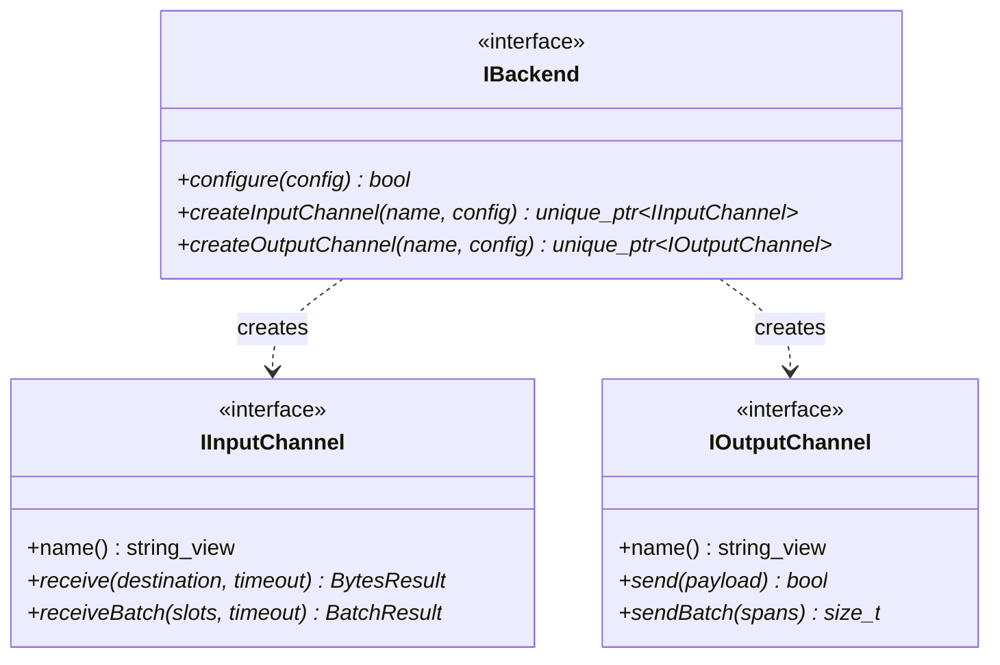
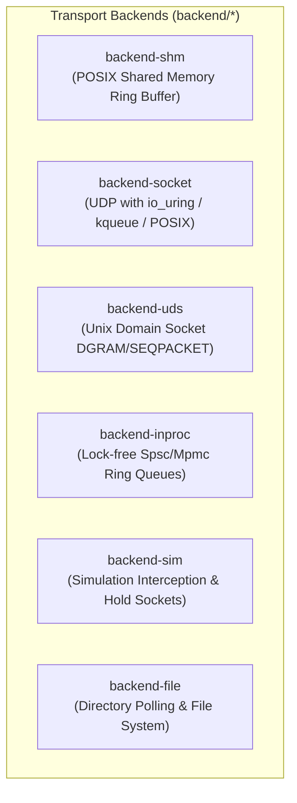

# Transport Layer & Channel Abstractions

## 1. Overview & Objectives
The transport layer (`backend/`) defines the communication substrate for the Proxy ecosystem. It abstracts the physical or operating-system-level mechanism of passing binary buffers between handlers, providing:
1. **Interface Segregation**: Clean separation between receiving (`IInputChannel`), sending (`IOutputChannel`), and transport configuration (`IBackend`).
2. **Batch Ingress & Vectorization**: Native support for passing batches of buffers (`BufferSlot`) to minimize system call overhead.
3. **Pluggable Transports**: Uniform behavior across Shared Memory (`shm`), Network UDP (`socket`), Unix Domain Sockets (`uds`), In-Process ring buffers (`inproc`), Files (`file`), and Simulation (`sim`).

---

## 2. Core Interfaces

### `IInputChannel`
- **`receive(destination, timeout)`**: Receives a single datagram into a caller-provided destination span.
- **`receiveBatch(slots, timeout)`**: Populates a span of `BufferSlot` instances in a single polling pass (using `recvmmsg` or sequential ring reads), returning a strongly-typed `BatchResult`.
- **Ownership of Name**: Every channel owns its canonical name string view, simplifying metrics reporting and logging.

### `IOutputChannel`
- **`send(payload)`**: Transmits a raw byte span (typically an encoded `MessageEnvelope`).
- **`sendBatch(spans)`**: Vectorized transmission for high-throughput batch bursts.

### `IBackend`
- Factory interface responsible for instantiating concrete channel pairs according to configuration keys (e.g. `channel.<name>.path`, `channel.<name>.port`).

---

## 3. Concrete Transport Implementations

### 1. `backend-shm` (POSIX Shared Memory)
- **Use Case**: Inter-process communication on a single host requiring sub-microsecond latency.
- **Implementation**: Circular ring buffer (`ShmRingBuffer`) mapped in `/dev/shm`.
- **Synchronization**: Lock-free atomic indices (`writeIndex`, `readIndex`) separated across 64-byte hardware cache lines, coupled with `ShmSignaler` for adaptive spinning and futex sleeping.

### 2. `backend-socket` (Network UDP)
- **Use Case**: Cross-host distributed messaging and external gateway ingress/egress.
- **Implementation**: Non-blocking UDP sockets paired with `ISocketPoller`.
- **Multiplexing**: Automatically utilizes Linux `io_uring`, macOS/BSD `kqueue`, or POSIX `recvmmsg` to drain batches of datagrams in a single kernel boundary crossing.

### 3. `backend-uds` (Unix Domain Sockets)
- **Use Case**: Local inter-process communication requiring OS permission enforcement and filesystem socket paths without raw memory mapping.
- **Implementation**: Datagram-oriented domain sockets (`AF_UNIX`, `SOCK_DGRAM`) with buffer management.

### 4. `backend-inproc` (In-Process Queues)
- **Use Case**: High-speed monolithic benchmarking or single-process deployment where multi-process isolation is not required.
- **Implementation**: Direct memory transfers over lock-free single-producer single-consumer queues (`Common::Queue::SpscQueue`).

### 5. `backend-sim` (Interactive Simulation)
- **Use Case**: Step-by-step interactive visual simulation and deterministic trace testing.
- **Implementation**: Emits exact `MessageResult` events over `/tmp/proxy_sim_events.sock` and diverts forwarded messages into channel-specific hold sockets (`/tmp/proxy_sim_hold_<channel>.sock`), allowing the Python coordinator to pause and step traffic.

### 6. `backend-file` (Directory / File Queue)
- **Use Case**: Offline debugging, audit recording, and file-based batch ingestion.
- **Implementation**: Output channels write sequentially numbered files to a directory; input channels poll directories for new incoming payloads.

---

## 4. Architectural Trade-offs & Decisions

| Transport | Latency | Throughput | Process Isolation | Operational Complexity |
| :--- | :--- | :--- | :--- | :--- |
| **`shm`** | **< 1 µs** | **> 10M msg/s** | Process Isolated | Requires shared memory segment management (`/dev/shm`). |
| **`inproc`** | **< 200 ns** | **> 20M msg/s** | Monolithic (Single Process) | None (memory managed within process). |
| **`socket`** | **5 – 15 µs** | **~ 1-2M msg/s** | Distributed (Network) | Requires UDP port allocation and network tuning. |
| **`uds`** | **2 – 6 µs** | **~ 3-5M msg/s** | Process Isolated | Requires filesystem socket cleanup on crash. |
| **`sim`** | **N/A (Stepped)** | **Stepped** | Multi-Process / Stepped | Requires Python simulation server. |

