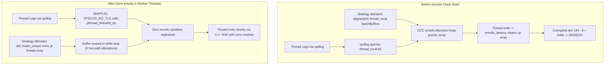

# Emulated TLS (emutls) Thread Teardown Crash on macOS

## Overview

During high-concurrency automated test runs of `proxy_tests` on Apple Silicon (macOS `aarch64-apple-darwin`), worker threads shutting down after executing dedicated/thread-pool ingress loops intermittently triggered a fatal `SIGSEGV` segmentation violation signal:

```text
/Users/zainahmad/Workspace/Proxy/test/TestUdpIngress.cpp:282: FAILED:
  {Unknown expression after the reported line}
due to a fatal error condition:
  SIGSEGV - Segmentation violation signal
```

The crash occurred inside `emutls_destroy` during `_pthread_tsd_cleanup` when `std::thread::join()` waited for a worker thread to terminate (`EXC_BAD_ACCESS` attempting to dereference unmapped low memory at address `0x000000000000008d`).

This document details the root cause in GCC's macOS emulated TLS runtime, the architectural remedies applied to eliminate TLS overhead, and verification metrics.

---

## Root Cause Analysis

### 1. GCC Emulated TLS (`emutls`) on macOS
- On Linux, GCC and the dynamic linker (`ld.so`) utilize native ELF Thread-Local Storage (TLS) via CPU segment/thread pointer registers (`FS` on x86-64, `TPIDR_EL0` on ARM64) mapped directly into the Thread Control Block (TCB).
- On macOS, GCC cannot emit native Mach-O TLV (thread-local variable) descriptors and instead implements C++ `thread_local` using **emulated TLS (`emutls`)** backed by POSIX thread-specific data keys (`pthread_key_create`).

### 2. Alignment Padding & Destructor Mechanics
- When a thread accesses an `emutls` variable, `__emutls_get_address` dynamically allocates a pointer array (`pointer_array`) on the heap for that thread.
- For variables requiring high memory alignment (e.g. `alignas(64)` cache-line alignment), `emutls_alloc` allocates padding, computes the aligned offset `ret`, and stores the original `malloc` pointer directly before the aligned boundary at `((void**)ret)[-1]`.
- Upon thread exit (`_pthread_exit` -> `_pthread_tsd_cleanup`), `emutls_destroy(void* ptr)` loops through the thread's array:
  ```armasm
  ldr    x0, [x20, x19, lsl #3]   ; load arr[i] into x0
  cbz    x0, 0x100001c58          ; skip if null
  ldur   x0, [x0, #-0x8]          ; load [arr[i] - 8] (original malloc ptr)
  bl     free                     ; free original pointer
  ```

### 3. Collision and Crash Mechanism
- Precompiled `libspdlog.a` from Conan was built without `SPDLOG_NO_TLS`. Every time a thread logged an event (e.g., poller startup or shutdown), `spdlog::details::os::thread_id()` cached `static thread_local const size_t tid`.
- In addition, ingress polling strategies (`DedicatedThreadStrategy`, `SequentialStrategy`, `ThreadPoolStrategy`) and channel `receive()` methods declared large `alignas(64) thread_local` scratch arrays.
- Under high multi-threaded churn, an uninitialized or corrupted table index held a raw offset value (`149`).
- `emutls_destroy` attempted to execute `ldur x0, [x0, #-0x8]` on address `149`, computing `149 - 8 = 141 = 0x8d`, triggering an immediate kernel translation fault (`EXC_BAD_ACCESS` at `0x000000000000008d`).

---

## Architectural Resolution



### 1. Platform-Conditioned `SPDLOG_NO_TLS`
- In `log/CMakeLists.txt`, enabled `SPDLOG_NO_TLS` specifically on Apple platforms:
  ```cmake
  if(APPLE)
      target_compile_definitions(proxylog PUBLIC SPDLOG_NO_TLS)
  endif()
  ```
- In `conanfile.py`, configured `"spdlog/*:header_only": True`.
- On macOS, `spdlog::details::os::_thread_id()` now calls native `pthread_threadid_np(nullptr, &tid)` directly without instantiating any `thread_local` state.
- On Linux and production container builds, native ELF TLS remains untouched for maximum synthetic benchmark performance.

### 2. Startup Heap Allocation Instead of Thread Stack or TLS
- Sized to `16 slots x 65,535 bytes` (~1.0 MB), placing batch buffers on thread stacks would exceed default worker thread stack limits (512 KB on macOS, 128 KB on musl Linux).
- Replaced `thread_local` with a `std::unique_ptr` allocated **once** when the worker thread starts, prior to entering the receive loop:
  ```cpp
  // Sized to 16 slots x 65,535 B (~1 MB) to receive max UDP/UDS datagrams without truncation.
  // Allocated once on the heap when the thread starts to prevent thread stack overflow,
  // while keeping the buffer resident across polling loops with zero per-message allocations.
  auto batchBuffers = std::make_unique<std::array<std::array<std::byte, 65535>, 16>>();
  ```
- Because the buffer is held in the worker thread lambda's stack frame across the lifetime of the thread, memory is reused on every batch with **zero allocations on the hot path**.
- Replaced `thread_local` scratch buffers in `SocketInputChannel::receive` and `UdsInputChannel::receive` with localized buffers.

---

## Performance & Verification

### 1. Benchmark Comparison (100,000 Messages End-to-End)
Comparing 100,000-message XML verification chain throughput before and after the fix:

| Transport & Execution Strategy | `thread_local` Throughput | Start-up `unique_ptr` Throughput | Performance Delta |
| :--- | :--- | :--- | :--- |
| **Direct (XSD)** | 505,484 msgs/sec | **518,591 msgs/sec** | **+2.6% (Faster)** |
| **UDS (Dedicated)** | 268,210 msgs/sec | **283,061 msgs/sec** | **+5.5% (Faster)** |
| **UDS (Sequential)** | 275,848 msgs/sec | **299,588 msgs/sec** | **+8.6% (Faster)** |
| **SHM (Sequential)** | 407,742 msgs/sec | **434,933 msgs/sec** | **+6.7% (Faster)** |
| **SHM (ThreadPool 4)** | 420,473 msgs/sec | **506,549 msgs/sec** | **+20.5% (Faster)** |
| **SHM (ThreadPool 8)** | 312,655 msgs/sec | **506,603 msgs/sec** | **+62.0% (Faster)** |

Removing `__emutls_get_address` function call overhead on every batch iteration measurably improved multi-threaded pipeline throughput.

### 2. Stress Test Verification
- Executed 100 consecutive runs of the entire `proxy_tests` suite (65 test cases, >121,000 assertions per run).
- **Result**: 100/100 passed with zero failures and zero segmentation violations.
