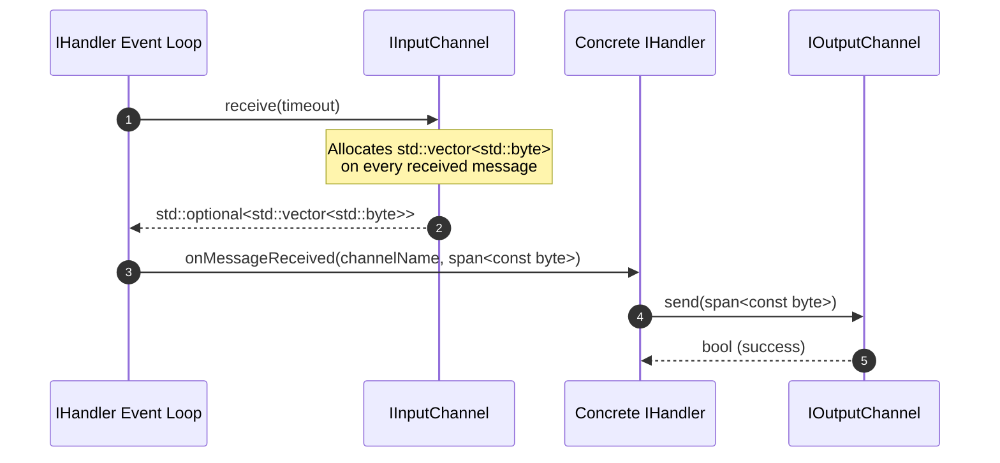
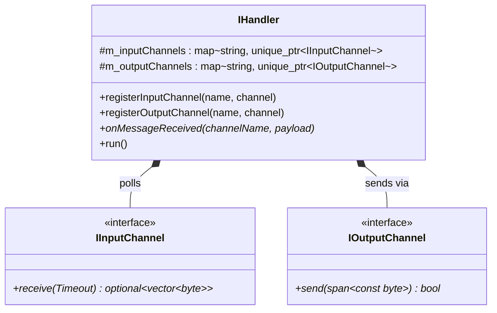

# 001: Initial Value-Copied Buffers & Multi-Channel Chaining

## 1. Overview & Problem Statement

### Why It's Needed
In the earliest stage of the Proxy project (`72cff56` – `fe3bad3`), the primary objective was to establish a clean, backend-agnostic handler abstraction capable of receiving messages from one or more input endpoints, executing domain logic, and transmitting messages to one or more output endpoints across different transports (`backend/file` and `backend/socket`).

At this stage, there was no standardized wire framing, batching, or zero-copy memory management. The system needed a simple, value-oriented channel interface that decoupled concrete handlers (`PrintHandler`, `DummySendHandler`, `DummyReceiveHandler`, `SplitHandler`, `MergeHandler`) from the underlying transport mechanisms.

---

## 2. Architecture & How It Works

### 2.1 Early Value-Copied Data Flow



### 2.2 Class Relationships



---

## 3. Design Decisions

### 3.1 Value-Returning `IInputChannel::receive(Timeout)`
- **Decision**: `IInputChannel::receive()` returned `std::optional<std::vector<std::byte>>`, where `std::nullopt` represented either a timeout or an error.
- **Rationale**: Provided self-contained buffer ownership for early prototyping without requiring callers to manage buffer lifecycles or maximum datagram sizes.
- **Trade-offs**: Incurred a dynamic heap allocation (`std::vector<std::byte>`) per received message and could not distinguish between normal idle timeouts and fatal channel errors.

### 3.2 Naked Application Payloads on the Wire
- **Decision**: Channels transmitted and received raw application bytes directly without a framing header.
- **Rationale**: Kept initial file and UDP socket implementations trivial and human-readable on disk.
- **Trade-offs**: Origin metadata (such as client UDP IP/port), ingress timestamps, and protocol identifiers were lost as soon as a message crossed a handler boundary.

### 3.3 String-Keyed Channel Maps in `IHandler`
- **Decision**: `IHandler` stored input and output channels in associative containers keyed by channel name (`std::string`), and handlers invoked `send(channelName, payload)`.
- **Rationale**: Simplified multi-channel routing in `SplitHandler` (1-to-N fan-out) and `MergeHandler` (N-to-1 fan-in).
- **Trade-offs**: Required hash/tree map lookups on the hot egress path.

---

## 4. Concrete Examples

### 4.1 Early `IInputChannel` & `IOutputChannel` Usage
```cpp
// Polling inside the early IHandler loop:
for (auto& [name, channel] : m_inputChannels) {
    if (auto data = channel->receive(timeout)) {
        onMessageReceived(name, *data);
    }
}

// Sending inside SplitHandler:
void SplitHandler::onMessageReceived(
    std::string_view channelName,
    std::span<const std::byte> message)
{
    for (const auto& outName : m_outputChannelNames) {
        send(outName, message);
    }
}
```

---

## 5. Tasks / Checklist

- [x] Define `Backend::IInputChannel`, `Backend::IOutputChannel`, and `Backend::IBackend` in `backend/interface`.
- [x] Implement `FileBackend` (`backend/file`) and `SocketBackend` (`backend/socket`).
- [x] Implement multi-channel registration in `Core::Handler::IHandler`.
- [x] Implement `PrintHandler`, `DummySendHandler`, `DummyReceiveHandler`, `SplitHandler`, and `MergeHandler`.

