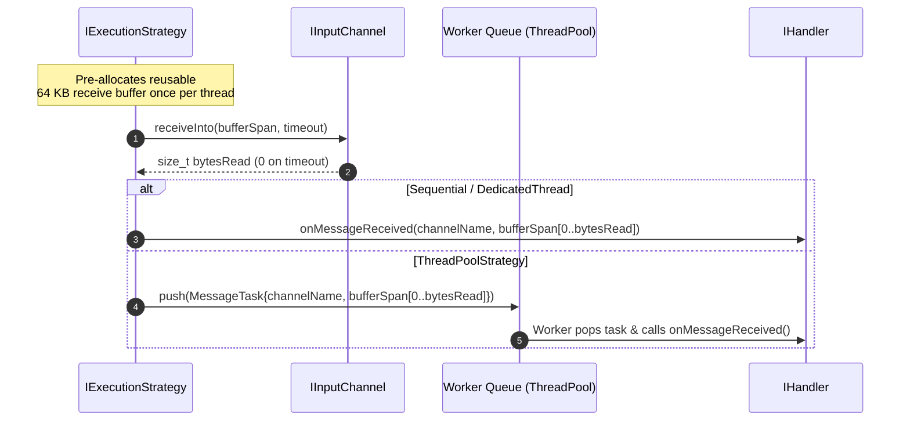

# 002: Pluggable Execution Strategies & Zero-Allocation Ingress

## 1. Overview & Problem Statement

### Why It's Needed
As message rates increased (`f4630b8` – `b6f8738`), two bottlenecks emerged in the initial messaging design:
1. **Per-Message Heap Allocations**: `IInputChannel::receive()` allocated a new `std::vector<std::byte>` on every datagram, causing allocator contention under multi-threaded load.
2. **Hardcoded Single-Threaded Loop**: `IHandler` directly owned the polling loop, preventing handlers from scaling across multiple cores or isolating slow validation work from socket draining.

 Furthermore, early multi-threading attempts that enqueued `std::function<void()>` closures into a work queue suffered from type-erasure heap allocations on every message.

### The Solution
1. **Caller-Provided Destination Buffers (`receiveInto`)**: Introduced `IInputChannel::receiveInto(std::span<std::byte> destination, Timeout)` so execution strategies could reuse pre-allocated stack or thread-local buffers across reads.
2. **Pluggable `IExecutionStrategy`**: Extracted concurrency orchestration into `SequentialStrategy`, `DedicatedThreadStrategy`, and `ThreadPoolStrategy`.
3. **Typed `MessageTask` Queue**: Replaced `std::function<void()>` closures with a dedicated `Core::Threading::MessageTask` type carrying the channel identifier and message bytes.

---

## 2. Architecture & How It Works

### 2.1 Zero-Allocation Ingress Flow



---

## 3. Design Decisions

### 3.1 `IInputChannel::receiveInto()` Over Value Allocation
- **Decision**: Add `virtual std::size_t receiveInto(std::span<std::byte> destination, Timeout timeout)` to `IInputChannel` and later invert the hierarchy (`f29dc3c`) so `receiveInto` is the primary pure virtual method.
- **Rationale**: Allows the caller (execution strategy) to allocate a 65,535-byte buffer once at thread startup and reuse it indefinitely with zero heap allocations on the hot path.

### 3.2 Concrete `MessageTask` Instead of `std::function<void()>`
- **Decision**: Introduce `Core::Threading::MessageTask` as the element type of the thread-pool work queue.
- **Rationale**: Capturing a `std::vector<std::byte>` inside a lambda and wrapping it in `std::function<void()>` exceeded `std::function`'s small-object buffer, triggering a second heap allocation per message. A concrete `MessageTask` struct enabled pre-allocated ring buffers and inline storage optimizations.

---

## 4. Concrete Examples

### 4.1 Reusable Buffer Polling in `SequentialStrategy`
```cpp
std::vector<std::byte> receiveBuffer(65536);

while (m_running.load(std::memory_order_relaxed)) {
    for (auto& [name, channel] : handler.inputChannels()) {
        std::size_t bytesRead = channel->receiveInto(receiveBuffer, timeout);
        if (bytesRead > 0) {
            std::span<const std::byte> view(receiveBuffer.data(), bytesRead);
            handler.onMessageReceived(name, view);
        }
    }
    handler.step();
}
```

---

## 5. Tasks / Checklist

- [x] Extract `Core::Threading::IExecutionStrategy` with `SequentialStrategy`, `DedicatedThreadStrategy`, and `ThreadPoolStrategy`.
- [x] Add `IInputChannel::receiveInto(std::span<std::byte>, Timeout)` across all transport backends.
- [x] Replace `std::function<void()>` queue items with `Core::Threading::MessageTask`.
- [x] Add multi-strategy benchmark suite to measure ingress throughput.

