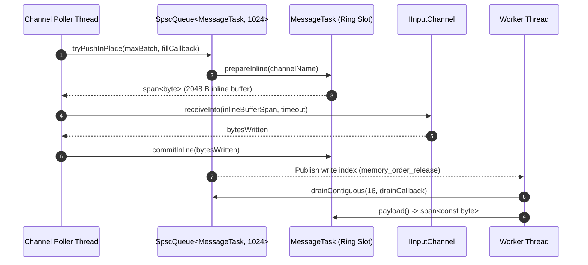

# 003: Small Buffer Optimization (SBO) & In-Place Ring Slot Ingress

## 1. Overview & Problem Statement

### Why It's Needed
Even after introducing `receiveInto()` and `MessageTask` (`f8a7cc8` – `6647594`), `ThreadPoolStrategy` still incurred heap allocations and extra memory copies when passing messages from channel poller threads to worker threads:
1. `MessageTask` initially held a `std::vector<std::byte>`, allocating heap memory when constructed unless ring slots reused capacity.
2. Channel pollers read datagrams into a temporary stack buffer and then copied them (`std::memcpy`) into the `MessageTask` inside the worker queue.
3. A single mutex-guarded work queue shared across all pollers and workers created lock contention under high message rates.

### The Solution
1. **Inline Small Buffer Optimization (`SmallBufferSize = 2048`)**: Embedded a fixed `std::array<std::byte, 2048>` inside `MessageTask` so standard MTU packets never touch the heap.
2. **In-Place Ring Slot Preparation (`prepareInline` / `commitInline`)**: Allowed channel pollers to obtain a writable span pointing directly into the ring buffer's next available `MessageTask::m_inlineBuffer`, reading from the OS socket straight into the queue slot with zero intermediate copies.
3. **Partitioned Per-Worker SPSC Queues**: Replaced the single mutex queue with lock-free per-worker `SpscQueue<MessageTask, 1024>` instances.

---

## 2. Architecture & How It Works

### 2.1 Zero-Copy In-Place Slot Ingress



---

## 3. Design Decisions

### 3.1 2,048-Byte Inline Buffer (`SmallBufferSize`)
- **Decision**: Size `MessageTask::m_inlineBuffer` to 2,048 bytes (`core/include/core/threading/MessageTask.hpp`).
- **Rationale**: Standard Ethernet MTU is 1,500 bytes, and typical financial/control-plane XML or binary messages are 100–1,024 bytes. A 2,048-byte inline buffer covers >99% of messages without heap allocation while keeping a 1,024-slot ring buffer compact (~2 MB per worker).

### 3.2 Two-Phase In-Place Write (`prepareInline` + `commitInline`)
- **Decision**: Expose `prepareInline(channelName)` returning a mutable `Common::Compat::span<std::byte>` of size `SmallBufferSize`, followed by `commitInline(size)` once the channel read completes.
- **Rationale**: Eliminates the intermediate bounce buffer in unconstrained `ThreadPoolStrategy` polling. The kernel `recvfrom` / `recvmmsg` writes directly into the `SpscQueue` slot memory.

---

## 4. Concrete Examples

### 4.1 `MessageTask` In-Place API (`core/include/core/threading/MessageTask.hpp`)
```cpp
Common::Compat::span<std::byte> MessageTask::prepareInline(std::string_view name)
{
    if (m_channelName != name) {
        m_channelName = name;
    }
    return Common::Compat::span<std::byte>(m_inlineBuffer.data(), m_inlineBuffer.size());
}

void MessageTask::commitInline(std::size_t size) noexcept
{
    m_inlineSize = std::min(size, SmallBufferSize);
    m_pooledSlice.reset();
    m_heapBuffer.clear();
}
```

---

## 5. Tasks / Checklist

- [x] Add 2,048-byte inline SBO buffer to `Core::Threading::MessageTask`.
- [x] Implement `prepareInline()` and `commitInline()` on `MessageTask`.
- [x] Implement lockless `SpscQueue::tryPushInPlace` and `drainContiguous` for zero-copy producer-to-consumer handoff.
- [x] Partition `ThreadPoolStrategy` queues per worker thread.

