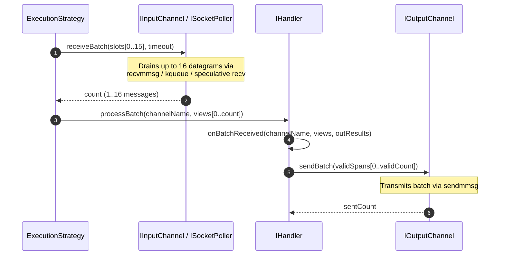

# 004: Vectorized Batch Ingress & Egress (`receiveBatch` / `sendBatch`)

## 1. Overview & Problem Statement

### Why It's Needed
Single-message polling and transmission (`receiveInto` and `send`) required at least one system call and one virtual function dispatch per datagram (`dec0119` – `f6f16cd`). Under bursts of 100,000+ messages/second over UDP (`backend/socket`) or Unix Domain Sockets (`backend/uds`), kernel boundary crossings dominated CPU time.

### The Solution
1. **Vectorized Ingress (`IInputChannel::receiveBatch` & `ISocketPoller::receiveBatch`)**: Drain up to 16 datagrams per poll cycle using Linux `::recvmmsg`, macOS/BSD `kqueue` multi-event draining, or speculative non-blocking `::recv` loops.
2. **Vectorized Egress (`IOutputChannel::sendBatch`)**: Transmit batches of message spans in a single call (using `::sendmmsg` on Linux or tight non-blocking loops on POSIX/macOS).
3. **Batched Handler Callbacks (`IHandler::onBatchReceived` & `processBatch`)**: Allow handlers (`SplitHandler`, `MergeHandler`, `XmlVerificationHandler`, `OrderValidationHandler`) to validate and forward an entire batch of messages at once.

---

## 2. Architecture & How It Works

### 2.1 Vectorized Batch Pipeline



---

## 3. Design Decisions

### 3.1 Speculative Non-Blocking Burst Drain
- **Decision**: When the first message arrives (after waiting up to `timeout`), socket and ring-buffer channels immediately attempt to drain up to `slots.size() - 1` additional ready messages using `MSG_DONTWAIT` (zero timeout) before returning.
- **Rationale**: Under low load (1 message ready), latency is identical to single-message mode because the first message returns immediately after a single non-blocking check. Under burst load, up to 16 messages are amortized across a single wakeup.

### 3.2 Backwards-Compatible Default Implementations
- **Decision**: `IInputChannel::receiveBatch` and `IOutputChannel::sendBatch` provide default implementations that iterate over single-message `receiveSlot` / `send`, while `IHandler::onBatchReceived` defaults to iterating over `onMessageReceived`.
- **Rationale**: Simple transports (`backend/file`, `backend/vendor`) and simple handlers (`PrintHandler`, `DummyReceiveHandler`) only need to implement the single-message primitive while still participating seamlessly in batched execution strategies.

---

## 4. Concrete Examples

### 4.1 Batched Validation & Egress in `XmlVerificationHandler`
```cpp
void XmlVerificationHandler::onBatchReceived(
    std::string_view channelName,
    Common::Compat::span<const Backend::MessageView> messages,
    Common::Compat::span<Backend::MessageResult> outResults)
{
    Common::Memory::SmallSpanBuffer spans(messages.size());
    std::size_t validCount = 0;

    for (std::size_t i = 0; i < messages.size(); ++i) {
        if (validate(messages[i].payload())) {
            spans[validCount++] = messages[i].rawBuffer();
            outResults[i] = Backend::Forwarded { .channel = m_outputChannel->name() };
        } else {
            outResults[i] = Backend::Dropped { "Rejected: XSD failure", 400 };
        }
    }

    if (validCount > 0 && m_outputChannel) {
        m_outputChannel->sendBatch(spans.span(validCount));
    }
}
```

---

## 5. Tasks / Checklist

- [x] Add `receiveBatch()` to `IInputChannel` and `ISocketPoller` (`PosixSocketPoller`, `KqueueSocketPoller`, `IoUringSocketPoller`).
- [x] Add `sendBatch()` to `IOutputChannel` with Linux `::sendmmsg` acceleration.
- [x] Add `onBatchReceived()` and `processBatch()` to `Core::Handler::IHandler`.
- [x] Override `onBatchReceived()` in `SplitHandler`, `MergeHandler`, `XmlVerificationHandler`, `OrderValidationHandler`, and `RouteHandler`.

