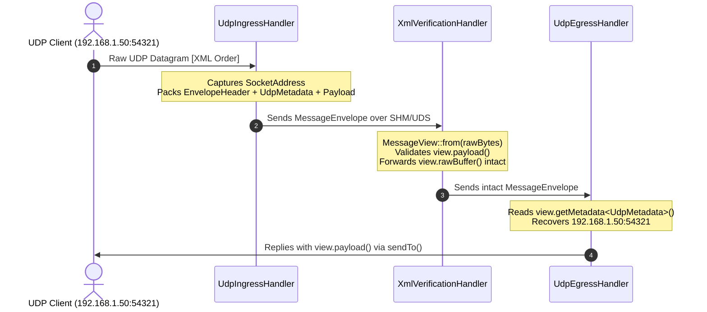

# 005: `MessageEnvelope`, `MessageView`, & Origin-Preserving Metadata

## 1. Overview & Problem Statement

### Why It's Needed
In multi-stage pipelines (`51f8fdb` – `5932201`), passing unframed application payloads across channels caused three architectural issues:
1. **Lost Network Provenance**: When `UdpIngressHandler` received a client UDP datagram and forwarded it through shared memory (`backend/shm`) or Unix domain sockets (`backend/uds`) to `OrderValidationHandler` and finally to `UdpEgressHandler`, the original client's IPv4/IPv6 address and source port were lost. `UdpEgressHandler` had no way to reply to the originating client.
2. **Missing End-to-End Latency Timestamps**: Without an ingress timestamp attached at the pipeline boundary, downstream handlers could not measure total transit and queueing age.
3. **Malformed Packet Detection**: Truncated or corrupted frames could not be rejected before invoking expensive XML/JSON parsers.

### The Solution
1. **`Backend::MessageEnvelope` & `EnvelopeHeader`**: Encapsulate every message in a binary wire envelope containing magic bytes (`0x5058`), version, `ProtocolId`, metadata length, payload length, and a 64-bit nanosecond ingress timestamp (`timestampNs`), followed by optional transport metadata (`UdpMetadata`) and the application payload.
2. **Non-Owning `Backend::MessageView`**: Provide a zero-copy view over an in-flight envelope exposing `.payload()`, `.metadata()`, `.rawBuffer()`, `.protocol()`, `.timestampNs()`, and typed `.getMetadata<T>()`.

---

## 2. Architecture & How It Works

### 2.1 Origin-Preserving Pipeline Flow



---

## 3. Design Decisions

### 3.1 Contiguous Single-Buffer Envelope Layout
- **Decision**: Store `[EnvelopeHeader][Metadata][Payload]` contiguously in a single byte span.
- **Rationale**: Allows intermediate handlers (`SplitHandler`, `MergeHandler`, `RouteHandler`, `XmlVerificationHandler`, `OrderValidationHandler`) to forward the entire message—including its original ingress timestamp and `UdpMetadata`—with a single `send(message.rawBuffer())` call without re-packing or copying metadata.

### 3.2 Zero-Copy `MessageView` in Handler Signatures
- **Decision**: Update `IHandler::onMessageReceived(std::string_view, const MessageView&)` and `onBatchReceived(..., span<const MessageView>, ...)` to pass `MessageView` by const reference/span.
- **Rationale**: `MessageView` holds lightweight non-owning `Common::Compat::span<const std::byte>` slices pointing directly into the channel's receive buffer. Parsing an envelope via `MessageView::from()` performs zero heap allocations.

---

## 4. Concrete Examples

### 4.1 Packing `UdpMetadata` at Ingress (`core/src/net/UdpInputChannel.cpp`)
```cpp
Backend::UdpMetadata meta {};
meta.srcPort = senderAddr.port();
meta.addressFamily = senderAddr.isIpv6() ? 6 : 4;
// ... populate IPv4/IPv6 bytes ...

std::size_t totalWritten = Backend::MessageEnvelope::packInto(
    slot.buffer,
    Backend::ProtocolId::Udp,
    Common::Compat::as_bytes(Common::Compat::span(&meta, 1)),
    Common::Compat::span<const std::byte>(rawDatagram.data(), bytesRead));
```

### 4.2 Replying to Origin at Egress (`handler/udp_egress_handler/src/UdpEgressHandler.cpp`)
```cpp
if (m_replyToOrigin && message.protocol() == Backend::ProtocolId::Udp) {
    if (const auto* meta = message.getMetadata<Backend::UdpMetadata>()) {
        const auto originAddr = (meta->addressFamily == 6)
            ? Backend::SocketAddress::fromIpv6Net(meta->srcIpv6, meta->srcPort)
            : Backend::SocketAddress::fromIpv4Net(meta->srcIp, meta->srcPort);
        m_udpOut->sendTo(message.payload(), originAddr);
        return Backend::Consumed {};
    }
}
```

---

## 5. Tasks / Checklist

- [x] Define `EnvelopeHeader`, `ProtocolId`, `UdpMetadata`, `MessageEnvelope`, and `MessageView`.
- [x] Implement `UdpInputChannel`, `UdpOutputChannel`, `UdpIngressHandler`, and `UdpEgressHandler`.
- [x] Update `IHandler::onMessageReceived` and `onBatchReceived` to accept `Backend::MessageView`.

