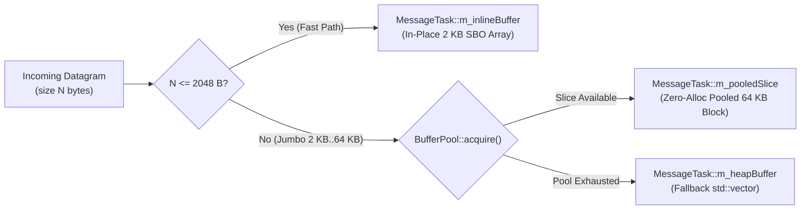

# 006: Zero-Copy Jumbo `BufferPool`, `MpmcQueue`, & Borrowed Channel Handles

## 1. Overview & Problem Statement

### Why It's Needed
In `ea14370` – `46bc3e6`, three performance and safety gaps remained in message handling:
1. **Jumbo Packet Heap Allocations**: While `MessageTask`'s 2,048-byte inline SBO buffer handled standard packets without allocation, jumbo datagrams (up to 64 KB) fell back to `std::vector<std::byte>` heap allocations on the poller thread.
2. **Head-of-Line Blocking in Non-FIFO Thread Pools**: When strict per-flow FIFO ordering was disabled, round-robin pushing to per-worker `SpscQueue`s could stall behind a single slow worker even when other workers were idle.
3. **Hot-Path String Lookups & Raw Pointers for Channels**: Handlers still held raw pointers or looked up output channels by string name (`send("channel_name", ...)`), risking dangling pointers or unnecessary hash lookups.

### The Solution
1. **Zero-Copy `BufferPool` & `BufferSlice`**: Added a lock-free pool of 64 KB blocks (`common/include/common/memory/BufferPool.hpp`). Jumbo messages acquire a `BufferSlice` that automatically returns its block to the pool when the `MessageTask` finishes or is overwritten.
2. **Lock-Free `MpmcQueue`**: Added a bounded multi-producer multi-consumer ring queue (`common/include/common/queue/MpmcQueue.hpp`) for unconstrained worker load balancing in `ThreadPoolStrategy`.
3. **Direct Channel Borrows (`Borrow<T>`, `ObserverPtr<T>`, `SmallSpanBuffer`)**: Removed string-keyed `send(channelName, ...)` from `IHandler`. `registerInputChannel()` and `registerOutputChannel()` return `Common::Memory::Borrow<T>`, and batched handlers construct span arrays on the stack via `Common::Memory::SmallSpanBuffer`.

---

## 2. Architecture & How It Works

### 2.1 Tiered Storage Inside `MessageTask`



---

## 3. Design Decisions

### 3.1 Three-Tier `MessageTask` Payload Storage
- **Decision**: `MessageTask::payload()` resolves in priority order: `m_inlineBuffer` (<= 2 KB) -> `m_pooledSlice` (pre-allocated 64 KB pool block) -> `m_heapBuffer` (fallback if all 256 pool blocks are simultaneously in flight).
- **Rationale**: Eliminates dynamic allocation for both normal MTU datagrams and 64 KB jumbo bursts while guaranteeing graceful degradation under extreme backpressure.

### 3.2 `Borrow<IOutputChannel>` & `SmallSpanBuffer`
- **Decision**: Delete `IHandler::send(std::string_view, ...)` and have handlers store `Common::Memory::Borrow<IOutputChannel>` or `ObserverPtr<IOutputChannel>` returned by `registerOutputChannel()`.
- **Rationale**: Enforces at compile time that channels are bound once during `onConfigure()` and accessed via direct pointer dereference on the hot path, while `SmallSpanBuffer<T, 64>` avoids heap-allocating `std::vector<span<const byte>>` during `onBatchReceived()`.

---

## 4. Concrete Examples

### 4.1 Acquiring a Pooled Slice for Jumbo Payloads (`core/src/threading/ThreadPoolStrategy.cpp`)
```cpp
if (msgSize > MessageTask::SmallBufferSize && bufferPool) {
    if (auto slice = bufferPool->acquire()) {
        std::memcpy(slice->data(), batchBuffer.data(), msgSize);
        task.assignSlice(channelName, std::move(*slice), msgSize);
    } else {
        task.assign(channelName, Common::Compat::span<const std::byte>(batchBuffer.data(), msgSize));
    }
} else {
    task.assign(channelName, Common::Compat::span<const std::byte>(batchBuffer.data(), msgSize));
}
```

---

## 5. Tasks / Checklist

- [x] Implement `Common::Memory::BufferPool` and RAII `BufferSlice`.
- [x] Integrate `BufferSlice` into `Core::Threading::MessageTask`.
- [x] Implement `Common::Queue::MpmcQueue` and integrate into `ThreadPoolStrategy`.
- [x] Introduce `Borrow<T>`, `ObserverPtr<T>`, `NotNull<T>`, and `SmallSpanBuffer` in `common/include/common/memory/`.
- [x] Remove string-based `send(channelName, ...)` from `IHandler`.

