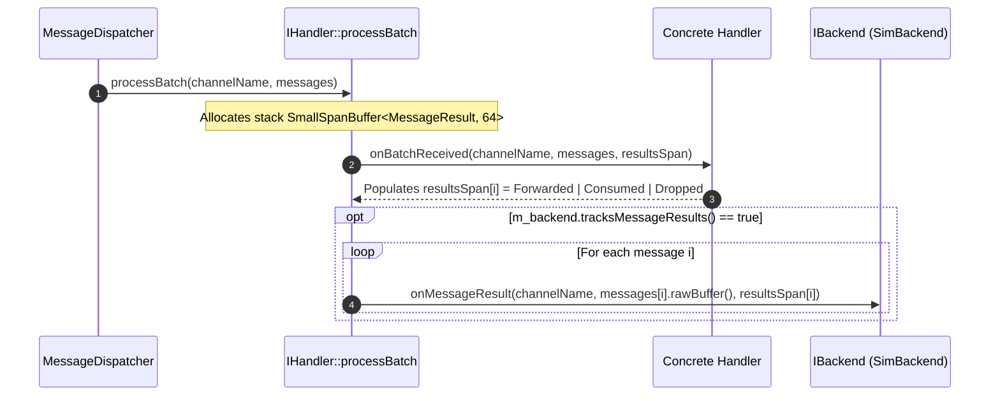

# 007: Strongly-Typed `MessageResult` & Simulation Trace Reporting

## 1. Overview & Problem Statement

### Why It's Needed
Prior to `cfef9c8` – `ec283dd`, `IHandler::onMessageReceived()` and `onBatchReceived()` returned `void`. Because the handler callback returned no structured outcome:
1. The framework could not distinguish whether a handler **forwarded** a message to a downstream channel, **consumed** it as a terminal sink, or **dropped/rejected** it due to validation failure.
2. The interactive simulation engine (`backend/sim`) and deterministic trace test suite could not report why a packet was dropped (e.g., `"Rejected: XSD schema validation failure"` with error code `400`) or which downstream channel received it.
3. Future transport settlement hooks had no outcome signal to decide whether an in-flight message succeeded or failed.

### The Solution
1. **`Backend::MessageResult` Variant**: Defined `Forwarded { std::string_view channel }`, `Consumed {}`, and `Dropped { std::string_view reason; int errorCode; }` unified under `MessageResult = Common::Types::Variant<Forwarded, Consumed, Dropped>`.
2. **Per-Message Batch Outcomes**: Updated `IHandler::onMessageReceived()` to return `MessageResult`, and updated `IHandler::onBatchReceived()` to populate a pre-allocated output span `Common::Compat::span<Backend::MessageResult> outResults`.
3. **Backend Outcome Hook (`IBackend::onMessageResult`)**: `IHandler::processBatch()` allocates `SmallSpanBuffer<MessageResult, 64>` on the stack, invokes `onBatchReceived()`, and reports each result to `m_backend.onMessageResult()` when `m_backend.tracksMessageResults()` is enabled.

---

## 2. Architecture & How It Works

### 2.1 `MessageResult` Dispatch Flow



---

## 3. Design Decisions

### 3.1 Zero-Overhead Stack Result Buffer in `processBatch`
- **Decision**: Use `Common::Memory::SmallSpanBuffer<Backend::MessageResult, 64>` inside `IHandler::processBatch()` and guard backend reporting behind `if (m_backend.tracksMessageResults())`.
- **Rationale**: Production backends (`shm`, `socket`, `uds`, `inproc`, `file`) return `false` from `tracksMessageResults()`, skipping the reporting loop completely, while stack allocation via `SmallSpanBuffer` ensures zero heap overhead for batch sizes up to 64.

---

## 4. Concrete Examples

### 4.1 `MessageResult` Definition (`backend/interface/include/backend/MessageResult.hpp`)
```cpp
namespace Backend {

struct Forwarded {
    std::string_view channel {};
};

struct Consumed {};

struct Dropped {
    std::string_view reason;
    int errorCode { 0 };
};

using MessageResult = Common::Types::Variant<Forwarded, Consumed, Dropped>;

} // namespace Backend
```

---

## 5. Tasks / Checklist

- [x] Define `Forwarded`, `Consumed`, `Dropped`, and `MessageResult` in `backend/interface/include/backend/MessageResult.hpp`.
- [x] Update `IHandler::onMessageReceived` and `onBatchReceived` across all handlers to return/populate `MessageResult`.
- [x] Add `tracksMessageResults()` and `onMessageResult()` to `Backend::IBackend` and implement in `SimBackend`.

