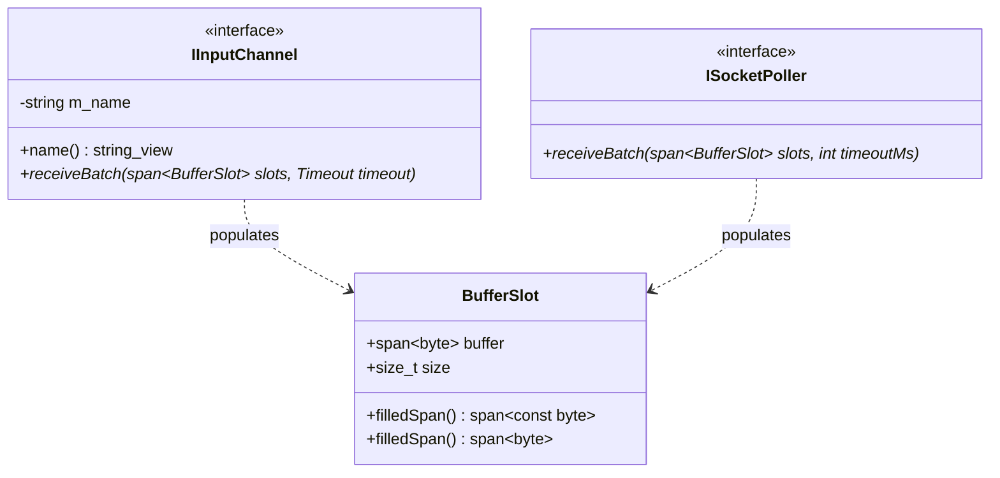

# 008: Cohesive `BufferSlot` & Channel Name Encapsulation

## 1. Overview & Problem Statement

### Why It's Needed
In `210c3db` – `26743a2`, vectorized batch receiving (`receiveBatch`) required callers to pass two separate parallel spans:
```cpp
std::size_t receiveBatch(
    std::span<const std::span<std::byte>> destinations,
    std::span<std::size_t> outSizes,
    Timeout timeout);
```
This parallel-array design had two drawbacks:
1. **Mismatched Span Lengths**: Callers had to manually maintain two separate arrays (`destinations` and `outSizes`) and keep their indices synchronized across pollers, strategies, and tests.
2. **No Per-Message Extensibility**: Adding any per-message ingress state (such as an out-of-band ownership `Lease`) would have required adding a third parallel span parameter to every channel and poller signature.

Additionally, channel names were stored externally in maps rather than owned by `IInputChannel` and `IOutputChannel` themselves.

### The Solution
1. **`Backend::BufferSlot`**: Consolidated the target buffer span and received byte count into a single cohesive struct (`backend/interface/include/backend/BufferSlot.hpp`) with `.filledSpan()` helpers.
2. **Channel-Owned Identity (`name()`)**: Encapsulated `m_name` inside `IInputChannel` and `IOutputChannel` base classes so channels carry their own canonical identity everywhere.

---

## 2. Architecture & How It Works

### 2.1 `BufferSlot` Batch Ingress



---

## 3. Design Decisions

### 3.1 Single Span of `BufferSlot`
- **Decision**: Replace `(destinations, outSizes)` with `Common::Compat::span<BufferSlot> slots` across `IInputChannel` and `ISocketPoller`.
- **Rationale**: Eliminates out-of-bounds mismatch bugs at compile time and provides an extensible per-message slot structure that later accommodated `BufferSlot::lease` without breaking batch signatures.

---

## 4. Concrete Examples

### 4.1 `BufferSlot` Usage in Polling Loops
```cpp
auto batchBuffers = std::make_unique<std::array<std::array<std::byte, 65535>, 16>>();
std::array<Backend::BufferSlot, 16> batchSlots;
for (std::size_t i = 0; i < 16; ++i) {
    batchSlots[i] = Backend::BufferSlot { Common::Memory::MutableByteView((*batchBuffers)[i]), 0 };
}

auto result = channel.receiveBatch(batchSlots, timeout);
```

---

## 5. Tasks / Checklist

- [x] Create `Backend::BufferSlot` in `backend/interface/include/backend/BufferSlot.hpp`.
- [x] Encapsulate `name()` in `IInputChannel` and `IOutputChannel`.
- [x] Refactor `IInputChannel::receiveBatch` and `ISocketPoller::receiveBatch` (`Posix`, `Kqueue`, `IoUring`) to take `span<BufferSlot>`.
- [x] Update all transport channels and execution strategies to use `BufferSlot`.

