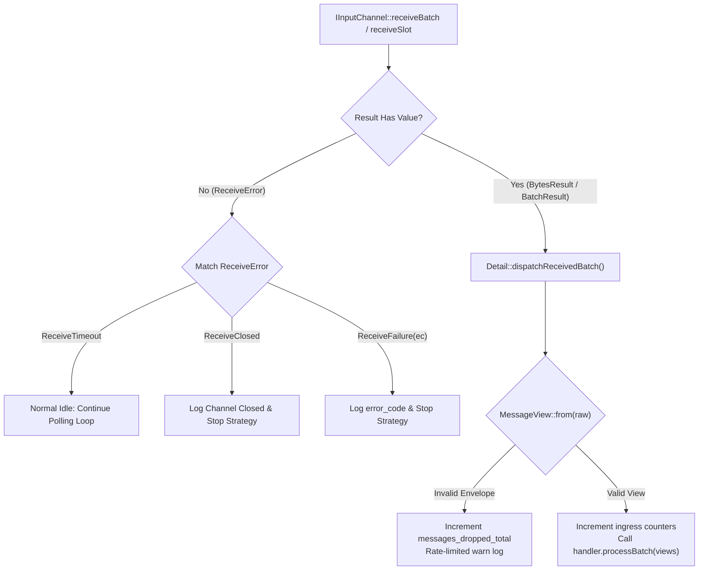

# 009: Centralized `MessageDispatcher` & Typed `ReceiveResult`

## 1. Overview & Problem Statement

### Why It's Needed
In `fa49b6e` – `0f51d56`, two reliability and observability problems existed in the ingress pipeline:
1. **Ambiguous Zero-Byte Return Values**: `IInputChannel::receiveInto()` and `receiveBatch()` returned `std::size_t`, using `0` for both normal idle timeouts and fatal channel errors (such as a closed socket, broken pipe, or uninitialized receiver). Execution strategies spun indefinitely on broken channels because they could not distinguish a timeout from a closed/faulted channel.
2. **Duplicated Envelope Validation & Double Latency Counting**: `SequentialStrategy`, `DedicatedThreadStrategy`, and `ThreadPoolStrategy` each duplicated `MessageView::from()` parsing, malformed drop counters, and ingress telemetry, and accidentally recorded `message_processing_duration_us` twice per message.

### The Solution
1. **Strongly-Typed `ReceiveResult` (`BytesResult` & `BatchResult`)**: Added `Backend::Result<T, E>` along with `ReceiveError = Common::Types::Variant<ReceiveTimeout, ReceiveClosed, ReceiveFailure>` and `ReceiveBatchFailure { std::size_t receivedCount; ReceiveError cause; }` (`backend/interface/include/backend/ReceiveResult.hpp`).
2. **Centralized `MessageDispatcher::dispatchReceivedBatch()`**: Consolidated all raw envelope validation, rate-limited malformed-envelope logging, ingress counters (`messages_ingress_total`, `bytes_ingress_total`, `messages_dropped_total`), and `handler.processBatch()` invocation into `core/src/threading/MessageDispatcher.cpp`.

---

## 2. Architecture & How It Works

### 2.1 Typed Receive Status & Centralized Dispatch



---

## 3. Design Decisions

### 3.1 Preserving Partial Reads in `ReceiveBatchFailure`
- **Decision**: When a batch drain reads $k > 0$ messages before encountering an error on read $k + 1$, `BatchResult` returns `ReceiveBatchFailure { .receivedCount = k, .cause = error }`.
- **Rationale**: Execution strategies first dispatch the $k$ already-received valid messages to `dispatchReceivedBatch()` so no in-flight data is lost, and then handle the terminal `cause`.

### 3.2 Single Telemetry Observation Boundary
- **Decision**: `MessageDispatcher::dispatchReceivedBatch()` owns ingress message/byte/drop counters, while `IHandler::processBatch()` owns `message_processing_duration_us` histogram observation.
- **Rationale**: Guarantees identical telemetry across `SimpleExecutionStrategy`, `SequentialStrategy`, `DedicatedThreadStrategy`, and `ThreadPoolStrategy`.

---

## 4. Concrete Examples

### 4.1 `ReceiveResult` Error Matching (`backend/interface/include/backend/ReceiveResult.hpp`)
```cpp
using ReceiveError = Common::Types::Variant<ReceiveTimeout, ReceiveClosed, ReceiveFailure>;
using BytesResult = Result<std::size_t, ReceiveError>;
using BatchResult = Result<std::size_t, ReceiveBatchFailure>;
```

---

## 5. Tasks / Checklist

- [x] Add `Result.hpp` and `ReceiveResult.hpp` to `backend/interface/include/backend/`.
- [x] Update `ISocketPoller` and all `IInputChannel` implementations to return `BytesResult` and `BatchResult`.
- [x] Create `Core::Threading::Detail::dispatchReceivedBatch` in `core/src/threading/MessageDispatcher.hpp` and `.cpp`.
- [x] Update all execution strategies to stop cleanly on `ReceiveClosed` / `ReceiveFailure` while treating `ReceiveTimeout` as normal idle.

