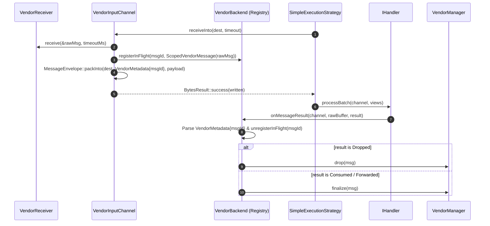

# 011: Vendor Backend PoC & In-Band Correlation Registry

## 1. Overview & Problem Statement

### Why It's Needed
When integrating the 3rd-party proprietary vendor transport SDK (`fcfe1d9` – `d2f9609`), a new class of message lifecycle constraints was introduced that differed fundamentally from buffer-owning OS transports (`shm`, `socket`, `uds`, `file`):
1. **External SDK Message Ownership**: The vendor SDK delivers an opaque `Sdk::VendorMessage` object via `VendorReceiver::receive(&msg, timeoutMs)`.
2. **Mandatory Lifecycle Finalization**: Each received `VendorMessage` must remain alive while the handler processes it and then be explicitly finalized (`vendorManager.finalize(msg)`) or dropped (`vendorManager.drop(msg)`).
3. **Envelope Unification in `backend/interface`**: Because `backend/*` targets depend only on `backend-interface` and `proxylog` (never `core`), `MessageEnvelope` and `MessageView` needed to live in `backend/interface` so `VendorInputChannel` could frame incoming payloads natively.

### The Initial PoC Solution (Superseded in 012)
In this first iteration:
1. Moved `MessageEnvelope`, `MessageView`, `EnvelopeHeader`, `ProtocolId`, `UdpMetadata`, and `MessageResult` into `backend/interface` under `namespace Backend`.
2. Wrapped each received `VendorMessage` in a move-only `ScopedVendorMessage` stored in a mutex-guarded `std::unordered_map<uint64_t, ScopedVendorMessage> m_inFlightMessages` inside `VendorBackend`.
3. Packed `VendorMetadata { uint64_t messageId }` into the 8-byte metadata section of the wire `MessageEnvelope`.
4. Overrode `VendorBackend::onMessageResult()` to re-parse the wire envelope after handler completion, extract `VendorMetadata::messageId`, remove the `ScopedVendorMessage` from `m_inFlightMessages`, and call `finalize()` or `drop()`.

---

## 2. Architecture & How It Works

### 2.1 In-Band Registry Lifecycle (Phase 11 PoC)



---

## 3. Design Decisions & Limitations Discovered

### 3.1 Unifying Framing Types in `backend/interface`
- **Decision**: Promote `MessageEnvelope`, `MessageView`, `EnvelopeHeader`, `ProtocolId`, `UdpMetadata`, and `MessageResult` from `core` to `backend/interface`.
- **Rationale**: Allows every backend (`socket`, `uds`, `shm`, `file`, `inproc`, `sim`, `vendor`) to pack and inspect `MessageEnvelope` frames without circular dependencies on `core`. This decision remains foundational in the architecture.

### 3.2 Limitations of the In-Band Registry (Why Phase 12 Replaced It)
While the in-band `VendorMetadata` + `m_inFlightMessages` registry worked for initial single-threaded PoC testing, architectural review identified five flaws that motivated the Phase 12 `Backend::Lease` redesign:
1. **In-Band Coupling**: Corrupting or stripping the envelope metadata lost the `messageId`, leaking the `ScopedVendorMessage` in `m_inFlightMessages`.
2. **Mutex & Hash-Map Overhead**: Every message locked `VendorBackend::m_mutex` multiple times across `registerInFlight`, `getInFlightPayload`, and `unregisterInFlight`.
3. **Duplicate ID Collisions**: Redelivered messages with the same `messageId` collided in `std::unordered_map::emplace`.
4. **Conflating Simulation Tracing with Transport Settlement**: Overloading `IBackend::onMessageResult()` mixed simulation telemetry with resource lifetime management.
5. **No Direct Access to the In-Flight `VendorMessage` During Egress**: Because the `VendorMessage` was hidden inside `VendorBackend`'s private map keyed by wire metadata, an output channel could not cleanly consume the in-flight object directly from the message context.

---

## 4. Concrete Examples

### 4.1 Unified `Backend::MessageEnvelope` Packing
```cpp
const std::size_t written = ::Backend::MessageEnvelope::packInto(
    destination,
    ::Backend::ProtocolId::Raw,
    Common::Compat::span<const std::byte> {},
    Common::Memory::ByteView(payload));
```

---

## 5. Tasks / Checklist

- [x] Move `MessageEnvelope`, `MessageView`, `EnvelopeHeader`, `ProtocolId`, `UdpMetadata`, and `MessageResult` to `backend/interface`.
- [x] Implement `SimpleExecutionStrategy` for deterministic single-threaded debugging.
- [x] Implement initial `backend/vendor` (`VendorBackend`, `VendorInputChannel`, `VendorOutputChannel`, `VendorSdkStub`).

