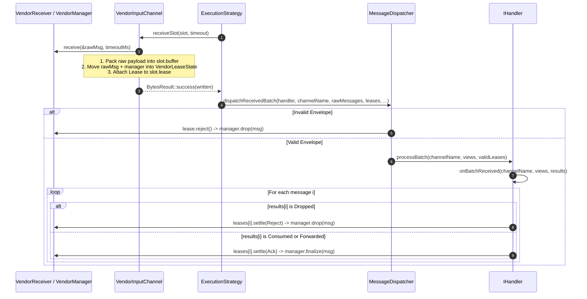
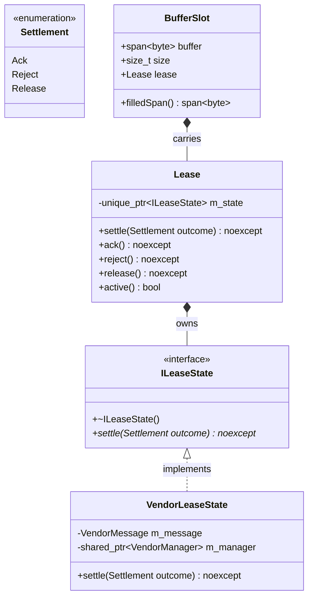

# 012: Out-of-Band `Backend::Lease` Ownership & `receiveSlot` Unification

## 1. Overview & Problem Statement

### Why It's Needed
In `168ad1d` – `c5c4632`, the in-band `VendorMetadata` and `VendorBackend::m_inFlightMessages` registry from Phase 011 were replaced to eliminate in-band correlation fragility, mutex contention, duplicate ID collisions, and `onMessageResult()` coupling.

Transports whose messages are owned by an external SDK (`backend/vendor`) need the in-flight message object to travel **out-of-band alongside the received bytes** with strict single-owner RAII semantics, while buffer-owning transports (`file`, `socket`, `shm`, `uds`, `inproc`, `sim`) must incur zero overhead.

### The Solution
1. **Out-of-Band RAII Ownership (`Backend::Lease` & `Backend::ILeaseState`)**: A move-only `Backend::Lease` wraps `std::unique_ptr<ILeaseState>` and travels next to the message buffer inside `BufferSlot::lease` and `MessageTask::m_lease`, never inside the wire bytes.
2. **Direct Message Ownership (`VendorLeaseState`)**: `VendorLeaseState` directly owns the `Sdk::VendorMessage` and `std::shared_ptr<Sdk::VendorManager>`, eliminating `VendorMetadata`, `ScopedVendorMessage`, and the backend hash map/mutex.
3. **Guaranteed Single Settlement (`Backend::Settlement`)**: A `Lease` settles its owned message at most once with `Settlement::Ack` (finalize), `Settlement::Reject` (drop), or `Settlement::Release` (unprocessed / redeliver). Destroying an unsettled `Lease` automatically settles with `Settlement::Release`.
4. **Unified Ingress Primitive (`IInputChannel::receiveSlot`)**: Replaced `receiveInto()` and `receive()` with `receiveSlot(BufferSlot& slot, Timeout)` so no receive call can ever accidentally discard a `Lease`.

---

## 2. Architecture & How It Works

### 2.1 End-to-End Out-of-Band Lease Flow



### 2.2 Class Relationships



---

## 3. Design Decisions

### 3.1 `Lease` Owns the Message Directly (Zero Registry)
- **Decision**: Store `Sdk::VendorMessage` and `std::shared_ptr<Sdk::VendorManager>` inside `VendorLeaseState : public Backend::ILeaseState`.
- **Rationale**: Every leased message has a single owner, settles at most once (`auto state = std::move(m_state)`), requires zero mutex locks or hash lookups, and never leaks on exceptions or early shutdown.

### 3.2 `IInputChannel::receiveSlot(BufferSlot&, Timeout)`
- **Decision**: Make `receiveSlot(BufferSlot&, Timeout)` the sole single-message virtual primitive on `IInputChannel`, and have `receiveBatch(span<BufferSlot>, Timeout)` delegate to `receiveSlot()`.
- **Rationale**: Makes it impossible to call an input channel method that drops `slot.lease`. Buffer-owning backends simply leave `slot.lease` empty (`nullptr`).

### 3.3 Thread-Pool Propagation via `MessageTask`
- **Decision**: Store `mutable Backend::Lease m_lease` inside `Core::Threading::MessageTask` and move it from `BufferSlot::lease` when enqueuing tasks into SPSC or MPMC worker queues in `ThreadPoolStrategy`.
- **Rationale**: Guarantees identical lease settlement across all four execution strategies (`SimpleExecutionStrategy`, `SequentialStrategy`, `DedicatedThreadStrategy`, and `ThreadPoolStrategy`).

---

## 4. Concrete Examples

### 4.1 `VendorInputChannel::receiveSlot` (`backend/vendor/src/VendorInputChannel.cpp`)
```cpp
::Backend::BytesResult VendorInputChannel::receiveSlot(
    ::Backend::BufferSlot& slot,
    Timeout timeout)
{
    slot.size = 0;
    slot.lease.release();
    // ... receive rawMsg from m_receiver and pack payload into slot.buffer ...
    slot.size = written;
    slot.lease = ::Backend::Lease(std::make_unique<VendorLeaseState>(std::move(rawMsg), m_manager));
    return ::Backend::BytesResult::success(written);
}
```

### 4.2 Settlement in `IHandler::processBatch` (`core/src/handler/IHandler.cpp`)
```cpp
const auto settleCount = std::min(leases.size(), messages.size());
for (std::size_t i = 0; i < settleCount; ++i) {
    leases[i].settle(
        resultsSpan[i].is<::Backend::Dropped>()
            ? ::Backend::Settlement::Reject
            : ::Backend::Settlement::Ack);
}
```

---

## 5. Tasks / Checklist

- [x] Add `Settlement`, `ILeaseState`, and `Lease` to `backend/interface`.
- [x] Extend `BufferSlot` with `Backend::Lease lease` and unify `IInputChannel` on `receiveSlot()`.
- [x] Propagate `Backend::Lease` through `MessageTask`, `ThreadPoolStrategy`, `SequentialStrategy`, `DedicatedThreadStrategy`, `SimpleExecutionStrategy`, `MessageDispatcher`, and `IHandler::processBatch()`.
- [x] Implement `VendorLeaseState` and remove `VendorMetadata`, `ScopedVendorMessage`, and `VendorBackend` in-flight registry.
- [x] Verify all unit tests and settlement invariants in `test/TestVendorBackend.cpp`.

