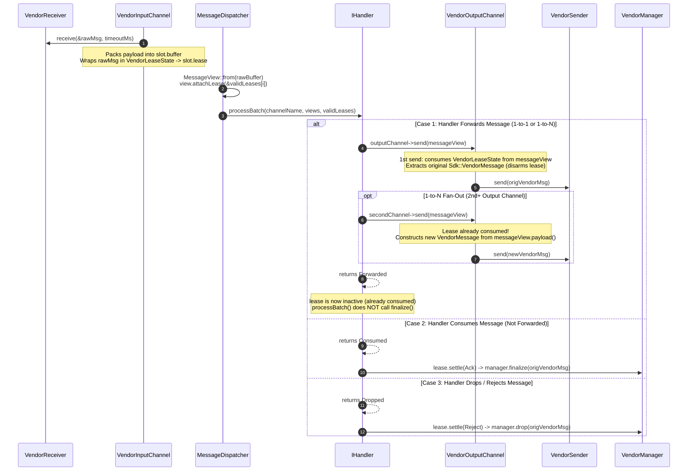
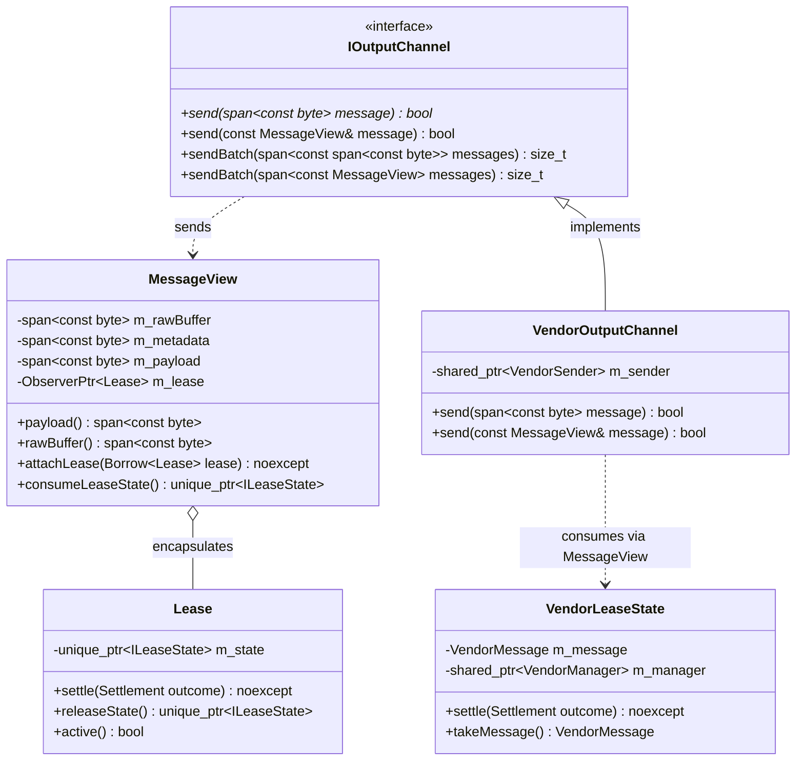

# 013: Consuming VendorMessage Forwarding & `MessageView` Egress

## 1. Overview & Problem Statement

### Why It's Needed
In the 3rd-party Vendor SDK integration (`backend/vendor`), a new lifecycle requirement applies when forwarding messages across pipeline channels:
- **Forwarding Must Transmit the Exact Received `VendorMessage` Object**: When a `VendorMessage` is received from a `VendorInputChannel` and a handler forwards that message to a `VendorOutputChannel`, the output channel must pass the **actual received `Sdk::VendorMessage` instance** (preserving its internal SDK identity, headers, and state)—not merely reconstruct a new `VendorMessage` from payload bytes.
- **Consuming Lifecycle Semantics**:
  - **Forwarded**: Forwarding a received `VendorMessage` to an output channel is a **consuming operation**. Once `VendorSender::send(msg)` is invoked with the original `VendorMessage`, `VendorManager::finalize(msg)` must **not** be called.
  - **Fan-Out (1-to-N)**: Because forwarding consumes the in-flight `VendorMessage`, if a handler (such as `SplitHandler`) forwards the same `MessageView` to multiple output channels, the first output channel consumes and sends the original `VendorMessage` object, and subsequent output channels automatically construct and send a new `VendorMessage` from the payload bytes.
  - **Consumed (Terminal Sink)**: When a message is consumed without being forwarded (e.g. `PrintHandler`, `DummyReceiveHandler`), `VendorManager::finalize(msg)` is called (`Settlement::Ack`).
  - **Rejected / Dropped**: When a message is rejected (e.g. `Dropped` result or malformed envelope), `VendorManager::drop(msg)` is called (`Settlement::Reject`).

### The Solution
1. **Encapsulate `Lease` Inside `Backend::MessageView`**: `MessageView` holds an internal pointer to its associated `Backend::Lease` (bound by `MessageDispatcher` before handler invocation), keeping `Lease` completely encapsulated away from the `IOutputChannel` interface and handler business logic.
2. **Differentiate `MessageView` vs. Raw Payload on `Backend::IOutputChannel`**:
   - `IOutputChannel::send(Common::Compat::span<const std::byte> message)`: Sends raw or pre-packed byte buffers (e.g. from generators like `DummySendHandler`).
   - `IOutputChannel::send(const MessageView& message)` and `IOutputChannel::sendBatch(Common::Compat::span<const MessageView> messages)`: Sends an already-formed in-flight `MessageView`.
   - Buffer-owning backends (`shm`, `socket`, `uds`, `file`, `inproc`, `sim`) inherit the default implementation which forwards `message.rawBuffer()`.
   - `VendorOutputChannel` overrides `send(const MessageView&)` to consume the `VendorLeaseState` encapsulated in `message`, moving the original `Sdk::VendorMessage` directly into `m_sender->send(origMsg)` without triggering `finalize()`. If the lease was already consumed (e.g. 2nd+ channel in fan-out), it creates a new `Sdk::VendorMessage` from `message.payload()`.

---

## 2. Architecture & How It Works

### 2.1 End-to-End Consuming Forward vs. Consume vs. Drop Flow



### 2.2 Class Relationships



---

## 3. Design Decisions

### 3.1 Encapsulating `Lease` Inside `MessageView`
- **Decision**: Store a non-owning `Common::Memory::ObserverPtr<Backend::Lease> m_lease` inside `Backend::MessageView`, populated via `attachLease(Common::Memory::Borrow<Lease>)` by `MessageDispatcher::dispatchReceivedBatch()`, and expose `MessageView::consumeLeaseState()` to extract the underlying `std::unique_ptr<ILeaseState>`.
- **Rationale**:
  - Keeps `Backend::Lease` completely hidden from `IOutputChannel` signatures and handler implementations.
  - Handlers simply pass `message` (`const Backend::MessageView&`) to `m_outputChannel->send(message)`.
  - Consuming the state via `Lease::releaseState()` transfers ownership of `ILeaseState` out of `Lease` (`std::move(m_state)`), automatically disarming the `Lease` so `IHandler::processBatch()`'s post-callback `lease.settle(...)` becomes a no-op (`finalize()` is not called).

### 3.2 Overloading `IOutputChannel::send(const MessageView&)` & `sendBatch(span<const MessageView>)`
- **Decision**: Add virtual `send(const MessageView&)` and `sendBatch(Common::Compat::span<const MessageView>)` overloads to `Backend::IOutputChannel`.
- **Rationale**:
  - Cleanly separates sending an already-formed `MessageView` from sending raw byte spans (`Common::Compat::span<const std::byte>`).
  - Default implementations in `IOutputChannel` delegate directly to `send(message.rawBuffer())` and vectorized `sendBatch(rawBufferSpans)`, preserving zero-copy envelope forwarding and `sendmmsg` batching for `socket`, `uds`, `shm`, `inproc`, `file`, and `sim`.
  - Allows `VendorOutputChannel` to intercept `MessageView` sends and consume the original `VendorMessage` object.

### 3.3 1-to-N Fan-Out Fallback on Consumed Messages
- **Decision**: In `VendorOutputChannel::send(const MessageView&)`, if `message.consumeLeaseState()` returns a valid `VendorLeaseState`, move and send its `Sdk::VendorMessage`; otherwise (if no lease was attached or a prior channel in `SplitHandler` already consumed it), construct and send a new `Sdk::VendorMessage` from `message.payload()`.
- **Rationale**: Satisfies single-consumption ownership for the original `VendorMessage` while allowing 1-to-N broadcast handlers (`SplitHandler`) to function seamlessly across all channels.

---

## 4. Concrete Examples

### 4.1 Consuming `VendorOutputChannel::send(const MessageView&)` (`backend/vendor/src/VendorOutputChannel.cpp`)
```cpp
bool VendorOutputChannel::send(const ::Backend::MessageView& message)
{
    if (!m_sender) {
        Proxy::Log::warn("[VendorOutputChannel] send() called without initialized VendorSender on channel '{}'", name());
        return false;
    }

    if (auto state = message.consumeLeaseState()) {
        if (auto* vendorState = dynamic_cast<VendorLeaseState*>(state.get())) {
            Sdk::VendorMessage origMsg = vendorState->takeMessage();
            return m_sender->send(origMsg);
        }
    }

    const auto payloadSpan = message.payload();
    std::string payloadStr(
        reinterpret_cast<const char*>(payloadSpan.data()),
        payloadSpan.size());

    Sdk::VendorMessage outMsg(0, std::move(payloadStr));
    return m_sender->send(outMsg);
}
```

### 4.2 Handler Forwarding (`handler/xml_verification_handler/src/XmlVerificationHandler.cpp`)
```cpp
Backend::MessageResult XmlVerificationHandler::onMessageReceived(
    std::string_view channelName,
    const Backend::MessageView& message)
{
    if (validate(message.payload())) {
        if (!m_outputChannel) {
            return Backend::Dropped { "No output channel available for forwarding", 500 };
        }
        m_outputChannel->send(message);
        return Backend::Forwarded { .channel = m_outputChannel->name() };
    }
    return Backend::Dropped { "Rejected: XSD schema validation failure", 400 };
}
```

---

## 5. Tasks / Checklist

- [x] **1. Feature Documentation**
  - [x] Create `docs/features/013-message-consuming-vendor-forward.md`.
- [x] **2. Encapsulate Lease Consumption in `Lease` and `MessageView` (`backend/interface`)**
  - [x] Add `Lease::releaseState() noexcept` to `Backend::Lease`.
  - [x] Add `attachLease(Lease*)` and `consumeLeaseState() const noexcept` to `Backend::MessageView`.
  - [x] Add `send(const MessageView&)` and `sendBatch(Common::Compat::span<const MessageView>)` to `Backend::IOutputChannel`.
- [x] **3. Bind Lease to `MessageView` at Dispatch (`core`)**
  - [x] Update `MessageDispatcher::dispatchReceivedBatch()` to attach `&validLeases[validViews]` to each `MessageView`.
- [x] **4. Implement Consuming Forward in `backend/vendor`**
  - [x] Add `VendorLeaseState::takeMessage() noexcept` to move out the owned `Sdk::VendorMessage`.
  - [x] Override `VendorOutputChannel::send(const ::Backend::MessageView&)` to consume the `VendorLeaseState` and send the exact `VendorMessage` object (or construct a new one if already consumed).
- [x] **5. Update Forwarding Handlers (`handler/*`)**
  - [x] Update `SplitHandler`, `MergeHandler`, `XmlVerificationHandler`, `OrderValidationHandler`, `RouteHandler`, and `UdpIngressHandler` to call `send(message)` / `sendBatch(messages)` with `MessageView`.
- [x] **6. Testing & Verification (`test`)**
  - [x] Add unit and integration tests in `test/TestVendorBackend.cpp` verifying:
    - 1-to-1 consuming forward preserves the exact `VendorMessage` (including its `id`) and does not call `finalize()` or `drop()`.
    - 1-to-N fan-out (`SplitHandler` / multiple output channels) consumes the original `VendorMessage` on the first channel and creates a new `VendorMessage` on the second channel without calling `finalize()`.
    - Consumed messages (not forwarded) call `finalize()`.
    - Dropped messages call `drop()`.
  - [x] Format with `clang-format -i` and run the full CTest suite.

