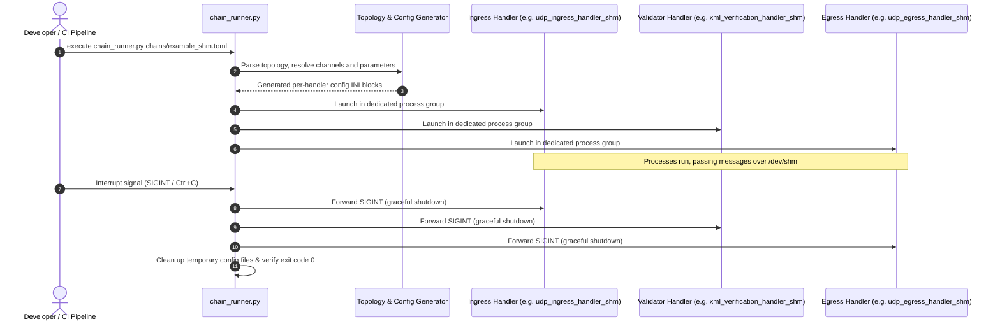

# Multi-Process Pipeline Orchestration (`scripts/chain_runner.py`)

## 1. Overview & Problem Statement

### Why It's Needed
In modern message proxy architectures, handlers are designed to be deployed as independent microservice processes rather than a monolithic application. Running multiple cooperating processes introduces significant operational complexity:
- **Manual Configuration Overhead**: Each process needs its own configuration file with matched socket paths, ports, or shared memory segments.
- **Port & Channel Mappings**: Ingress, worker, and egress handlers must have their input/output channel bindings aligned correctly (e.g. Ingress Output $\rightarrow$ Validator Input).
- **Process Supervision & Lifecycle**: Starting 5 processes manually, capturing their stdout/stderr, and ensuring that pressing `Ctrl+C` cleans up every process and unlinks temporary shared memory or socket files is error-prone.

### The Solution
`scripts/chain_runner.py` is an **automated multi-process pipeline supervisor**. It reads a single declarative topology file (`.toml` or `.json`), dynamically locates the compiled C++ binaries for the requested transport backend, generates matched runtime configurations, launches the processes in an isolated process group, and coordinates graceful shutdown.

---

## 2. How It Works

### Orchestration Sequence



### Core Responsibilities
1. **Binary Discovery (`find_bin_dir`)**:
   - Automatically searches for built binaries in CMake output directories (e.g., `build/debug/bin`, `build/release/bin`, or custom paths passed via `--bin-dir`).
   - Resolves handler executable names according to the requested backend (e.g. handler type `print_handler` with backend `shm` $\rightarrow$ `print_handler_shm`).
2. **Channel Topology Resolution**:
   - Matches `output_channel = "orders_raw"` in one handler with `input_channel = "orders_raw"` in downstream handlers.
   - For `file` and `shm` backends, automatically generates unique file paths and shared memory descriptors in temporary directories.
3. **Signal Forwarding & Group Cleanup**:
   - Uses `os.killpg()` to propagate signals across child process trees, preventing orphan background processes.

---

## 3. High-Level Design Decisions

1. **Declarative Topologies over Shell Scripts**:
   - Topologies are written in `.toml` or `.json`. This declarative format is self-documenting, can be version-controlled, and can be consumed by both local runners and CI pipelines.
2. **Transport Swapping Without Topology Rewrites**:
   - A single pipeline topology can be executed across different backends simply by passing `--backend`:
     ```bash
     ./scripts/chain_runner.py chains/example_chain.toml --backend socket
     ./scripts/chain_runner.py chains/example_chain.toml --backend shm
     ```
3. **Seamless Simulation Mode (`--sim`)**:
   - When run with the simulation backend (`backend = "sim"`), `chain_runner.py` launches the interactive simulation coordinator and WebSocket server, enabling step-wise debugging in the web UI.

---

## 4. Concrete Examples

### Example: Complete Pipeline Specification (`chains/example_pipeline.toml`)
```toml
backend = "socket"

[config]
"telemetry.statsd.host" = "127.0.0.1"
"telemetry.statsd.port" = 8125

# Stage 1: Ingress receiving UDP datagrams
[[handlers]]
name = "ingress"
type = "dummy_send"
output_channel = "stage1_to_stage2"
[handlers.config]
"dummy.message" = "Hello Proxy!"
"dummy.delay_ms" = 500

# Stage 2: Processing & Printing
[[handlers]]
name = "processor"
type = "print_handler"
input_channel = "stage1_to_stage2"
```

### Example: Running the Pipeline from Command Line
```bash
# 1. Run with default discovered binaries:
./scripts/chain_runner.py chains/example_pipeline.toml

# 2. Run pointing to a specific build directory:
./scripts/chain_runner.py chains/example_pipeline.toml --bin-dir ./build/debug/bin

# 3. Override transport backend to Shared Memory at runtime:
./scripts/chain_runner.py chains/example_pipeline.toml --backend shm
```

---

## 5. Tasks / Checklist
- [x] Implement TOML and JSON pipeline config parsing
- [x] Implement dynamic binary resolution across build directories
- [x] Implement process group supervision and signal forwarding
- [x] Implement automatic temporary config generation (`proxy.conf`)
- [x] Add simulation mode integration (`--sim`, `--trace`)
