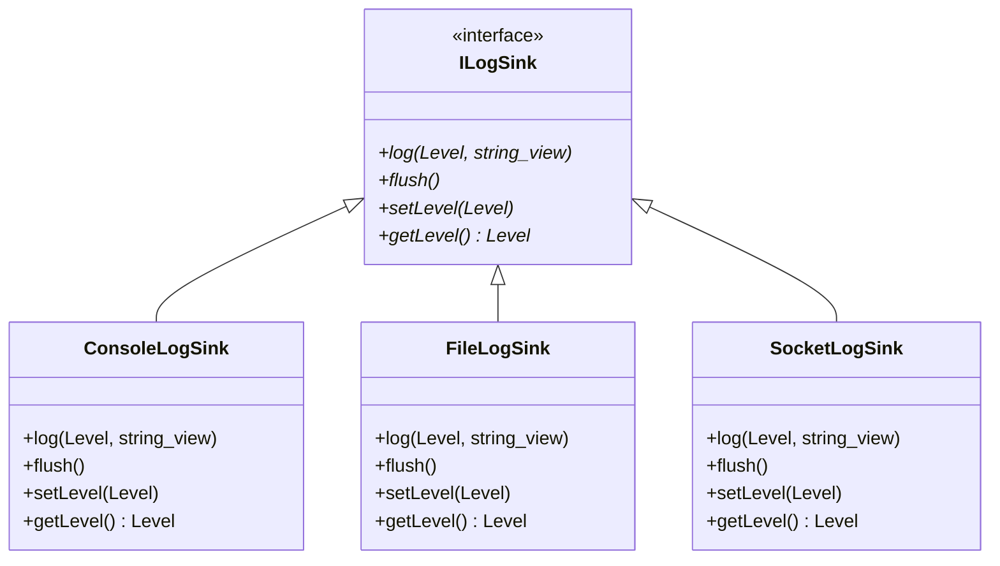

# 001: Universal Logging Library (`proxylog`) & `spdlog` Sinks

## 1. Overview & Problem Statement

### Why It's Needed
In `46cffb7`, low-latency message routing across multiple processes required a universal logging abstraction (`log/` -> `proxylog` target, `Proxy::Log` namespace) that solved three core problems:
1. **Hot-Path Formatting Overhead**: Constructing formatted log strings when a log severity level is disabled wastes CPU cycles and causes heap allocations on critical packet paths.
2. **Backend-Specific Log Routing**: File-based deployments needed thread-safe disk file logging (`FileLogSink`), network deployments needed non-blocking UDP datagram streaming to centralized log collectors (`SocketLogSink`), and local development needed colorized console output (`ConsoleLogSink`).
3. **Engine Encapsulation**: Domain and handler code needed to remain decoupled from third-party `spdlog` headers.

### The Solution
1. **Abstract `Proxy::Log::ILogSink` Interface**: Defined `log(Level, std::string_view)`, `flush()`, `setLevel(Level)`, and `getLevel()` in `log/include/log/ILogSink.hpp`.
2. **Pre-Built `spdlog` Sink Adapters**: Implemented `ConsoleLogSink`, `FileLogSink` (with optional console mirroring), and `SocketLogSink` (UDP datagram sink with optional console mirroring).
3. **Lock-Free `shouldLog()` Fast-Path Check**: `Proxy::Log::{trace, debug, info, warn, error, critical}` checks `shouldLog(level)` before evaluating `fmt::format(...)`, guaranteeing zero string formatting or allocation when a level is disabled.

---

## 2. Architecture & How It Works

### 2.1 `ILogSink` Hierarchy



---

## 3. Design Decisions

### 3.1 Single Initialization Point (`Proxy::Log::init`)
- **Decision**: Expose `Proxy::Log::init(std::unique_ptr<ILogSink> sink)` and have each transport backend initialize its matching sink inside `IBackend::configure(const IConfig&)`.
- **Rationale**: Handlers simply call `Proxy::Log::info(...)` without knowing whether logs are written to stdout, a file, a UDP socket, or a 3rd-party vendor logger (`VendorLogSink`).

---

## 4. Concrete Examples

### 4.1 Logging & Custom Sink Initialization
```cpp
#include "log/Log.hpp"
#include "log/FileLogSink.hpp"

Proxy::Log::init(std::make_unique<Proxy::Log::FileLogSink>("/tmp/proxy.log", /*mirrorConsole=*/true));
Proxy::Log::info("Channel '{}' processed {} messages", channelName, count);
```

---

## 5. Tasks / Checklist

- [x] Define `ILogSink` and `Level` in `log/include/log/` (`46cffb7`).
- [x] Implement `ConsoleLogSink`, `FileLogSink`, and `SocketLogSink` encapsulating `spdlog` (`46cffb7`).
- [x] Package `log` as `proxylog/0.1.0` via Conan 2 (`log/conanfile.py`).

