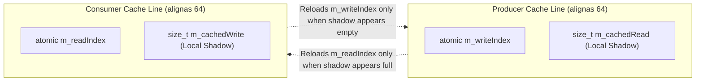

# 003: Lock-Free Queues (`SpscQueue`, `MpmcQueue`) & `BufferPool`

## 1. Overview & Problem Statement

### Why It's Needed
In `cdcce04` – `c1663c8`, passing messages between channel poller threads and worker threads in `ThreadPoolStrategy` (and across in-process channels in `backend/inproc`) required concurrency and memory primitives that eliminated lock contention, cache-line bouncing, and dynamic heap allocation:
1. **Mutex Queue Contention**: Standard `std::queue` + `std::mutex` serialized producer and consumer threads under 100k+ msg/sec rates.
2. **Cache-Line False Sharing**: Naive ring buffers placed `head` and `tail` indices on the same 64-byte cache line, causing continuous L1/L2 cache invalidations between producer and consumer cores.
3. **Jumbo Packet Allocations**: Messages exceeding the 2 KB inline SBO limit up to 64 KB required a lock-free pre-allocated slab pool to avoid per-packet `std::vector` heap allocations.

### The Solution
1. **Lock-Free `SpscQueue<T, Capacity>` (`cdcce04`, `c3dc136`, `b6f4d22`)**: Implemented a power-of-two Single-Producer Single-Consumer ring buffer (`common/include/common/queue/SpscQueue.hpp`) with 64-byte cache-line aligned atomic indices, cached shadow indices (`m_cachedRead`, `m_cachedWrite`) to minimize cross-core atomic loads, zero-copy `tryPushInPlace`, and batched `drainContiguous`.
2. **Lock-Free Bounded `MpmcQueue<T>` (`ea14370`)**: Implemented a Vyukov-style sequence-stamped Multi-Producer Multi-Consumer bounded queue (`common/include/common/queue/MpmcQueue.hpp`) for work-stealing thread-pool load balancing.
3. **Lock-Free `BufferPool` & RAII `BufferSlice` (`c1663c8`)**: Implemented a pre-allocated slab pool of 64 KB blocks (`common/include/common/memory/BufferPool.hpp`) managed by a lock-free index stack, returning move-only `BufferSlice` handles that automatically recycle their block on destruction.

---

## 2. Architecture & How It Works

### 2.1 `SpscQueue` Cache-Line Residency & Shadow Indices (`b6f4d22`)



---

## 3. Design Decisions

### 3.1 Shadow Index Caching in `SpscQueue` (`b6f4d22`)
- **Decision**: Maintain a thread-local shadow copy of the opposite index (`m_cachedRead` on the producer cache line; `m_cachedWrite` on the consumer cache line) and only perform an `acquire` load of the remote atomic index when the cached shadow indicates the ring is full or empty.
- **Rationale**: Under batched traffic, 15 out of 16 pushes/pops avoid cross-core cache coherence traffic completely.

### 3.2 RAII `BufferSlice` Returning Blocks to `BufferPool` (`c1663c8`)
- **Decision**: `BufferPool::acquire()` returns `std::optional<BufferSlice>`, and `~BufferSlice()` pushes the block index back onto the pool's lock-free free list.
- **Rationale**: Guarantees that pooled 64 KB jumbo buffers are never leaked regardless of which worker thread consumes the `MessageTask`.

---

## 4. Concrete Examples

### 4.1 Batched Zero-Copy Drain on `SpscQueue`
```cpp
Common::Queue::SpscQueue<Core::Threading::MessageTask, 1024> queue;

std::size_t drained = queue.drainContiguous(16, [&](Common::Compat::span<Core::Threading::MessageTask> batch) {
    // Process up to 16 contiguous tasks in a single index commit
});
```

---

## 5. Tasks / Checklist

- [x] Implement generic lockless `SpscQueue` with zero-copy in-place forwarding and shadow index tuning (`cdcce04`, `c3dc136`, `b6f4d22`).
- [x] Implement lock-free `MpmcQueue` (`ea14370`).
- [x] Implement lock-free `BufferPool` and `BufferSlice` (`c1663c8`).
- [x] Relocate queues and buffer pool into `common` (`Common::Queue`, `Common::Memory`) (`ef4732c`).

