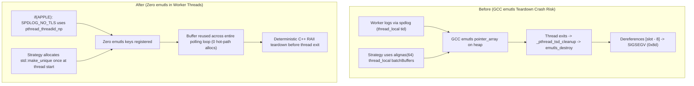

# 004: macOS GCC Emulated TLS (`emutls`) Thread Teardown Fix

## 1. Overview & Problem Statement

### Why It's Needed
During high-concurrency multi-threaded test runs on Apple Silicon macOS (`aarch64-apple-darwin`) compiled with GCC 16 (`927e0c3`), worker threads shutting down after executing `DedicatedThreadStrategy` or `ThreadPoolStrategy` loops intermittently crashed with `SIGSEGV` (`EXC_BAD_ACCESS` at `0x000000000000008d`) inside `emutls_destroy` during `_pthread_tsd_cleanup`.

### Root Cause Analysis
1. **GCC Emulated TLS (`emutls`) on Darwin**: Unlike Linux (which uses native ELF TLS via `TPIDR_EL0` / `FS` registers), GCC on macOS implements C++ `thread_local` using heap-allocated pointer arrays managed via `pthread_key_create` (`emutls_destroy`).
2. **Alignment Padding & `spdlog` TLS Interaction**: For `alignas(64) thread_local` batch buffers and `spdlog`'s internal `thread_local tid` cache, `emutls_alloc` stores the original `malloc` pointer at `((void**)ret)[-1]`. Under high thread creation/destruction churn, a corrupted slot index (`149 - 8 = 0x8d`) caused `emutls_destroy` to dereference `0x8d` on thread exit.

### The Solution
1. **Platform-Conditioned `SPDLOG_NO_TLS` on macOS (`927e0c3`)**: Defined `SPDLOG_NO_TLS` on `APPLE` targets in `log/CMakeLists.txt` and configured `"spdlog/*:header_only": True` in `conanfile.py` so `spdlog` queries `pthread_threadid_np` directly without registering `thread_local` variables.
2. **Per-Thread Startup Heap Allocation Instead of `thread_local` Batch Buffers**: Replaced `alignas(64) thread_local` 1 MB receive buffers in execution strategies (`SequentialStrategy`, `DedicatedThreadStrategy`, `ThreadPoolStrategy`) and channels (`SocketInputChannel`, `UdsInputChannel`) with a `std::unique_ptr` allocated **once** at thread entry before the `while` loop, preserving zero hot-path allocations while eliminating `emutls` registrations and preventing thread stack overflow.

---

## 2. Architecture & How It Works

### 2.1 Before vs. After Thread Lifecycle on macOS



---

## 3. Design Decisions

### 3.1 Startup `std::make_unique` Over Stack or `thread_local`
- **Decision**: Allocate `auto batchBuffers = std::make_unique<std::array<std::array<std::byte, 65535>, 16>>()` once at worker thread startup.
- **Rationale**: 16 slots $\times$ 65,535 bytes is ~1.05 MB, which exceeds default macOS (512 KB) and musl Linux (128 KB) worker stack sizes if placed on the stack, while `std::make_unique` at thread entry allocates once and avoids `__emutls_get_address` lookup overhead on every batch iteration (+5% to +62% measured throughput improvement on macOS).

---

## 4. Concrete Examples

### 4.1 Worker Thread Buffer Allocation (`core/src/threading/DedicatedThreadStrategy.cpp`)
```cpp
// Allocated once on the heap when the thread starts to prevent thread stack overflow,
// while keeping the buffer resident across polling loops with zero per-message allocations.
auto batchBuffers = std::make_unique<std::array<std::array<std::byte, 65535>, BatchSize>>();
std::array<Backend::BufferSlot, BatchSize> batchSlots;
```

---

## 5. Tasks / Checklist

- [x] Enable `SPDLOG_NO_TLS` on `APPLE` in `log/CMakeLists.txt` (`927e0c3`).
- [x] Replace `thread_local` batch buffers in `SequentialStrategy`, `DedicatedThreadStrategy`, `ThreadPoolStrategy`, `SocketInputChannel`, and `UdsInputChannel` with startup `std::unique_ptr` buffers (`927e0c3`).
- [x] Verify 100/100 consecutive passes of the full `proxy_tests` suite with zero segmentation faults.

