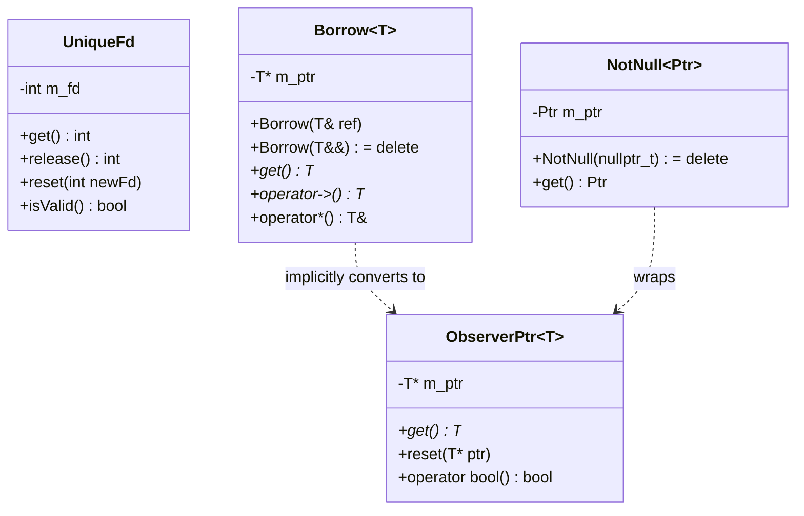

# 005: Value Types & RAII Safety (`UniqueFd`, `Borrow`, `NotNull`, `ObserverPtr`, `SmallSpanBuffer`)

## 1. Overview & Problem Statement

### Why It's Needed
In `46bc3e6` – `334cda2`, raw C primitives (`int` file descriptors, raw `T*` pointers, and heap-allocated `std::vector<span<...>>` temporary arrays) across `core`, `backend/*`, and `handler/*` created resource-leak and dangling-pointer risks:
1. **Manual `::close(fd)` Calls**: Socket and shared-memory descriptors required manual `::close()` cleanup across error paths, destructors, and move assignments.
2. **Ambiguous Pointer Ownership**: Raw `IOutputChannel*` pointers in handlers did not express whether the pointer owned the channel, whether it could be `nullptr`, or whether it could bind to a temporary rvalue.
3. **Batch Span Vector Allocations**: Constructing `std::vector<span<const std::byte>>` inside `onBatchReceived()` allocated heap memory on every batch.

### The Solution
Introduced five zero-overhead RAII and value-type primitives (initially in `core`, then promoted to `common/include/common/`):
1. **`Common::Io::UniqueFd` (`334cda2`)**: Move-only RAII file descriptor wrapper that automatically closes valid descriptors (`fd >= 0`) via `::close()` upon destruction or `reset()`.
2. **`Common::Memory::Borrow<T>` (`334cda2`)**: Non-owning, non-null rebindable reference wrapper with deleted rvalue constructor (`Borrow(T&&) = delete`) to prevent dangling temporary bindings at compile time. Returned by `IHandler::registerInputChannel` and `registerOutputChannel`.
3. **`Common::Memory::NotNull<T>` (`334cda2`)**: Non-null pointer wrapper rejecting `nullptr_t` at compile time and asserting non-null at construction.
4. **`Common::Memory::ObserverPtr<T>` (`7da2296`)**: Explicitly non-owning nullable pointer wrapper replacing raw `T*` members.
5. **`Common::Memory::SmallSpanBuffer<T, InlineCapacity>` (`46bc3e6`)**: Stack-allocated inline array with automatic heap fallback when batch size exceeds `InlineCapacity` (default 64).

---

## 2. Architecture & How It Works

### 2.1 Non-Owning Pointer & Reference Safety Hierarchy



---

## 3. Design Decisions

### 3.1 Compile-Time Rvalue Rejection on `Borrow<T>`
- **Decision**: Delete `Borrow(T&&) = delete` while providing `Borrow(T&)` and rebindable copy assignment.
- **Rationale**: Unlike `std::reference_wrapper`, `Borrow<T>` provides convenient `->` and `*` pointer syntax for container elements (`std::vector<Borrow<IOutputChannel>>` in `SplitHandler`) while guaranteeing at compile time that it never binds to a temporary object.

---

## 4. Concrete Examples

### 4.1 `UniqueFd` & `Borrow<IOutputChannel>` Usage
```cpp
// RAII socket descriptor management:
Common::Io::UniqueFd sockFd(::socket(AF_INET, SOCK_DGRAM, 0));
if (!sockFd) {
    return;
}

// Non-null borrowed channel handle in a handler:
Common::Memory::ObserverPtr<Backend::IOutputChannel> m_outputChannel;
m_outputChannel = registerOutputChannel(backend().createOutputChannel("orders", config));
```

---

## 5. Tasks / Checklist

- [x] Implement `ObserverPtr<T>` and `SmallSpanBuffer<T, N>` (`46bc3e6`, `7da2296`).
- [x] Implement `UniqueFd`, `Borrow<T>`, and `NotNull<T>` and adopt across sockets, channels, and handlers (`334cda2`).
- [x] Add comprehensive unit tests in `test/TestValueTypes.cpp`.

