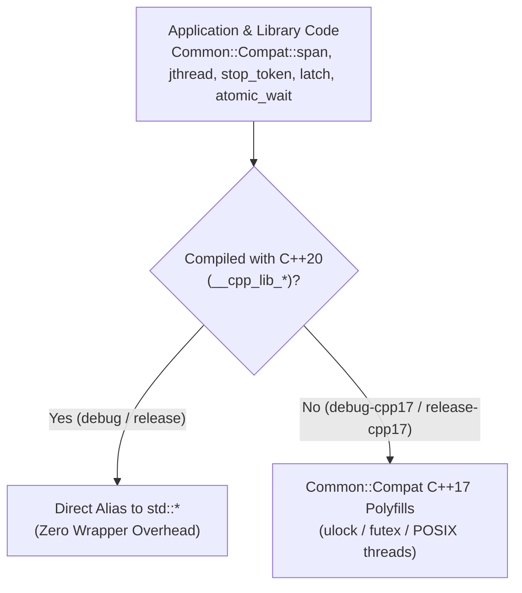

# 006: Zero-Dependency C++17/C++20 Compatibility Polyfills (`Common::Compat`)

## 1. Overview & Problem Statement

### Why It's Needed
In `ef4732c`, the Proxy codebase needed to support environments constrained to **C++17** compilers/standard libraries while keeping **C++20** as the default project standard (`PROXY_CXX_STANDARD = 20` or `17`).

Throughout the codebase, C++20 library features were heavily used: `std::span`, `std::jthread`, `std::stop_token`, `std::stop_source`, `std::stop_callback`, `std::latch`, `std::bit_cast`, `std::atomic_wait` / `std::atomic_notify_*`, `std::remove_cvref_t`, and `std::string_view::starts_with` / `ends_with`.

### The Solution
Created the standalone `common` library (`Common` namespace, `common/0.1.0` Conan package) providing zero-external-dependency compatibility polyfills under `Common::Compat` (`common/include/common/compat/`):
1. **Strict `Common::Compat` Qualification Policy**: All C++20 polyfilled primitives reside strictly in `namespace Common::Compat` (never injected into `namespace std`, which is undefined behavior in C++). Under C++20 builds (`__cpp_lib_*`), `Common::Compat` aliases map directly to `std::`. Under C++17 builds, they resolve to native polyfills.
2. **Native OS Address Waiting (`AtomicWait.hpp`)**: Implemented `Common::Compat::atomic_wait`, `atomic_notify_one`, and `atomic_notify_all` in C++17 using native kernel address-wait primitives matching `libc++`/`libstdc++`:
   - **macOS / Darwin**: `__ulock_wait` (`UL_COMPARE_AND_WAIT`) and `__ulock_wake` (`ULF_WAKE_ALL`).
   - **Linux**: `syscall(SYS_futex, ..., FUTEX_WAIT_PRIVATE)` and `FUTEX_WAKE_PRIVATE`.
   - **Windows**: `WaitOnAddress` and `WakeByAddressAll`.
3. **Dedicated CMake Presets**: Added `debug-cpp17` and `release-cpp17` presets alongside `debug` and `release` to continuously verify both standards.

---

## 2. Architecture & How It Works

### 2.1 `Common::Compat` Dual-Standard Resolution



---

## 3. Design Decisions

### 3.1 Never Inject into `namespace std`
- **Decision**: Keep all polyfills inside `namespace Common::Compat` and require explicit `Common::Compat::` qualification everywhere in the codebase (`AGENTS.md` Rule 1).
- **Rationale**: Opening `namespace std` to add standard types/functions is undefined behavior per `[namespace.std]` and obscures whether a file includes the compatibility header.

### 3.2 Kernel Address-Wait (`ulock` / `futex`) Over Condition-Variable Hash Tables
- **Decision**: Use Darwin `__ulock_wait` and Linux `SYS_futex` directly in `AtomicWait.hpp`.
- **Rationale**: Avoids lost wakeups and lock contention inherent to striped condition-variable hash tables.

---

## 4. Concrete Examples

### 4.1 Using `Common::Compat` Primitives
```cpp
#include "common/compat/Compat.hpp"

void process(Common::Compat::span<const std::byte> data, Common::Compat::stop_token stoken)
{
    while (!stoken.stop_requested()) {
        // ...
    }
}
```

---

## 5. Tasks / Checklist

- [x] Create `common` subproject (`common/CMakeLists.txt`, `common/conanfile.py`) (`ef4732c`).
- [x] Implement `Span.hpp`, `StopToken.hpp`, `Jthread.hpp`, `Latch.hpp`, `BitCast.hpp`, `AtomicWait.hpp`, `StringView.hpp`, and `TypeTraits.hpp` in `common/include/common/compat/` (`ef4732c`).
- [x] Relocate `Common::Memory`, `Common::Queue`, and `Common::Io` into `common` (`ef4732c`).
- [x] Add `debug-cpp17` and `release-cpp17` CMake presets and `test/TestCommonCompat.cpp` unit tests (`ef4732c`).

