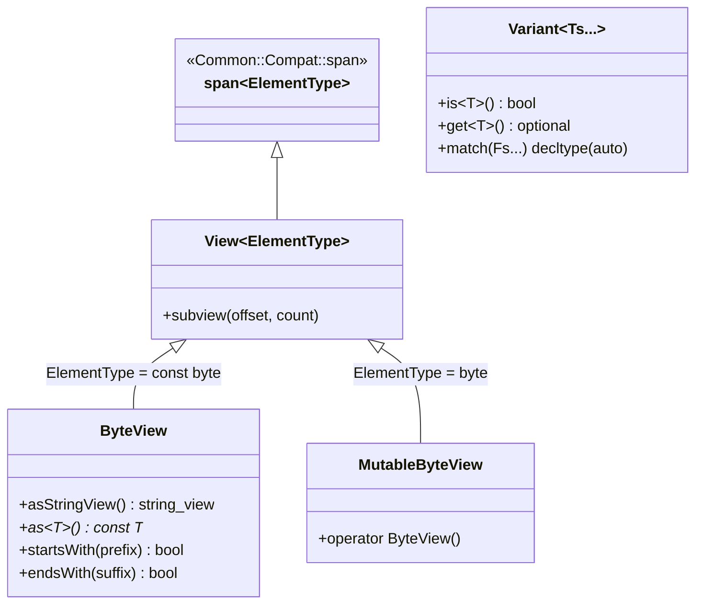

# 007: Ergonomic `ByteView`, `MutableByteView`, & `Common::Types::Variant`

## 1. Overview & Problem Statement

### Why It's Needed
In `12bcf75` and `d2f9609`, two sources of repetitive syntactic boilerplate across `backend`, `core`, `handler`, and `test` were addressed:
1. **Verbose `reinterpret_cast<const std::byte*>` Span Conversions (`12bcf75`)**: Passing `std::string`, `std::string_view`, `std::vector<T>`, `std::array<T, N>`, or POD structs into `Common::Compat::span<const std::byte>` parameters required error-prone `reinterpret_cast` expressions at every call site.
2. **Cumbersome `std::variant` Inspection & Visitation (`d2f9609`)**: Using raw `std::variant` for `MessageResult`, `ReceiveError`, `ExecutionModel`, and `RouteHandler` patterns required verbose free functions (`std::holds_alternative<T>(v)`, `std::get_if<T>(&v)`, `std::visit(Overload{...}, v)`).

### The Solution
1. **Three-Tiered Non-Owning View Hierarchy (`12bcf75`)**:
   - `Common::Memory::View<ElementType>` (`common/include/common/memory/View.hpp`): Generic view inheriting from `Common::Compat::span<ElementType>`.
   - `Common::Memory::ByteView` (`common/include/common/memory/ByteView.hpp`): Immutable byte view inheriting from `View<const std::byte>` that constructs directly from contiguous containers, strings, string literals, and POD structs, and provides `.asStringView()`, `.asChar()`, `.as<T>()`, `.startsWith()`, `.endsWith()`, and `==` against `std::string_view`.
   - `Common::Memory::MutableByteView` (`common/include/common/memory/MutableByteView.hpp`): Writable byte view inheriting from `View<std::byte>` for receive buffers.
2. **Ergonomic `Common::Types::Variant<Ts...>` & `Overload<Fs...>` (`d2f9609`)**:
   - Implemented `Common::Types::Variant<Ts...>` (`common/include/common/types/Variant.hpp`) inheriting from `std::variant<Ts...>` and adding concise `.is<T>()`, `.get<T>()` (returning `std::optional<std::reference_wrapper<T>>` for lvalues or `std::optional<T>` for rvalues), and `.match(lambdas...)`.

---

## 2. Architecture & How It Works

### 2.1 `View` & `Variant` Class Relationships



---

## 3. Design Decisions

### 3.1 Public Inheritance from `span` and `std::variant`
- **Decision**: Derive `View<T>` publicly from `Common::Compat::span<T>` and `Variant<Ts...>` publicly from `std::variant<Ts...>` with zero additional data members.
- **Rationale**: Preserves `sizeof`, trivial copyability, and 100% drop-in compatibility with functions expecting `Common::Compat::span` or `std::variant` while providing member convenience methods.

---

## 4. Concrete Examples

### 4.1 `ByteView` & `Variant::match` Usage
```cpp
#include "common/memory/ByteView.hpp"
#include "common/types/Variant.hpp"

// Zero-cast ByteView construction and comparison:
Common::Memory::ByteView view("<Order id=\"1\"/>");
if (view.startsWith("<Order")) {
    channel->send(view);
}

// Concise variant pattern matching:
result.match(
    [](const Backend::Forwarded& fwd) { /* forwarded to fwd.channel */ },
    [](const Backend::Consumed&)      { /* consumed */ },
    [](const Backend::Dropped& drop)  { /* dropped: drop.reason */ }
);
```

---

## 5. Tasks / Checklist

- [x] Implement `View<T>`, `ByteView`, and `MutableByteView` in `common/include/common/memory/` and unit tests in `test/TestByteView.cpp` (`12bcf75`).
- [x] Implement `Common::Types::Variant` and `Common::Types::Overload` in `common/include/common/types/Variant.hpp` and unit tests in `test/TestVariant.cpp` (`d2f9609`).
- [x] Refactor `reinterpret_cast` call sites and `std::variant` usages across `backend/interface`, `core`, `handler`, and `test`.

