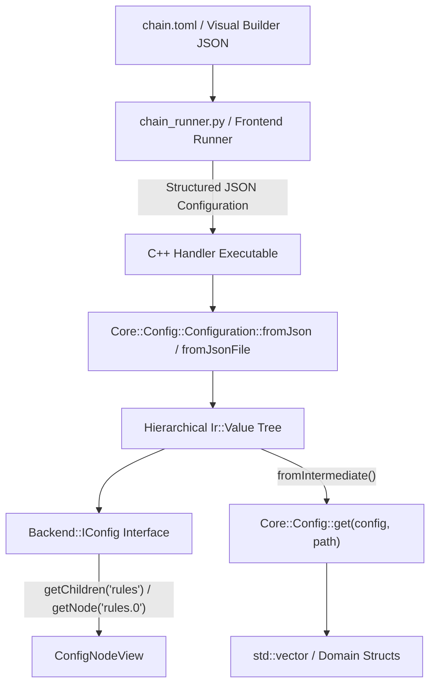

# Feature: Hierarchical JSON Configuration & Structured Dot-Notation Querying

## Overview & Problem Statement
Prior to this feature, pipeline chains were authored in structured formats (TOML files and JSON in the Visual Builder), but the C++ configuration layer (`Core::Config::Configuration`) relied on flat key-value pairs (`key=value`) and an INI parser. This created several architectural and operational deficiencies:
1. **Ad-Hoc Flattening**: Python runners (`scripts/chain_runner.py`, `scripts/proxy_runner/config.py`) performed lossy flattening and array stringification (e.g. `route.rules=rule_1,rule_2`).
2. **Brittle String Escaping**: Multiline configurations such as embedded Lua scripts required carriage return and newline substitution (`\n`) to prevent truncating flat lines.
3. **Lack of Clean Sub-Node Traversal**: Handlers that required list-of-objects configuration (such as `route_handler` rules) had to manually construct sub-prefixes (`route.rule.<name>.*`) and parse CSV strings.

This feature introduces a two-tier hierarchical configuration architecture backed by `Core::Serialization::Ir::Value` and JSON ingestion, offering uniform JSON-pointer-style dot notation (`"route.default_action"`, `"rules.0.name"`) and one-line deserialization of reflected structs and vectors.

---

## Architecture & How It Works



### 1. Two-Tier Query System
To respect strict architectural layering (`AGENTS.md` Section 8: `backend-interface` and `backend/*` cannot depend on `core`), querying is divided into two decoupled tiers:

- **Tier 1: `Backend::IConfig` (`backend-interface`)**:
  - Independent of `core`.
  - Supports dot notation for scalar lookups: `get<T>(path)` / `getOr<T>(path, default)` (e.g. `"server.port"`, `"rules.0.pattern"`).
  - Provides sub-node navigation via `getNode(path)` returning `Common::Memory::ObserverPtr<const IConfig>`.
  - Provides child iteration via `getChildren(path)` returning `std::vector<Common::Memory::ObserverPtr<const IConfig>>` for standard range-based `for` loops.

- **Tier 2: Reflected Type Deserialization (`Core::Config::get<T>` in `core`)**:
  - Leverages `Core::Serialization::TypeTraits<T>` and `Core::Serialization::Ir::fromIntermediate<T>`.
  - Enables single-line struct and vector deserialization:
    ```cpp
    auto rules = Core::Config::get<std::vector<RouteRule>>(config, "rules");
    ```

### 2. Format Ingestion
- `Core::Config::Configuration` parses JSON directly into `Ir::Value` using `Configuration::fromJson(std::string_view)` and `Configuration::fromJsonFile(path)`.
- Dot-separated programmatic assignments via `config.set("server.port", "8080")` build the corresponding intermediate object tree automatically.

---

## Concrete Examples

### Dot-Notation Querying in C++
```cpp
#include "backend/IConfig.hpp"
#include "core/config/ConfigReader.hpp"
#include "core/config/Configuration.hpp"

auto config = Core::Config::Configuration::fromJson(R"({
    "server": {
        "host": "127.0.0.1",
        "port": 8080
    },
    "rules": [
        { "name": "ruleA", "pattern": "DROP" },
        { "name": "ruleB", "pattern": "ALLOW" }
    ]
})");

// Direct scalar query with dot notation:
int port = config.getOr<int>("server.port", 3000);

// Sub-node view:
auto serverNode = config.getNode("server");
std::string host = serverNode->getOr<std::string>("host", "localhost");

// Range-based for loop over array children:
for (const auto& ruleNode : config.getChildren("rules")) {
    std::string name = ruleNode->getOr<std::string>("name", "");
}

// Single-line reflected struct vector deserialization:
auto rules = Core::Config::get<std::vector<RouteRuleConfig>>(config, "rules");
```

---

## Tasks / Checklist

- [x] Modernize `Backend::IConfig` with `getNode(path)` and `getChildren(path)`.
- [x] Implement `Core::Config::ConfigNodeView` wrapping `Core::Serialization::Ir::Value`.
- [x] Adapt `Core::Config::Configuration` to store `Ir::Value` and support pure JSON ingestion.
- [x] Implement `Core::Config::ConfigReader` providing `Core::Config::get<T>` for reflected types and vectors.
- [x] Support structured `rules` array querying in `RouteHandlerConfig`.
- [x] Add comprehensive unit tests in `test/TestConfiguration.cpp`.
- [x] Verify complete test suite (`proxy_tests` and python `unittest`).

