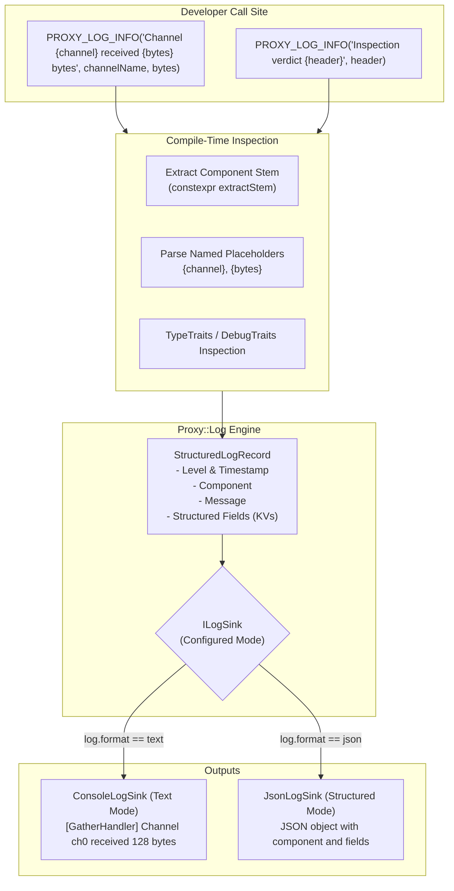

# 010: Structured Logging, Runtime Output Formatting, and Zero-Overhead Telemetry

## Overview & Problem Statement

Historically, logging across the `Proxy` framework relied on manual string formatting into `Proxy::Log::{trace, debug, info, warn, error, critical}`. Handlers consistently prepended hardcoded prefixes to log statements (such as `[DummyReceive]`, `[GatherHandler]`), resulting in repetitive code, potential typos, and inconsistent prefixes.

Furthermore, traditional console logging formatted contextual domain variables (`channelName`, `payloadSize`, `correlationId`) directly into an unstructured text sentence. While human-readable in a terminal, this is difficult for log collectors, observability pipelines (Loki, Elasticsearch, Datadog), and automated analysis tools to index without fragile, high-overhead regular expressions.

Additionally, standard compiler macros like `__FILE__` expand to full absolute filesystem paths (e.g. `/Users/...` or `/build/...`), introducing security risks (CWE-200 / CWE-497 path leakage) and redundant noise if both the file path and component name are recorded.

### Goals
1. **Runtime Output Mode Switch**: Seamlessly toggle between human-friendly colored terminal text and structured machine-readable JSON (NDJSON) via configuration (e.g. `log.format = "json"` or `log.structured = true`).
2. **Zero-Boilerplate Component Tagging**: Automatically capture the component/handler name at compile-time from the source file stem without leaking absolute system paths or requiring developers to manually write `[HandlerName]`.
3. **Natural Human-Friendly Syntax with Structured Fields**: Support natural prose with named placeholders (e.g. `"Channel {channel} received {bytes} bytes"`) and automatic variable naming, extracting variables into first-class queryable JSON keys while rendering natural sentences in the terminal.
4. **Deep `DebugTraits` and `TypeTraits` Integration**: Leverage the reflection system in `Core::Serialization` to automatically format reflected structs into nested JSON objects or colorized terminal output without manual serializer glue.
5. **Compile-Time Guardrails**: Encourage structured logging over untyped anonymous `{}` placeholders through compile-time validation.

---

## Architecture & How It Works

### High-Level Architecture



---

## Design Decisions

1. **Compile-Time Stem Extraction (`extractStem`)**:
   - `std::string_view extractStem(std::string_view path)` operates entirely at compile-time (`constexpr`).
   - Strips directory paths (`/` and `\`) and file extensions (`.cpp`, `.hpp`).
   - Prevents absolute build paths from leaking into binaries or log outputs, eliminating CWE-200 path exposure.
2. **Unified Component Tagging**:
   - Eliminates redundant fields: rather than logging both `"file": "GatherHandler.cpp"` and `"logger": "GatherHandler"`, a single clean `"component": "GatherHandler"` is emitted.
   - Developers can override this default per file or per class by defining `PROXY_LOG_TAG "CustomTag"`.
3. **Format Engine & Dual-Mode Extraction**:
   - **Mode A (Named Placeholder Interpolation)**: Format strings with named `{field_name}` placeholders embed variables naturally in prose while extracting key names for structured serialization.
   - **Mode B (Dual-Mode Auto-Extractor)**: When a plain message is passed alongside raw variable arguments without placeholders (e.g. `PROXY_LOG_WARN("Queue overflow detected", queueCapacity, droppedCount)`), the macro automatically stringifies the variable expressions (`#var`) to extract field keys without requiring placeholders or repetitive `kv()` wrappers.
   - In Text mode, trailing variables are formatted cleanly as `[key1=val1 key2=val2]`.
   - In JSON mode, both modes emit top-level structured JSON keys seamlessly.
4. **Reflection Interoperability**:
   - For primitive types (`int`, `double`, `bool`, `std::string_view`), values map directly to JSON primitives.
   - For reflected types satisfying `Core::Serialization::TypeTraits<T>`, fields are serialized as nested JSON dictionaries.
   - For text output, reflected types reuse `Core::Serialization::DebugFormat`.

---

## Concrete Examples

### 1. Developer Logging Call Site

```cpp
// 1. Natural sentence with named placeholders:
PROXY_LOG_INFO("Channel {channel} received {bytes} bytes", channelName, payloadSize);

// 2. Trailing arguments auto-named:
PROXY_LOG_WARN("Queue overflow detected", queueCapacity, droppedCount);

// 3. Reflected custom struct:
InspectionHeader header{...};
PROXY_LOG_INFO("Processed inspection packet {header}", header);
```

### 2. Output in Text Mode (`log.format = "text"`)
```text
[2026-11-09 12:30:00.123] [info] [DummyReceive] Channel ch0 received 128 bytes
[2026-11-09 12:30:00.124] [warn] [DummyReceive] Queue overflow detected queueCapacity=1024 droppedCount=1
[2026-11-09 12:30:00.125] [info] [GatherHandler] Processed inspection packet InspectionHeader { protocol: 0x1, verdict: 2 }
```

### 3. Output in JSON Mode (`log.format = "json"`)
```json
{"timestamp":"2026-11-09T12:30:00.123456Z","level":"INFO","component":"DummyReceive","message":"Channel {channel} received {bytes} bytes","channel":"ch0","bytes":128}
{"timestamp":"2026-11-09T12:30:00.124102Z","level":"WARN","component":"DummyReceive","message":"Queue overflow detected","queueCapacity":1024,"droppedCount":1}
{"timestamp":"2026-11-09T12:30:00.125831Z","level":"INFO","component":"GatherHandler","message":"Processed inspection packet {header}","header":{"protocol":1,"verdict":2}}
```

---

## Tasks / Checklist

- [x] **1. Compile-Time Path & Component Utilities (`log/include/log/ComponentTag.hpp`)**
  - [x] Implement `constexpr std::string_view extractStem(std::string_view path) noexcept`.
  - [x] Add unit test verifying absolute and relative paths strip properly at compile time.
- [x] **2. Structured Field Value Model & JSON Sink (`log/include/log/Structured.hpp`, `log/src/JsonLogSink.cpp`)**
  - [x] Define `LogField` variant holding primitives and string views.
  - [x] Implement `JsonLogSink` rendering timestamp, level, component, message, and fields to stdout/file.
  - [x] Support runtime switching between `ConsoleLogSink` and `JsonLogSink` in `Proxy::Log::init`.
- [x] **3. Structured Logging Macros & Dual-Mode Auto-Extractor (`log/include/log/LogMacros.hpp`)**
  - [x] Define `PROXY_LOG_TRACE`, `PROXY_LOG_DEBUG`, `PROXY_LOG_INFO`, `PROXY_LOG_WARN`, `PROXY_LOG_ERROR`, `PROXY_LOG_CRITICAL`.
  - [x] Implement named format string extraction (`{name}`) and variable binding.
  - [x] Implement Dual-Mode Auto-Extractor for unformatted trailing variables (`PROXY_LOG_WARN("msg", var1, var2)`).
  - [x] Compile-time validation and dispatch.
- [ ] **4. Core & DebugTraits Integration (`core/include/core/log/StructuredTraits.hpp`)**
  - [ ] Adapter that hooks `TypeTraits<T>` into structured `LogField` dictionary serialization.
  - [ ] Verify nested reflected struct formatting in both text and JSON sinks.
- [x] **5. Verification & Testing**
  - [x] Write unit tests for structured logging macros, JSON sink, and text formatting.
  - [x] Update existing handler logging to adopt `PROXY_LOG_*` macros.
