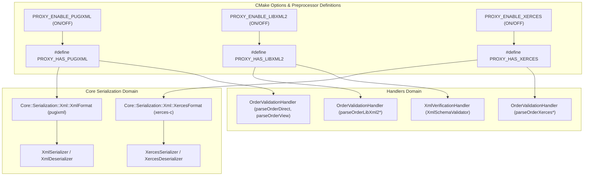

# Conditional XML Library Switches & Core Xerces-C Integration

## Overview & Problem Statement
The Proxy system employs several XML libraries across core serialization and handler domains:
- **`pugixml`**: Extremely fast lightweight DOM parser/serializer used for core serialization (`Core::Serialization::Xml`) and high-throughput order validation.
- **`libxml2`**: Standard W3C parser and XSD schema validator used in `XmlVerificationHandler` and benchmark comparison in `OrderValidationHandler`.
- **`xerces-c`**: Enterprise-grade Apache XML framework used for DOM/SAX validation and enterprise schema support.

Previously, these libraries were either unconditionally linked or hardcoded across target CMake files without compile-time toggles or Conan option flags. Furthermore, `core` only supported `pugixml` as its XML backend format policy.

This feature introduces:
1. **Configurable CMake Options & Preprocessor Switches**:
   - `PROXY_ENABLE_PUGIXML` (default: `ON`): defines `PROXY_HAS_PUGIXML`
   - `PROXY_ENABLE_LIBXML2` (default: `ON`): defines `PROXY_HAS_LIBXML2`
   - `PROXY_ENABLE_XERCES` (default: `ON`): defines `PROXY_HAS_XERCES`
2. **Conan 2 Options**:
   - `core/conanfile.py` and root `conanfile.py` options allowing users to enable/disable XML dependencies at package generation and consumption time.
3. **Core Xerces-C Support**:
   - `Core::Serialization::Xml` gains support for Xerces-C via `XercesFormat`, `XercesSerializer<T>`, and `XercesDeserializer<T>` in `core/include/core/serialization/xml/XercesFormat.hpp` and `core/src/serialization/xml/XercesFormat.cpp`.
4. **Conditional Compilation Across Handlers & Tests**:
   - `OrderValidationHandler`, `XmlVerificationHandler`, and benchmark/test suites conditionally compile XML paths using `#if PROXY_HAS_*` switches.

## Architecture & How It Works

## Tasks / Checklist
- [x] Add CMake options (`PROXY_ENABLE_PUGIXML`, `PROXY_ENABLE_LIBXML2`, `PROXY_ENABLE_XERCES`) and export definitions to targets.
- [x] Update `conanfile.py` and `core/conanfile.py` with options for `with_pugixml`, `with_libxml2`, `with_xerces`.
- [x] Implement `XercesFormat.hpp` and `XercesFormat.cpp` in `core` (`Core::Serialization::Xml::XercesFormat`, `XercesSerializer`, `XercesDeserializer`).
- [x] Wrap `XmlFormat.hpp`, `XmlFormat.cpp`, and `XmlSerializer.hpp` under `#if PROXY_HAS_PUGIXML`.
- [x] Guard `OrderValidationHandler` and its benchmark methods with `#if PROXY_HAS_PUGIXML`, `#if PROXY_HAS_LIBXML2`, and `#if PROXY_HAS_XERCES`.
- [x] Guard `XmlVerificationHandler` with `#if PROXY_HAS_LIBXML2`.
- [x] Guard tests in `TestSerialization.cpp` and `TestOrderValidationHandler.cpp`.
- [x] Verify build and tests across configurations.

