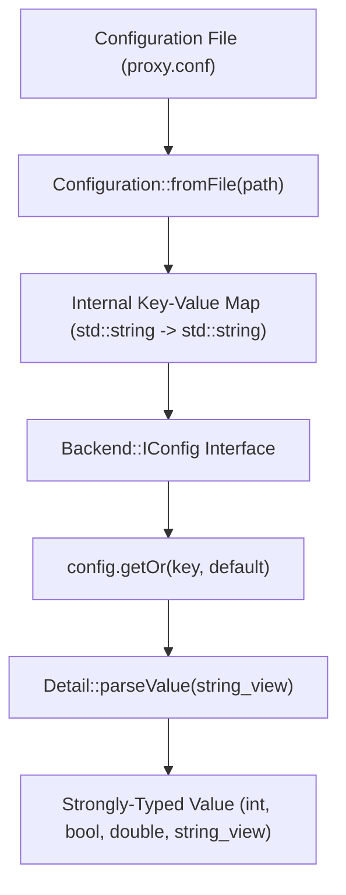

# Configuration Subsystem & Strongly-Typed Resolution

## 1. Overview & Problem Statement

### Why It's Needed
In a multi-stage message pipeline, configuration values originate from diverse sources (flat text files, INI blocks, environment variables, command-line arguments, and Python runners).
Common configuration approaches present notable pitfalls:
- **Stringly-Typed Interfaces**: Storing and querying raw strings forces every handler to manually parse integers, floats, or booleans using `atoi` or `std::stoi`, leading to scattered, brittle error handling.
- **Locale & Allocation Issues**: Functions like `std::stof` or `stringstream` incur dynamic heap allocations and are vulnerable to OS locale differences (e.g. comma vs. period decimal points).
- **Inconsistent Defaults**: When a setting is missing, different parts of an application fallback to inconsistent defaults unless governed by a central interface.

### The Solution
The Proxy configuration system couples an abstract interface (`Backend::IConfig`) with a concrete file-backed key-value store (`Core::Config::Configuration`). It delivers:
1. **Strongly-Typed Template Resolution**: `config.get<T>(key)` and `config.getOr<T>(key, default)` supporting primitives, strings, and string views.
2. **Zero-Allocation In-Place Parsing**: Uses `std::from_chars` and `Common::Compat::remove_cvref_t` for fast, locale-independent type conversions without heap allocations or exceptions.
3. **Structured INI / Section File Syntax**: Clean key-value syntax with support for comment prefixes (`#`, `;`) and section prefixes.

---

## 2. Architecture & Type Parsing Pipeline



### Supported Conversion Types:
- **Strings**: `std::string`, `std::string_view`
- **Booleans**: `bool` (parses `"true"`, `"false"`, `"1"`, `"0"`, `"yes"`, `"no"`, `"on"`, `"off"`)
- **Integers**: `int8_t`, `uint8_t`, `int16_t`, `uint16_t`, `int32_t`, `uint32_t`, `int64_t`, `uint64_t`
- **Floating Point**: `float`, `double` (via non-allocating fast character scanning)

---

## 3. High-Level Design Decisions

1. **Separation of Interface (`IConfig`) and Storage (`Configuration`)**:
   - Transports and handlers only depend on the abstract `Backend::IConfig` header in `backend/interface`.
   - The concrete storage class `Core::Config::Configuration` can be replaced or extended (e.g., backed by an in-memory map or JSON object) without touching handler code.
2. **Exception-Free `std::optional` Semantics**:
   - All conversions return `std::optional<T>`. If a value is missing or syntactically malformed, `getOr(key, default)` returns the default cleanly without throwing C++ exceptions.

---

## 4. Concrete Examples

### Example: Configuration File Syntax (`proxy.conf`)
```ini
# Global Transport Settings
backend = shm
shm.capacity = 4096

; Ingress Handler Settings
[channel.orders_raw]
path = /tmp/proxy_shm_orders.dat

[ingress]
host = 127.0.0.1
port = 9123
enabled = true
rate_limit_factor = 1.25
```

### Example: Querying Typed Values in C++
```cpp
#include "core/config/Configuration.hpp"

// Load from file:
auto config = Core::Config::Configuration::fromFile("proxy.conf");

// Strongly-typed retrieval with default fallbacks:
std::string host = config.getOr<std::string>("ingress.host", "0.0.0.0");
uint16_t port    = config.getOr<uint16_t>("ingress.port", 8080);
bool isEnabled   = config.getOr<bool>("ingress.enabled", false);
double factor    = config.getOr<double>("ingress.rate_limit_factor", 1.0);

// Optional retrieval when presence determines application behavior:
if (auto path = config.get<std::string>("channel.orders_raw.path")) {
    Proxy::Log::info("Binding shared memory channel to: {}", *path);
}
```

---

## 5. Tasks / Checklist
- [x] Define abstract `IConfig` interface with templated getters
- [x] Implement non-allocating `parseValue<T>` converters
- [x] Implement INI-style file loader (`Configuration::fromFile`)
- [x] Add comprehensive unit tests in `test/TestConfiguration.cpp`

