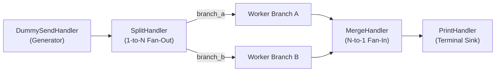

# 001: Foundational Handlers, Fan-Out (`SplitHandler`), & Fan-In (`MergeHandler`)

## 1. Overview & Problem Statement

### Why It's Needed
In `72cff56` – `fe3bad3`, the Proxy project established the foundational `Core::Handler::IHandler` base contract and the core building blocks for composing multi-stage message processing pipelines:
1. **Synthetic Traffic Generation (`DummySendHandler`)**: Needed an autonomous generator that emits configurable payloads at fixed intervals via `IHandler::step()` without requiring external network tools.
2. **Terminal Sinks (`PrintHandler`, `DummyReceiveHandler`)**: Needed lightweight consumer handlers to inspect and verify message delivery at the end of a pipeline.
3. **1-to-N Broadcast Fan-Out (`SplitHandler`)**: Needed a way to duplicate incoming messages from one upstream channel across an arbitrary list of downstream output channels (e.g. primary validator + audit logger).
4. **N-to-1 Aggregation Fan-In (`MergeHandler`)**: Needed a way to funnel messages arriving from multiple independent input channels into a single consolidated downstream output channel.

### The Solution
Implemented five backend-agnostic handlers under `handler/` (`print_handler`, `dummy_send`, `dummy_receive`, `split_handler`, `merge_handler`), all inheriting strictly from `Core::Handler::IHandler` and compiled across every discovered transport backend via `proxy_add_handler_all_backends()`.

---

## 2. Architecture & How It Works

### 2.1 Fan-Out (`SplitHandler`) & Fan-In (`MergeHandler`) Topology



---

## 3. Design Decisions

### 3.1 Zero Backend `#ifdef`s in Handler Source Files
- **Decision**: Handler `.hpp` and `.cpp` files include only `core/handler/IHandler.hpp` and `backend/` interface headers (`IBackend`, `IInputChannel`, `IOutputChannel`, `IConfig`), never concrete backend headers (`FileInputChannel.hpp`, `SocketOutputChannel.hpp`, etc.).
- **Rationale**: Guarantees that any handler automatically compiles and functions identically across `file`, `socket`, `uds`, `shm`, `inproc`, `sim`, and `vendor` backends.

### 3.2 Comma-Separated Channel Lists for `SplitHandler` and `MergeHandler`
- **Decision**: Configure multiple output channels on `SplitHandler` via `split.output_channels = ch1,ch2,...` and multiple input channels on `MergeHandler` via `merge.input_channels = in1,in2,...`.
- **Rationale**: Allows arbitrary fan-out and fan-in arity to be declared purely in `.toml` or `.conf` files without recompiling.

---

## 4. Concrete Examples

### 4.1 `SplitHandler` Batched Broadcast (`handler/split_handler/src/SplitHandler.cpp`)
```cpp
void SplitHandler::onBatchReceived(
    std::string_view /*channelName*/,
    Common::Compat::span<const Backend::MessageView> messages,
    Common::Compat::span<Backend::MessageResult> outResults)
{
    for (auto outChannel : m_outputChannels) {
        outChannel->sendBatch(messages);
    }

    const std::string_view firstName = m_outputChannels.empty()
        ? std::string_view {}
        : m_outputChannels.front()->name();
    for (std::size_t i = 0; i < messages.size(); ++i) {
        outResults[i] = Backend::Forwarded { .channel = firstName };
    }
}
```

---

## 5. Tasks / Checklist

- [x] Implement `PrintHandler` (`handler/print_handler`) (`72cff56`).
- [x] Implement `DummySendHandler` (`handler/dummy_send`) and `DummyReceiveHandler` (`handler/dummy_receive`) (`9282c30`).
- [x] Implement `SplitHandler` (`handler/split_handler`) for 1-to-N message fan-out (`063256f`).
- [x] Implement `MergeHandler` (`handler/merge_handler`) for N-to-1 message fan-in (`fe3bad3`).

