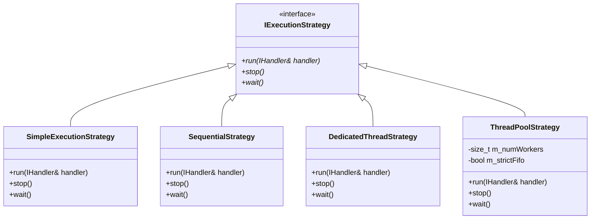
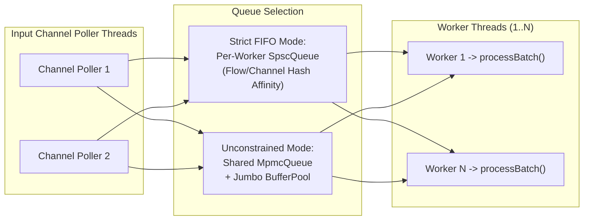

# 002: Pluggable Execution Strategies (`Sequential`, `DedicatedThread`, `ThreadPool`, `Simple`)

## 1. Overview & Problem Statement

### Why It's Needed
In `f4630b8` – `fcfe1d9`, different handler workloads and deployment environments required fundamentally different concurrency models:
1. **Low-Volume / Single-Core Determinism**: Lightweight routers and file-based chains needed a single-threaded polling loop with zero inter-thread queueing overhead.
2. **Multi-Channel Isolation**: Gateways listening to multiple independent input channels needed a dedicated thread per input channel so a slow read on one channel never delayed another.
3. **CPU-Intensive Validation Scaling**: Compute-heavy handlers (such as XSD schema validation in `XmlVerificationHandler`) needed to decouple fast socket draining from parallel multi-core worker execution while optionally preserving per-flow FIFO ordering.
4. **Step-Through Debugger Clarity**: Integrating 3rd-party SDKs (`backend/vendor`) in `lldb`/`gdb` required a minimalist, single-slot synchronous loop (`SimpleExecutionStrategy`) with a flat stack trace.

### The Solution
Extracted concurrency orchestration behind `Core::Threading::IExecutionStrategy` (`core/include/core/threading/IExecutionStrategy.hpp`), configured declaratively via `Core::Handler::ExecutionModel` (`SequentialModel`, `DedicatedThreadModel`, `ThreadPoolModel`, `SimpleModel`):
1. **`SequentialStrategy`**: Single thread round-robins across registered input channels using batched `receiveBatch` and invokes `handler.step()`.
2. **`DedicatedThreadStrategy`**: Spawns one `Common::Compat::jthread` per input channel plus a dedicated `step()` thread.
3. **`ThreadPoolStrategy`**: Spawns per-channel poller threads that enqueue `MessageTask` items into either partitioned per-worker `SpscQueue`s (when `strictFifo = true`, hashing channel/flow affinity) or a shared lock-free `MpmcQueue` (when `strictFifo = false`).
4. **`SimpleExecutionStrategy`**: Single-threaded, single-slot (`receiveSlot`) synchronous loop with zero batching or queueing for transparent debugging.

---

## 2. Architecture & How It Works

### 2.1 Strategy Class Hierarchy



### 2.2 `ThreadPoolStrategy` Strict-FIFO vs. Unconstrained MPMC Modes



---

## 3. Design Decisions

### 3.1 Declarative `ExecutionModel` Variant
- **Decision**: Represent execution configuration as `using ExecutionModel = Common::Types::Variant<SequentialModel, DedicatedThreadModel, ThreadPoolModel, SimpleModel>` parsed from `execution.model` in configuration (`sequential`, `dedicated`, `thread_pool`, `simple`).
- **Rationale**: Allows any handler binary to switch between single-threaded, dedicated-thread, or thread-pool execution via configuration without recompiling handler code.

### 3.2 Partitioned SPSC vs. Shared MPMC in `ThreadPoolStrategy` (`4335bbc`, `ea14370`)
- **Decision**: Support both per-worker `SpscQueue` (with flow affinity hashing so messages from the same source never reorder) and shared `MpmcQueue` (for work-stealing load balancing when ordering is not required).
- **Rationale**: Gives operators explicit control over the ordering-versus-tail-latency trade-off.

---

## 4. Concrete Examples

### 4.1 Configuring Execution Strategy in `.toml` / `.conf`
```ini
execution.model = thread_pool
execution.threads = 4
execution.strict_fifo = true
execution.poll_timeout_ms = 5
```

---

## 5. Tasks / Checklist

- [x] Define `Core::Threading::IExecutionStrategy` and implement `SequentialStrategy`, `DedicatedThreadStrategy`, and `ThreadPoolStrategy` (`f4630b8`).
- [x] Partition per-worker SPSC queues and add MPMC work queue + `BufferPool` (`4335bbc`, `ea14370`, `c1663c8`).
- [x] Implement `SimpleExecutionStrategy` for single-slot deterministic debugging (`fcfe1d9`).

