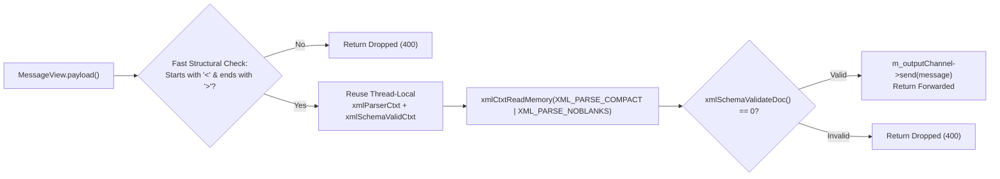

# 003: `XmlVerificationHandler` & `OrderValidationHandler` Optimizations

## 1. Overview & Problem Statement

### Why It's Needed
In `03085f4` – `4e2cd04`, the Proxy pipeline was benchmarked under high-rate financial XML order validation workloads (20,000 to 100,000 messages/second). Two specialized validation handlers were introduced and systematically optimized:
1. **`XmlVerificationHandler` (`handler/xml_verification_handler`)**: Validates incoming XML payloads against a W3C XSD schema (`order.xsd`) using `libxml2` and forwards valid messages while dropping invalid ones. Initially, creating a new `xmlSchemaValidCtxtPtr` and parsing with default DOM options on every message limited throughput and caused lock contention inside `libxml2`.
2. **`OrderValidationHandler` (`handler/order_validation_handler`)**: Validates structured `<Order>` messages (checking required fields, allowed currency/instrument sets, positive quantities, and structural integrity) and benchmarks multiple parsing strategies (`libxml2`, `xerces-c`, `Core::Serialization::Xml`, and direct `pugixml`).

### The Solution
1. **Single-Class `XmlSchemaValidator` with Thread-Local Context Reuse (`0852d4d`, `8bd648d`, `2f0f448`, `8f45e94`)**:
   - Extracted XSD validation into a dedicated `XmlSchemaValidator` class (`handler/xml_verification_handler/src/XmlSchemaValidator.hpp` & `.cpp`).
   - Added a fast structural pre-filter (`<` ... `>`) to reject non-XML garbage before invoking `libxml2`.
   - Cached per-thread `xmlParserCtxtPtr` and `xmlSchemaValidCtxtPtr` with `XML_PARSE_COMPACT | XML_PARSE_NOBLANKS | XML_PARSE_NONET` to eliminate per-message parser allocation.
2. **Four-Phase Optimization in `OrderValidationHandler` (`8580ed0` – `4e2cd04`)**:
   - **Option 1 (`52f0b97`)**: Zero-copy `OrderView` (`std::string_view` fields) deserialization via `Core::Serialization::Xml`.
   - **Option 2 (`5658a5d`)**: Compile-time `constexpr` bitmap / fast-lookup tables for currency and symbol validation.
   - **Option 3 (`f7b09ab`)**: Direct in-place DOM parsing with `pugixml::xml_document::load_buffer_inplace` over stack scratch memory.
   - **Option 4 (`4e2cd04`)**: Fast ingress pipeline with cached `Borrow<IOutputChannel>` handle and batched `onBatchReceived` vectorization.

---

## 2. Architecture & How It Works

### 2.1 `XmlVerificationHandler` Validation Pipeline



---

## 3. Design Decisions

### 3.1 Single-Class-Per-File Extraction (`XmlSchemaValidator`, `8bd648d`)
- **Decision**: Extract `XmlSchemaValidator` out of `XmlVerificationHandler.cpp` into its own `XmlSchemaValidator.hpp` and `XmlSchemaValidator.cpp` files, codifying the project's Single-Class-Per-File policy in `AGENTS.md`.
- **Rationale**: Keeps `XmlVerificationHandler` focused purely on channel binding and batch message forwarding while making `XmlSchemaValidator` independently testable.

### 3.2 In-Place `pugixml` Parsing + Compile-Time Validation Tables (`f7b09ab`, `5658a5d`)
- **Decision**: In `OrderValidationHandler::parseOrderDirect`, copy the payload into a stack buffer and invoke `doc.load_buffer_inplace()`, validating fields against compile-time lookup tables without constructing intermediate `std::string` objects.
- **Rationale**: Reduced per-message order validation time to sub-microsecond latency with zero heap allocations.

---

## 4. Concrete Examples

### 4.1 Batched Validation in `XmlVerificationHandler` (`handler/xml_verification_handler/src/XmlVerificationHandler.cpp`)
```cpp
void XmlVerificationHandler::onBatchReceived(
    std::string_view /*channelName*/,
    Common::Compat::span<const Backend::MessageView> messages,
    Common::Compat::span<Backend::MessageResult> outResults)
{
    Common::Memory::SmallSpanBuffer<Backend::MessageView, 64> validMessages;
    const std::string_view outName = m_outputChannel ? m_outputChannel->name() : std::string_view {};

    for (std::size_t i = 0; i < messages.size(); ++i) {
        if (validate(messages[i].payload())) {
            if (m_outputChannel) {
                validMessages.push_back(messages[i]);
                outResults[i] = Backend::Forwarded { .channel = outName };
            } else {
                outResults[i] = Backend::Dropped { "No output channel available", 500 };
            }
        } else {
            outResults[i] = Backend::Dropped { "Rejected: XSD schema validation failure", 400 };
        }
    }

    if (!validMessages.empty() && m_outputChannel) {
        m_outputChannel->sendBatch(validMessages.span());
    }
}
```

---

## 5. Tasks / Checklist

- [x] Implement `XmlVerificationHandler` and `XmlSchemaValidator` (`03085f4`, `8bd648d`).
- [x] Optimize `XmlSchemaValidator` with compact DOM parsing, thread-local contexts, and structural pre-filtering (`0852d4d`, `2f0f448`, `8f45e94`).
- [x] Implement `OrderValidationHandler` with Catch2 micro-benchmarks comparing `libxml2`, `xerces-c`, `OrderView`, and in-place `pugixml` (`8580ed0` – `4e2cd04`).

