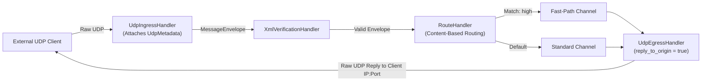
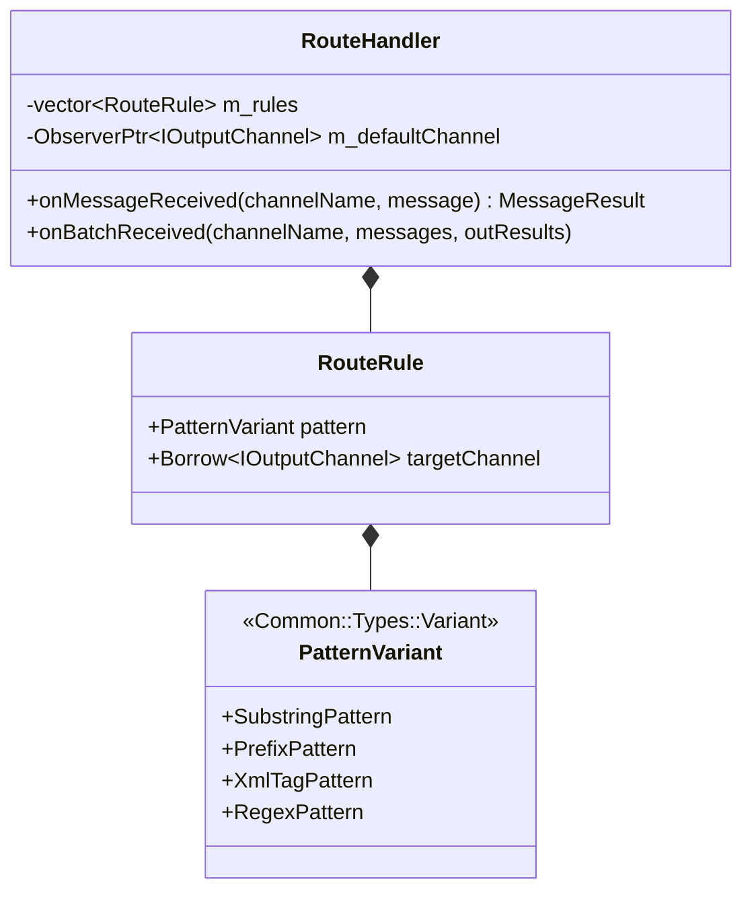

# 004: Edge UDP Gateways (`UdpIngressHandler`, `UdpEgressHandler`) & Dynamic `RouteHandler`

## 1. Overview & Problem Statement

### Why It's Needed
In `51f8fdb` – `cd630fd`, production topologies required three specialized routing and edge-gateway handlers:
1. **External UDP Ingress Gateway (`UdpIngressHandler`)**: Needed a dedicated edge handler that binds a high-speed UDP network socket (`Core::Net::UdpInputChannel`), wraps incoming client datagrams in `Backend::MessageEnvelope` frames with `UdpMetadata` provenance (client IPv4/IPv6 + port), and injects them onto the internal IPC bus (`shm`, `uds`, `inproc`, etc.).
2. **External UDP Egress Gateway (`UdpEgressHandler`)**: Needed a symmetrical egress gateway that reads validated `MessageEnvelope` frames from the internal IPC bus, strips the envelope header, and either sends the raw application payload to a configured static UDP destination or dynamically replies directly to the originating client's IP/port (`reply_to_origin = true`).
3. **Content-Based Dynamic Router (`RouteHandler`)**: Needed an intermediate routing handler capable of inspecting incoming message payloads and dynamically routing each message to different downstream output channels based on configurable matching strategies (`Substring`, `Prefix`, `XmlTag`, `Regex`) with a fallback `default_channel`.

### The Solution
Implemented `udp_ingress_handler`, `udp_egress_handler`, and `route_handler` under `handler/`, completing the end-to-end edge-to-core-to-edge pipeline catalog.

---

## 2. Architecture & How It Works

### 2.1 End-to-End Edge Gateway & Dynamic Routing Pipeline



### 2.2 `RouteHandler` Pattern Variant Evaluation (`cd630fd`)



---

## 3. Design Decisions

### 3.1 Variant-Based Pattern Dispatch in `RouteHandler` (`cd630fd`)
- **Decision**: Represent routing matchers (`SubstringPattern`, `PrefixPattern`, `XmlTagPattern`, `RegexPattern`) as alternatives in a `Common::Types::Variant` rather than a polymorphic inheritance hierarchy.
- **Rationale**: Keeps routing rules contiguous in memory (`std::vector<RouteRule>`) and evaluates fast `ByteView` / `std::string_view` checks (`startsWith`, `find`) without virtual dispatch or heap allocations.

### 3.2 Batched Per-Destination Grouping in `RouteHandler::onBatchReceived`
- **Decision**: When `RouteHandler` receives a batch of messages, it evaluates the routing rules for each message, groups contiguous or per-target spans on the stack, and flushes via `sendBatch()`.
- **Rationale**: Preserves vectorized egress performance even when a batch contains messages destined for different downstream channels.

---

## 4. Concrete Examples

### 4.1 `RouteHandler` Configuration
```ini
route.input_channel = verified_orders
route.default_channel = standard_orders
route.rules = high_priority:xml_tag:priority=HIGH:urgent_orders,cancel_req:prefix:<Cancel:cancel_orders
```

### 4.2 `UdpEgressHandler` Configuration
```ini
udp_egress.input_channel = processed_orders
udp_egress.host = 127.0.0.1
udp_egress.port = 9999
udp_egress.reply_to_origin = true
```

---

## 5. Tasks / Checklist

- [x] Implement `UdpIngressHandler` (`handler/udp_ingress_handler`) (`51f8fdb`).
- [x] Implement `UdpEgressHandler` (`handler/udp_egress_handler`) with `reply_to_origin` provenance routing (`5932201`).
- [x] Implement `RouteHandler` (`handler/route_handler`) with `Substring`, `Prefix`, `XmlTag`, and `Regex` pattern variants (`cd630fd`).
- [x] Add comprehensive unit tests in `test/TestUdpIngress.cpp` and `test/TestRouteHandler.cpp`.

